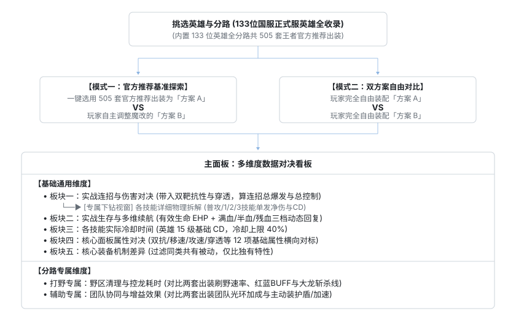

# 王者出装箱 ｜ 王者荣耀出装对比系统与底层战术知识库

<p align="left">
  <a href="CHANGELOG.md"></a>
  <a href="LICENSE"></a>
  <a href="https://wzry.aodilab.com"></a>
  <a href="#"></a>
  <a href="https://github.com/aodilab/wzry-build-comparator/releases/tag/v1.2.0"></a>
  <a href="https://wzry.aodilab.com"></a>
  <a href="https://wzry.aodilab.com"></a>
  <a href="https://www.python.org/"></a>
</p>

- 🖥️ **电脑大屏端**：[王者出装箱在线推演平台 (wzry.aodilab.com)](https://wzry.aodilab.com)（双轨横向对比、双靶抗性打靶、方案导出）
- 📱 **手机随身端**：微信搜一搜「**王者出装箱**」（v1.2.1 现已全量上线，对局选人秒查，即开即用）
- 🎬 **真机实操演示**：[前往 Release v1.2.0 获取完整真机实操演示视频 (50s 竖屏超清) »](https://github.com/aodilab/wzry-build-comparator/releases/tag/v1.2.0)
- 📚 **开源算法库**：王者荣耀底层物理算分引擎与 6 卷战术知识库

> [!NOTE]
> **📢 最新版本更新公告 [v1.2.1] (2026-10-17)**  
> 1. **正式服平衡性同步**：全面对齐 10月15日 正式服赵云、鲁班大师、姬小满、女娲等 10 位英雄数值与机制调整；  
> 2. **四大数据库深度校准**：补全全库 132 处技能文本截断、修复递减冷却（`-X/Lv`）与充能技能 CD 解析、对齐巫术法杖强击与打野/游走叠层被动；  
> 3. **操作交互优化**：装备商店支持“先选定预览、再确认装备”防误触，优化长文本纵向滑动。  
> 完整修复明细与技术解析请参阅 ➔ [**CHANGELOG.md (版本演化日志)**](CHANGELOG.md)。

---

## 一、 为什么要做这套推演系统？

很多玩家在备战或实战中，常常面临方案抉择：
- *“这把逆风，我最后一件到底补碎星锤还是补破军？”*
- *“打野走半肉穿透伤害够不够秒后排？还是走全肉抗伤更稳？”*
- *“辅助是出近卫+救赎保后排，还是出极影+奔狼打强开？”*

传统助手只给静态推荐，无法横向评估优劣。  
本系统收录 133 位国服英雄、505 套官方推荐基准，支持将任意两套出装（含 30 颗自选铭文）并排对决，通过**实战伤害、野区清理、多维续航、技能冷却、面板属性、机制差异** 6 大维度，直接给出底层打靶物理数据。

---

## 二、 整体设计架构流程

<p align="center">
  
</p>


---

## 三、 各大对比板块的具体设计

### 1. 通用基础板块

#### 【板块一】实战连招与伤害对决
- **底层伤害公式**：拒绝只看面板攻击力，将我方 **固定穿透 + 百分比穿透**（优先扣减固定穿透，再扣减百分比穿透）与目标护甲魔抗综合带入游戏底层减免公式：

  $$\text{受击净伤害} = \text{原始总伤害} \times \frac{602}{602 + \text{目标实际抗性}}$$

- **双靶抗性基准**：
  - **中射脆皮靶（350 物抗 / 180 法抗）**：测算切后排脆皮的真实秒人净掉血；
  - **前排坦克靶（1000 物抗 / 600 法抗）**：测算打前排肉盾时破晓、碎星锤、虚无法杖等穿透装的实际收益。
- **专属下钻视窗（各技能详细物理拆解与效果对决）**：
  - 主面板汇总连招打完的 **总爆发伤害与总控制时长**；点击下钻二级视窗后，将 **普攻、1技能、2技能、大招** 拆分为独立卡片，逐行比对单发技能的 **实际净伤害、控制时长、回血量与实际冷却**，直观定位两套出装的伤害差距究竟出在哪个技能上。

#### 【板块二】实战生存与多维续航对决
- **物理有效生命（EHP）**：衡量血量与护甲综合后的真实抗揍能力，计算公式为：

  $$\text{物理有效生命 (EHP)} = \text{最大生命} \times \left(1 + \frac{\text{物理防御}}{602}\right)$$

- **三档血线动态续航模型**：除常态脱战每 5 秒回血与普攻打靶吸血外，专门带入 **满血（100%）、半血（50%）、残血（20%）** 三档状态，精准还原不死鸟之眼、已损生命值回复等机制在不同血线下的真实续航差距。

#### 【板块三】各技能实际冷却时间
- **满级冷却折算**：基于英雄 **15 级满级**各技能基础 CD，综合铭文与装备冷却缩减，并严格执行游戏 **40% 冷却缩减上限**约束（溢出部分自动截断），直接换算出两套出装下 1/2/3 技能的实战冷却秒数。

#### 【板块四】核心面板属性对决（12 项满级硬指标横比）
- **输出属性（5 项）**：`物理/法术攻击`、`攻击速度`、`暴击率/暴击效果`、`物理穿透 (固定+百分比)`、`法术穿透 (固定+百分比)`
- **生存与功能（7 项）**：`最大生命值`、`物理防御 (附免伤率%)`、`法术防御 (附免伤率%)`、`冷却缩减%`、`物理/法术吸血率`、`每5秒回血`、`移速`

#### 【板块五】核心装备机制差异
- **共有机制过滤，独有特性高亮**：自动剔除两套出装中重复的共有装备被动，仅提取并排比对双方**独有的装备特效与主动技能**（例如：方案 A 独有【制裁/梦魇】重伤减疗，方案 B 独有【冰痕/凝冰】减速留人），一眼看清功能取舍。

---

### 2. 分路专属板块

#### 【打野专属】野区清理与控龙耗时
- **红蓝 BUFF 刷怪效率**：按基准血量 `6500`（物抗 `240` / 法抗 `180`），测算两套出装的清野耗时与刷野速率差。
- **史诗大龙（暴君/主宰）控龙测算**：按基准血量 `24000`（物抗 `360` / 法抗 `280`），测算单刷大龙总耗时与惩击安全斩杀线。

#### 【辅助专属】团队协同与增益效果
- **团队光环收益**：量化对比近卫荣耀、极影等光环装为周围队友提供的双抗、攻速、移速及冷却缩减加成。
- **主动装实战数值**：对比救赎之翼群体护盾值、奔狼纹章爆发加速比例与持续时长、形昭之鉴探草减速范围等团队协同收益。

---

## 四、 核心战术知识库矩阵

本项目内置 6 大纯净 Markdown 战术知识库，收录于 [`output/`](output/) 目录，完全开源可直接在 GitHub 查看与全文检索：

| 卷&nbsp;号 | 知识库模块（点击直达） | 核心内容提要 |
| :---: | :--- | :--- |
| **`01`** | [**全英雄技能数值与成长库**](output/01_王者荣耀_全英雄技能数值与等级成长库.md) | 133 位国服英雄被动与全技能 1~15 级物理/法术基础加成与成长数值 |
| **`02`** | [**战术克制与阵容搭档谱系**](output/02_王者荣耀_英雄战术克制与阵容搭档拓扑.md) | 133 位英雄官方正向克制、被克制关系与最佳开黑搭档拓扑矩阵 |
| **`03`** | [**五大分路定位与战术指南**](output/03_王者荣耀_五大分路定位与战术流派指南.md) | 对抗 / 打野 / 中路 / 发育 / 游走五大分路定位、流派演进与攻防节奏 |
| **`04`** | [**全装备属性与合成图谱**](output/04_王者荣耀_全装备属性与合成升级图谱.md) | 121 件六大类装备基础属性、唯一被动机制与合成升级拓扑 |
| **`05`** | [**全铭文图鉴与搭配方案**](output/05_王者荣耀_全铭文图鉴与英雄搭配方案.md) | 30 颗五级铭文属性明细与各职业标准百穿 / 攻速 / 暴击 / 吸血配装 |
| **`06`** | [**峡谷战场机制与运营规则**](output/06_王者荣耀_峡谷战场机制与宏观运营规则.md) | 兵线与防御塔抗性、野区主宰暴君刷新周期与底层伤害减免公式 |

---

## 五、 精选英雄实战出装详解（深度数据拆解）

本项目基于底层实战推演引擎，提供全期节点打靶与多流派对决示范分析：

- 🏹 **[【S45 赵云打野出装详解】从前中期过渡到后期三大变阵的数据拆解](docs/guides/zhaoyun_jungle_guide.md)**  
  *深入拆解：5分钟第一大件暗影战斧 vs 怒龙剑盾斩杀线对比、10分钟暗影双龙团六种三大件过渡方案横测、15分钟六神装三大变阵物理/法术有效生命与极限回血实录。*

---

## 六、 知识库构建与运行

本项目基于 Python 3.8+ 开发：

```bash
# 1. 安装环境依赖
pip install -r requirements.txt

# 2. 生成 6 卷战术知识库 (output/)
python build.py --kb
```

---

## 七、 附录：133 位全英雄速查索引

<details>
<summary><b>🔍 点击展开 133 位国服英雄与全分路出装基准速查</b></summary>

> 本项目已完整录入以下全部 133 位国服正式服英雄，各分路均配备 505 套王者官方推荐出装与专属铭文作为基准：

#### ⚔️ 对抗路 / 战士 (32 位)
`赵云` `钟无艳` `吕布` `曹操` `典韦` `宫本武藏` `达摩` `老夫子` `关羽` `花木兰` `亚瑟` `刘备` `杨戬` `雅典娜` `哪吒` `铠` `狂铁` `李信` `盘古` `曜` `马超` `夏洛特` `司空震` `云缨` `赵怀真` `姬小满` `亚连` `海诺` `大司命` `影` `空空儿` `蚩奼`

#### 🔮 中路 / 法师 (39 位)
`小乔` `墨子` `妲己` `嬴政` `高渐离` `孙膑` `扁鹊` `芈月` `周瑜` `甄姬` `武则天` `貂蝉` `安琪拉` `姜子牙` `王昭君` `张良` `蔡文姬` `诸葛亮` `大乔` `干将莫邪` `鬼谷子` `女娲` `明世隐` `杨玉环` `弈星` `米莱狄` `沈梦溪` `上官婉儿` `嫦娥` `瑶` `西施` `金蝉` `桑启` `海月` `朵莉亚` `元流之子(法师)` `少司缘` `元流之子(辅助)` `王维`

#### 🛡️ 对抗路 / 游走 / 坦克 (22 位)
`廉颇` `庄周` `刘禅` `白起` `夏侯惇` `项羽` `程咬金` `刘邦` `牛魔` `张飞` `钟馗` `太乙真人` `东皇太一` `苏烈` `梦奇` `孙策` `盾山` `猪八戒` `鲁班大师` `蒙恬` `元流之子(坦克)` `大禹`

#### ⚡ 打野 / 刺客 (19 位)
`阿轲` `孙悟空` `心魔六耳` `李白` `露娜` `韩信` `兰陵王` `不知火舞` `娜可露露` `橘右京` `百里玄策` `裴擒虎` `元歌` `司马懿` `云中君` `镜` `澜` `暃` `元流之子(刺客)`

#### 🏹 发育路 / 射手 (21 位)
`孙尚香` `鲁班七号` `马可波罗` `狄仁杰` `后羿` `李元芳` `虞姬` `黄忠` `百里守约` `公孙离` `伽罗` `蒙犽` `阿古朵` `艾琳` `戈娅` `莱西奥` `敖隐` `苍` `元流之子(射手)` `孙权` `卢雅那`

#### 📊 核心对比场景与数据指标速查
- **热门实战对决流派**：暴击流 vs 半肉穿透流、纯肉抗伤流 vs 专精流、双烧流 vs 冷却缩减流、惩击边路 vs 闪现边路。
- **核心物理测算依据**：游戏底层抗性减免公式 `602 / (602 + 实际抗性)`、350物抗中射脆皮靶、1000物抗前排坦克靶、40%冷却缩减上限、物理有效生命 (EHP)、多血线动态续航模型。
- **分路场景专项数据**：打野红蓝BUFF清怪耗时、暴君/主宰大龙斩杀线推演、辅助团队双抗光环覆盖率、救赎/奔狼/形昭主动技能收益。

</details>

---

## 赞助与支持

如果这个项目对你的游戏理解或数据研究有所帮助，欢迎支持作者一杯可乐 🥤。

<div align="center">
  
</div>
