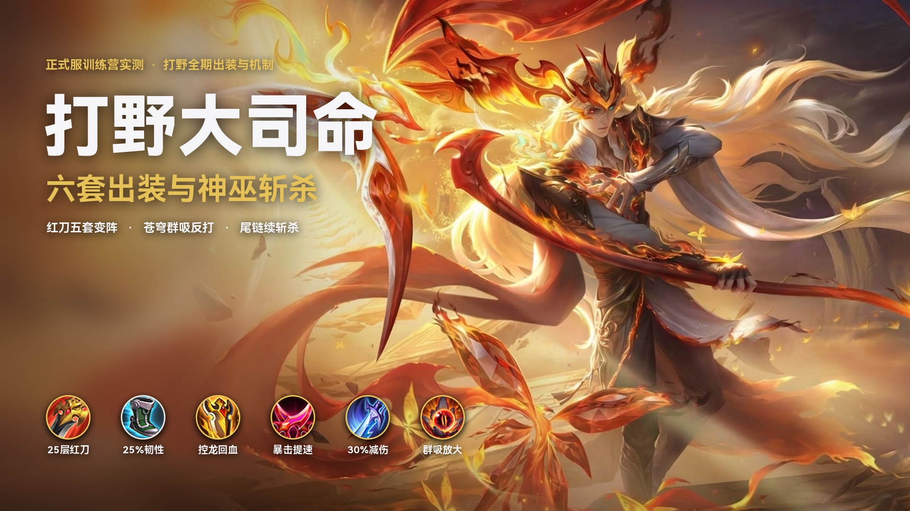
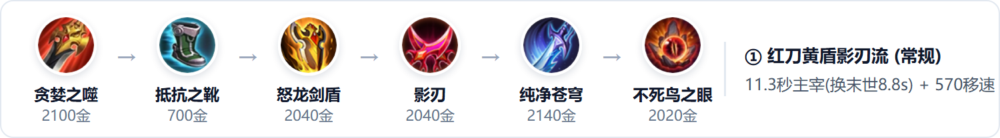
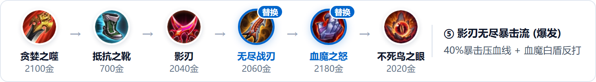
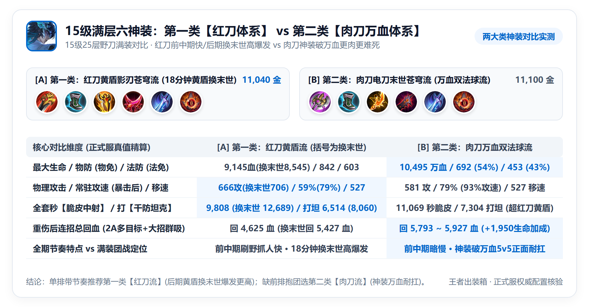
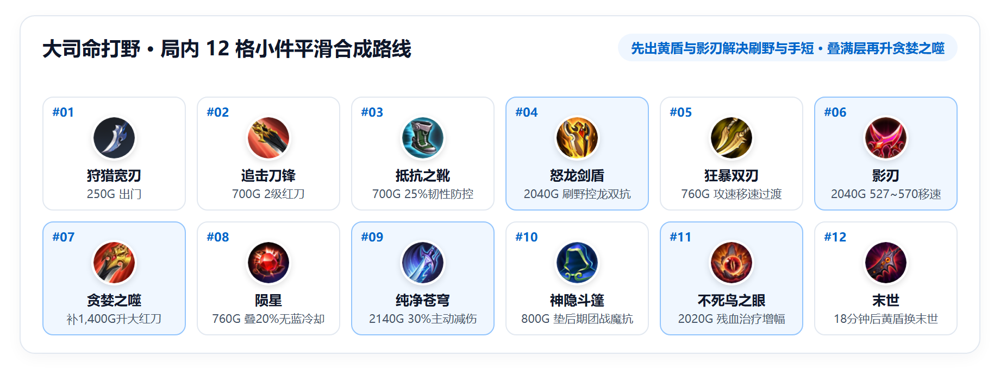
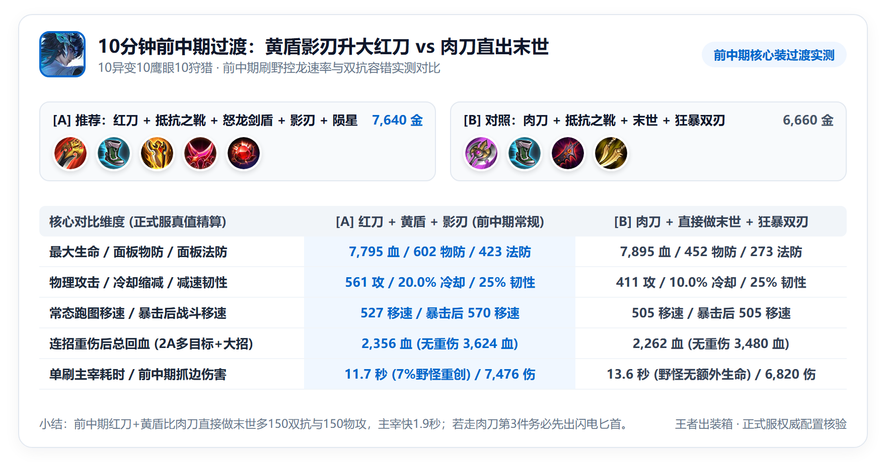
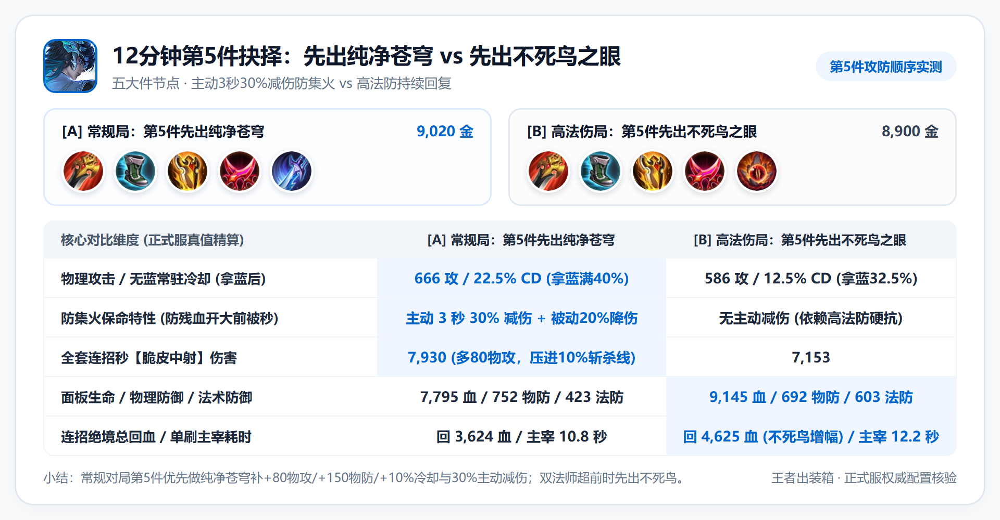

# 打野大司命出装与实战细节详解

*(注：文中数据均计入五级铭文，并按对局时期折算了敌方护甲魔抗、敌方破晓/碎星锤/虚无法杖穿透，以及梦魇之牙/制裁之刃降低 `35%` 回血的效果。)*

---

## 一、 英雄特点、强势期与四个实战机制

### 1. 英雄特点与强势期
* **战士型打野，3 秒魂链持续走 A + `10%` 血量神巫斩杀 + 多目标连线群吸**：大司命自身没有霸体和解控技能，常规控制局鞋位优先推荐 **`抵抗之靴`**（`+100法防 / +50物防 / +50移速 / +25%韧性`）。被动【鸣戈】将普攻转化为持续 **3 秒的灵魂锁链**（相连期间无需站桩，可自由移动走位；魂链每次造成 `50% AD` 物理伤害，敌人若不挣脱魂链则伤害频率越来越高，结束时额外造成 `70~140(+80% AD)` 法术伤害；每 `1%` 攻速连续线性加快魂链攻击频率；开始和结束段附带 `100%` 法球效果，中间持续段附带 `50%` 法球效果）。`1技能` 二段唤回戈（持续 **4 秒**）与 `3技能` 落地（持续 **8 秒**）均使大司命进入**【神巫】状态**，普攻目标生命值低于 **`10%`**（野怪为 `750~1500`）时直接触发斩杀（**无视护盾，名刀/复活甲除外**）。
* **技能加成结构与手短应对思路**：大司命 `1/2/3技能` 伤害均绑定 **额外物理攻击加成（穿墙1技能 `95% + 60% = 155% 额外AD` 法伤、2技能挥戈 `60% 额外AD` 物伤 + 生死界枯枝 `45% 额外AD` 法伤、大招 `150% 额外AD` 物伤）**，而 `2A` 每次回血（`80~160 + 1.5%额外生命`）与大招落地回血（`750~1500 + 12%额外生命`，每命中一名敌方英雄回复效果增加 `50%`，最高增加 `100%`）绑定 **额外生命值**。由于空放 `1技能【往生途】` 通道生成较慢且缺乏瞬发远距硬控，若移速不足易被敌方后排拉开距离扯断魂链；实战需围绕 **1 技能穿墙加速铺路、`影刃` 暴击提速粘人、`怒龙剑盾` 提速刷野撑双抗血量，以及 `纯净苍穹` 主动减伤防残血被秒** 构建出装。

### 2. 四个容易忽略的实战机制
1. **1 技能触碰墙体或生死界壁加速生成，二段收戈开启 4 秒不限目标斩杀，且配 `22.5%` 冷却可实现“4 秒神巫 + 3 秒尾链近乎衔接 7.75 秒冷却”**：空放 `1技能【往生途】` 划路较慢（基础 `280~560 + 95%额外AD` 法伤）；只要 **往生之路碰到墙体或 2 技能生死界壁就会加速生成，此后命中敌人额外造成 `150~300 (+60%额外AD)` 法术伤害**，大司命在往生之路上无视地形并增加 **`50%~100%` 移速**（首次碰墙生成往生之桥，穿梭获得爆发加速并对附近敌人造成 `15%~30%` 减速）。**三个核心斩杀细节**：① **1 技能一段 6 秒路径倒计时期间（长戈插在地上未收回手里时）没有斩杀效果**，必须手动再点一下 1 技能提前唤回长戈（或等 6 秒倒计时走完自动唤回）才会进入 4 秒【神巫】状态（大招落地为 8 秒）；② **【神巫】状态挂在大司命自身**，期间不管打谁、不限斩杀次数，低于 `10%` 血量（野怪 `750~1500`）均会无视护盾直接斩杀；③ **1 技能冷却从二段收戈时开始计算，但神巫尾链可无缝延长斩杀窗口**——满级 1 技能在红刀+苍穹（`22.5%` 冷却）下实际 CD 为 `7.75 秒`（从按下二段收戈开始倒计时），由于开启的 **`4 秒`【神巫】状态** + 神巫状态结束前平 A 连上的那根 **`3 秒` 持续魂链仍可触发斩杀**，两者叠加（`4s + 3s = 7s`）覆盖了绝大部分冷却期，实测等这根尾链完成斩杀后，**仅间隔不到 1 秒下一个 1 技能就已转好（拿蓝 `40%` 冷却仅 `6 秒` 更是全程无缝）**。
2. **2技能 `500~750` 范围拖拽微调界壁 + 2A 强化魂链「多目标连线 +50% 额外伤害 + 持续回血」**：`2技能【寂无器】` 造成 `200~400(+60%额外AD)` 物伤与 1 秒 `25%~50%` 减速，并**可在 `500~750` 距离内拖拽控制【生死界壁】的生成位置**，触碰界壁挂上印记并受 `140~280(+45%额外AD)` 法伤与 1 秒 `25%~50%` 减速。下一次普攻（`2A`）变为**强化魂链，对目标造成 `50%` 额外伤害并回复 `80~160(+1.5%额外生命)` 生命值**；若攻击范围内有带印记的目标，魂链最多同时连接 **3 个目标**，对每个印记目标施加同样的额外伤害和回复效果（连接非英雄单位回复效果为 `50%` 并额外造成击退，且可同步触发 `怒龙剑盾` 被动回血）。
3. **每 `1%` 攻速连续线性提升魂链攻击频率，配合 `影刃` 移速加成持续粘人**：大司命 15 级自带 `14%` 攻速成长（`+1.0%/级`），搭配 `10狩猎（+10%攻速/+10%移速）` 与 **`影刃`（`+45物攻 / +35%攻速 / +20%暴击率 / +7.5%移速`，被动【暴风】普攻命中加 `10%` 攻速与 `5%` 移速，暴击后翻倍至 `+20%` 攻速与 `+10%` 移速）**，常驻面板移速达 **`527`**、暴击后战斗移速达 **`570`**，常驻攻速 `59%`（暴击后 `79%`），连续线性加快 3 秒魂链伤害频率，走 A 追击大幅降低断链概率。
4. **残血先按 `纯净苍穹` 再开大招【魂归忘忧】群吸反打**：大司命大招落地对附近敌人造成 `380~760(+150%额外AD)` 物伤与 `0.5秒` 击退，命中敌方英雄回复 `750~1500(+12%额外生命)` 生命（每命中一名敌方英雄回复效果增加 `50%`，最多增加 `100%`），凝聚命中的敌方英雄灵体协战 8 秒（继承 `30%` 物攻），并开启 8 秒【神巫】状态；由于自身没有霸体技能，团战血量下到 `35%~40%` 时，**先按 `纯净苍穹`（主动 3 秒 `30%` 伤害减免）顶住集火，再贴脸跳大回血击退**，配合 `10%` 血量神巫斩杀完成反打。

---

## 二、 核心适配装备原因与打野位主流六神装体系对比

### 1. 五件核心适配装备与机制联动原因
* **① 打野刀双路线抉择：`贪婪之噬`（2,100金，高AD压斩杀线） vs `巨人之握`（2,100金，万血双法球流）**：
  - **`贪婪之噬`（红刀）**：大司命 `1/2/3技能` 分别受 `155% / 105% / 150%` 额外物攻加成，被动魂链全段受总物攻加成；叠满 25 层野怪奖赏后共提供 **`+165物理攻击 / +12.5%冷却缩减 / +5%移速`**（被动【狩猎】附带灼烧物伤），前中期配合 `怒龙剑盾` 刷野切C压血线更快，18 分钟后可将黄盾平替为 `末世`。
  - **`巨人之握`（肉刀）**：基础 `+1,200生命 / +5%冷却 / +5%移速`，叠满 25 层后共提供 **`+1,950最大生命 / +10%冷却缩减 / +5%移速`** 且被动【狩猎】对野怪与敌人持续造成物理灼烧。由于大司命 `2A` 每跳回血（`+1.5%额外生命`）与 `3技能` 落地群吸（`+12%额外生命`，最高翻倍至 `+24%额外生命`）均绑定额外生命值，出 **`巨人之握`** 可在第 3、4 件直接做出 **`闪电匕首/影刃 + 末世`** 而不怕身板过脆，满级生命达 **`10,495~11,282`**，同时放大技能回血、末世/电刀双法球与血魔之怒被动。
* **② 前中期防装选择 `怒龙剑盾`（2,040金）**：一是 **提速刷野控龙**——被动【重创】对兵线/野怪造成 `7% 最大生命` 物理伤害并回复伤害效果 `50%`（即 `3.5% 最大生命`）的生命，被动【神力】对敌方英雄造成 `3.5% 最大生命` 物理伤害（冷却均为 2.5 秒）；二是 **撑起双抗与技能回血**——提供 **`+1,100最大生命 / +150物理防御 / +150法术防御`**，同步放大 `2A`（`+1.5%额外生命`）与大招（`+12%额外生命`）的回复量。
* **③ 强化魂链输出与粘人选择 `影刃` / `末世` / `闪电匕首` / `制裁之刃` / `无尽战刃`**：
  - **`影刃`（2,040金，提速粘人核心）**：提供 `+45物攻 / +35%攻速 / +20%暴击率 / +7.5%移速`；3 秒物理魂链每一跳均可暴击，暴击后触发被动【暴风】获得 `+20%攻速 / +10%移速`，使常驻 `527` 移速跃升至 **`549~570`**，解决手短易被风筝断链的问题；
  - **`末世`（2,100金，法球破坦）与 `闪电匕首`（2,040金，高攻速移速连锁电弧）**：3 秒魂链首末段触发 `100%` 法球、中间段触发 `50%` 法球，且每 `1%` 攻速同时加快魂链物理跳数、法球触发次数与 `2A` 回血跳数；`末世` 提供 `+40物攻 / +20%攻速 / +20%物理吸血 / +500最大生命` 与【破败】按目标额外生命物伤，`闪电匕首` 提供 `+40物攻 / +35%攻速 / +7.5%移速` 与高频连锁法伤，搭配肉刀可在正面团战打出持续混伤；
  - **`制裁之刃`（2,080金，高吸血+重伤+残血回魂）**：提供 `+75物攻 / +30%物理吸血 / +20%攻速`，被动【重伤】通过 `2A` 连线同时降低敌方多人 `35%` 生命回复与吸血，被动【回魂】在生命低于 `40%` 时回复 `160~320(+4%最大生命)` 且每次普攻行为命中额外回复 `30~60(+0.8%最大生命)`；
  - **`无尽战刃`（2,060金，暴击压斩杀线）**：提供 `+120物攻 / +20%暴击率` 与被动【无尽】（`+20%` 基础暴击效果，且每 `2%` 暴击率增加 `1%` 暴击效果），配影刃凑齐 `40%` 暴击率与 `240%` 暴击效果，快速压低脆皮血线。
* **④ 团战防集火选择 `纯净苍穹`（2,140金，或 `血魔之怒` / `名刀·司命`）**：大司命没有霸体且大招需在半血以下贴脸释放才能吃满回血，**`纯净苍穹`** 提供 **`+80物攻 / +150物防 / +10%冷却`**，被动【残废】对首个命中英雄造成 `10%~20%` 减速并使其对自己伤害降低 `20%`（持续 3 秒，冷却 8 秒），主动【驱散】获得 3 秒 `30%` 减伤（冷却 75 秒），也可按战局选 **`血魔之怒`（2,180金，`+75物攻 / +900生命`，主动 `40%` 最大生命白盾 + 被动【狂怒】普攻附带 `1.5%` 最大生命物理伤害，半血以下提升 `25%~50%`）** 或 **`名刀·司命`（2,060金，`+75物攻 / +15%攻速 / +500生命`，被动【暗幕】致命伤 `1~1.6秒` 免疫伤害锁血）**。
* **⑤ 法防与回复增幅选择 `不死鸟之眼`（2,020金，留人替换选 `寒霜袭侵`）**：
  - **`不死鸟之眼`**：提供 **`+90物理防御 / +180法术防御 / +1,350最大生命`**，被动【血统】每损失 `10%` 生命获得 `6.5%` 生命回复效果（残血最高 **`+58.5%` 回复**），同步放大 `2A`、大招、黄盾被动与物理吸血，抵消敌方 `35%` 重伤削减；搭配 `抵抗之靴 + 怒龙剑盾` 可将满级法防堆至 **`603` 点（`50%` 法术减伤）**，即便面对敌方法师 `虚无法杖` 穿透仍能稳住血线。
  - **`寒霜袭侵`（2,040金）**：提供 **`+750最大生命 / +25%攻速 / +70物攻`**，被动【寒霜】普攻和技能减少目标 `5%~10%` 移速（可叠 2 层即 `10%~20%` 减速），被动【冻伤】每 3 秒造成 `135~270(+45%额外AD)` 物伤，配合 2 技能 `50%` 减速与苍穹 `20%` 减速实现三重粘人。

---

### 2. 打野位「红刀体系 vs 肉刀体系」六套六神装面板与实战数据总表

大司命打野出装分为两大类：**【第一类：红刀体系（`贪婪之噬`）】**主打前中期刷野控龙节奏与单切压斩杀线；**【第二类：肉刀体系（`巨人之握`）】**前中期节奏比红刀稍慢、瞬间爆发略低，但**六神装成型后拥有破万血身板与更高群吸回血，5v5 正面抱团更肉更不容易被集火秒杀，且双法球满装伤害反超红刀黄盾常规神装**。15 级满层（25 层野刀）实测对比如下：

| 评估维度 *(打野位 15级满层)* | ① 红刀·黄盾影刃苍穹流 *(前中期常规→18min换末世)* | ② 红刀·末世名刀苍穹流 *(顺风切C/双保命)* | ③ 红刀·影刃制裁不死鸟流 *(克制回血/高续航)* | ④ 红刀·黄盾寒霜粘人流 *(32.5%CD/三重减速)* | ⑤ 红刀·影刃无尽暴击流 *(高暴击压斩杀线)* | ⑥ 肉刀·万血双法球流 *(成型更肉/5v5正面抱团)* |
| :--- | :---: | :---: | :---: | :---: | :---: | :---: |
| **核心装备组合 (总价)** | **红刀+黄盾+影刃+苍穹+不死鸟** *(11,040金，后期黄盾换末世)* | **红刀+末世+影刃+苍穹+名刀** *(11,140金)* | **红刀+影刃+制裁+苍穹+不死鸟** *(11,080金)* | **红刀+黄盾+黑切+苍穹+寒霜** *(11,110金)* | **红刀+影刃+无尽+血魔+不死鸟** *(11,100金)* | **肉刀+电刀(影刃)+末世+苍穹+不死鸟** *(11,100金)* |
| **最大生命 / 护盾免伤特性** | **9,145** *(换末世 8,545)* | 7,695 *(30%免伤+名刀暗幕)* | 8,045 *(主动30%免伤)* | **9,045** *(主动30%免伤)* | 8,945 *(+3,578血魔白盾)* | **10,495 ~ 11,282 (破万血+30%免伤)** |
| **物理攻击 / 常驻攻速** | 666 攻 / 59% *(换末世 706/79%)* | **779 攻 / 90.6% 攻速** | 741 攻 / 79% 攻速 | 744 攻 / 65% 攻速 | **781 攻** / 59% 攻速 | 581 攻 / **79% (99%) 攻速** |
| **物防 (免伤) / 法防 (免伤)** | **842 (58%) / 603 (50%)** | 602 (50%) / 273 (31%) | 692 (54%) / 453 (43%) | 752 (56%) / 423 (41%) | 542 (47%) / 453 (43%) | **692 (54%) / 453 (43%)** |
| **无蓝冷却(1/2/3技能) / 移速** | 22.5% (7.8/6.2/24.8s) / **527(570)** | 22.5% (7.8/6.2/24.8s) / 505(548) | 22.5% (7.8/6.2/24.8s) / **527(570)** | **32.5% (6.8/5.4/21.6s)** / 494 | 12.5% (8.8/7.0/28.0s) / **527(570)** | 20% (8.0/6.4/25.6s) / **527(570)** |
| **一套秒【脆皮中射】伤害** | 9,808 *(换末世 **12,689**)* | **13,895** | 10,476 | **12,084 (244物穿)** | **12,788 (40%暴击)** | **10,750 ~ 11,069** *(超红刀黄盾)* |
| **一套打【千防坦克】伤害** | 6,514 *(换末世 **8,060**)* | **8,728 (末世法球)** | 6,896 | 7,214 | **8,139** | **6,972 ~ 7,304 (双法球)** |
| **重伤后总回血 / 保命减伤** | **4,625~5,427** / 苍穹30%减伤 | 3,164 / 30%减伤+名刀暗幕 | **6,472** / 苍穹30%减伤 | 2,643 / 苍穹30%减伤 | 4,346 / +3,578白盾 | **5,793~6,290** / **万血+苍穹30%减伤** |
| **单刷主宰耗时 / 核心定位** | 11.3s *(换末世 8.8s)* / **全期均衡** | 8.6s / **顺风切C锁血** | 10.8s / **针对敌方回血** | **8.2s** / **高穿减速留人** | 8.8s / **高暴击秒脆皮** | 9.2s / **成型耐扛持续混伤** |

---

### 3. 第一类：红刀体系（`贪婪之噬` —— 前中期节奏快、抓人爆发高，单排常规推荐）

#### （1）红刀黄盾影刃苍穹流 $\rightarrow$ 18分钟换末世流：前中期过渡与大后期收割兼顾

这套是 **`贪婪之噬 + 抵抗之靴 + 怒龙剑盾(18分钟换末世) + 影刃 + 纯净苍穹 + 不死鸟之眼`**（总价 `11,040` 金）。
* **核心优势**：
  1. **前中期刷野控龙效率高、双抗扎实**：二级红刀叠满提供 `+70` 物攻保障前中期抓边斩杀线，第 3 件做出 **`怒龙剑盾`** 凭借对野怪/小兵 `7%` 最大生命重创被动加快控龙速度；配合第 6 件 **`不死鸟之眼`** 将面板堆至 **`9,145血 / 842物防（58%物免） / 603法防（50%法免）`**。
  2. **18 分钟后黄盾平替 `末世` 输出进一步提升**：当对局进入 18 分钟六神装经济溢出期，将前中期刷野过渡装 `怒龙剑盾` 直接换为 **`末世`**（成型 **`贪婪之噬 + 抵抗之靴 + 末世 + 影刃 + 纯净苍穹 + 不死鸟之眼`**），面板 **`8,545血 / 706攻 / 79%常驻攻速（暴击99%） / 20%物理吸血`**，全套秒脆皮从 `9,808` 跃升至 **`12,689`**、打千防坦克从 `6,514` 跃升至 **`8,060`**，团战总回血同步提升至 **`5,427`**。
* **适用场景**：单排节奏带动局、前期需要高频入侵野区与控龙抓边的常规对局。

#### （2）红刀末世名刀苍穹流：顺风切 C 与双保命锁血

这套是 **`贪婪之噬 + 抵抗之靴 + 末世 + 影刃 + 纯净苍穹 + 名刀·司命`**（总价 `11,140` 金，配 `5祸源5红月 + 10鹰眼 + 5狩猎5夺萃` 凑齐 **`28%` 物理吸血**）。
* **核心优势**：3 秒魂链高频触发 `末世` 被动【破败】，配合 **`779` 物攻与 `90.6%` 常驻攻速**，全套秒脆皮达 **`13,895`**、打千防坦克达 **`8,728`**；进场有 **苍穹 3 秒 `30%` 减伤**，致命伤害有 **名刀 `1~1.6秒` 暗幕免疫伤害锁血**。
* **主要短板与换装细节**：面板生命为 `7,695`、法防仅 `273`（`31%`法免），惧怕敌方多法师远程消耗；**当 `名刀·司命` 触发进入 120 秒冷却后，直接将 `名刀·司命` 原格换为 `不死鸟之眼`**。

#### （3）红刀影刃制裁不死鸟流：克制敌方高回血阵容

这套是 **`贪婪之噬 + 抵抗之靴 + 影刃 + 制裁之刃 + 纯净苍穹 + 不死鸟之眼`**（总价 `11,080` 金）。
* **核心优势**：**`制裁之刃`（`+75物攻 / +30%物理吸血 / +20%攻速`）** 高度契合大司命 3 秒多段魂链——既让自身每跳魂链享受 `30%` 物理吸血与残血 `<40%` 血量【回魂】额外回复（配合不死鸟总回血高达 **`6,472`**，居各套之首），又能在 `2A` 连线多名敌人时同时挂上 `35%` 重伤。当敌方有 **蔡文姬、桑启、少司缘、白起、程咬金、猪八戒、狂铁、杨戬** 等高回复英雄时直接选用。

#### （4）红刀黄盾寒霜粘人流 & 红刀影刃无尽暴击流

* **黄盾寒霜粘人流（`贪婪之噬 + 抵抗之靴 + 怒龙剑盾 + 暗影战斧 + 纯净苍穹 + 寒霜袭侵`，总价 `11,110` 金）**：
  - **核心优势**：3 秒魂链每跳叠加 **`寒霜袭侵` 被动【寒霜】（叠满 `10%~20%` 减速）** 并每 3 秒触发【冻伤】额外物伤（`135~270 + 45%额外AD`），配合 **2 技能 `50%` 减速 + 1 技能 `30%` 减速 + 纯净苍穹 `20%` 减速**，拉满软控粘人能力；同时提供 **`32.5%` 无蓝常驻冷却**（拿蓝满 `40%` 冷却）与 **`244` 固定物穿**（配 `10红月10鹰眼10狩猎`），适合应对关羽、马超或无位移呆射阵容。

* **影刃无尽暴击流（`贪婪之噬 + 抵抗之靴 + 影刃 + 无尽战刃 + 血魔之怒 + 不死鸟之眼`，总价 `11,100` 金）**：
  - **核心优势**：利用物理魂链全额享受暴击与 **`无尽战刃`** 暴击伤害加成的机制，`影刃 + 无尽战刃` 凑齐 **`40%` 暴击率与 `240%` 暴击效果**，快速将脆皮压进 **`10%` 神巫斩杀线**；适合敌方多脆皮阵容。

---

### 4. 第二类：肉刀万血双法球体系（`巨人之握` —— 成型后六神装更肉不容易死，但前中期节奏稍慢）

这套是 **`巨人之握 + 抵抗之靴 + 闪电匕首(或影刃) + 末世 + 纯净苍穹(或血魔之怒) + 不死鸟之眼`**（总价 `11,100` 金）。

* **肉刀流在六神装成型后的核心优势**：
  1. **对比「红刀+黄盾+影刃」常规神装——肉刀神装既更肉、伤害反而更高**：因为肉刀本身提供 **`+1,950` 额外生命**，省去了防装位，得以同时配置 **`闪电匕首（或影刃）+ 末世` 两件攻速法球装**。满级不仅拥有 **`10,495 ~ 11,282` 的破万血身板与 `692物防(54%物免) / 453法防(43%法免)`**（比红刀黄盾流 `9,145` 血多出 `1,350~2,137` 点最大生命，连招重伤后总回血 **`5,793~5,927` vs `4,625`**），而且靠双攻速装与双法球混伤，**全套秒脆皮（`10,750~11,069` vs `9,808`）与打千防坦（`7,304` vs `6,514`）也高于红刀黄盾常规神装**。
  2. **对比「红刀 18 分钟黄盾换末世」高伤神装——用 `12%` 爆发差值换来 `+1,950` 最大生命与更高容错**：红刀换末世后虽然爆发更高（全套秒脆皮 `12,689` vs 肉刀 `11,069`），但血量降至 `8,545`，后期 5v5 正面进场若吃满控制容易在开出大招前被集火秒杀；而 **肉刀流拥有 `10,495~11,282` 生命（比红刀换末世多出 `1,950~2,737` 点最大生命与 `+1,168` 技能回血）**，能稳稳顶住敌方第一波集火开出【魂归忘忧】完成残血群吸与 `10%` 神巫斩杀。
* **肉刀流的客观短板与前中期过渡要点**：
  1. **前中期（4~9分钟）抓人爆发与刷野节奏慢于红刀**：二级肉刀 `巡守利斧` 为 `0` 物理攻击（二级红刀叠满有 `+70` 物攻），6~8 级一套技能比红刀少打约 `500` 点伤害；且 `末世` 百分比被动对无额外生命的野怪无效。
  2. **合成顺序要点**：若选用肉刀体系，**第 3 件务必先出 `闪电匕首`（靠 `+40物攻 / +35%攻速 / +7.5%移速` 与 `160~400` 连锁闪电 AOE 法伤提速清野），第 4 件再补 `末世`**，避免前中期「肉刀直接做末世」拖慢刷野节奏。
* **适用场景**：己方缺少前排坦边/硬辅、对局容易拖入中后期 5v5 正面阵地团战、追求神装成型后既肉又有持续法球输出的对局。

---

## 三、 铭文选择与线性攻速手感微调

由于大司命 **`1技能【往生途】`、2 技能生死界枯枝与魂链末段爆炸均为法术伤害（不享受百穿物理穿透）**，且 **每 `1%` 攻速连续线性加快魂链物理跳数、法球触发频率与 `2A` 回血跳数**，可根据出装流派在以下四套铭文中按需选择：

* **① 红刀影刃半肉通用铭文：`10祸源 + 10鹰眼 + 10狩猎`（16%暴击狩猎，游戏内官方精选默认）**
  - 提供 **`+16%暴击率 / +9物攻 / +64物穿 / +10%移速 / +10%攻速`**。由于大司命 1 技能两段、2 技能枯枝与魂链末段均为法术伤害（不吃 `异变` 的物理穿透），而 3 秒物理魂链每一跳均可暴击，带 `10祸源` 配合 `影刃（+20%暴击率）` 可达 **`36%` 暴击率**，高概率触发影刃【暴风】被动（`+20%攻速 / +10%移速`），配合 `10狩猎` 的 `10%` 初始移速贴近目标不断链。
* **② 双法球高频攻速铭文：`10红月 + 10鹰眼 + 10狩猎`（26%攻速暴击）**
  - 提供 **`+26%攻速 / +5%暴击率 / +9物攻 / +64物穿 / +10%移速`**。大司命 15 级仅自带 `14%` 基础攻速成长，带 `10红月` 可让 1 级出门自带 `26%` 攻速、满级配 `末世+影刃/电刀` 常驻攻速直达 **`95%`（触发影刃暴击被动达 `115%`）**，连续线性加快 3 秒魂链法球与 `2A` 回血频率，连招手感更顺畅。
* **③ 肉刀万血千血铭文：`10宿命 + 10虚空 + 10狩猎`（787血20%攻速）**
  - 提供 **`+787最大生命 / +23物理防御 / +20%攻速 / +5%冷却缩减 / +10%移速`**。搭配 **`巨人之握 + 闪电匕首/影刃 + 末世 + 纯净苍穹/血魔之怒 + 不死鸟之眼`** 时，满级生命达 **`11,282 ~ 12,182`**，且 `+5%` 冷却进一步加快肉刀体系的技能周转。
* **④ 末世名刀流暴击吸血铭文：`5祸源5红月 + 10鹰眼 + 5狩猎5夺萃`（或 `5祸源5红月 + 10鹰眼 + 10狩猎`）**
  - 提供 **`+10.5%暴击率 / +13%攻速 / +9物攻 / +64物穿 / +5%移速 / +8%物理吸血`**。兼顾暴击率与前期攻速手感，并用 `5夺萃（+8%物理吸血）` 配合 `末世（+20%物理吸血）` 凑齐 **`28%` 物理吸血**，在不出不死鸟之眼的情况下保障刷野、控龙与团战走 A 的持续续航。

---

## 四、 局内 12 格平滑合成路线、10 分钟野刀节点与大后期换装

### 1. 两类体系局内 12 格平滑合成路线
* **第一类（红刀体系）：**
  `狩猎宽刃 → 追击刀锋 → 抵抗之靴 → 怒龙剑盾 → 狂暴双刃 → 影刃 → 升贪婪之噬 → 陨星 → 纯净苍穹 → 神隐斗篷 → 不死鸟之眼 → (18分钟后黄盾可换末世)`
* **第二类（肉刀体系，先电刀提速清野、第 4 件再补末世）：**
  `狩猎宽刃 → 巡守利斧 → 抵抗之靴 → 速击之枪 → 闪电匕首 → 升巨人之握 → 血魂刃 → 末世 → 纯净苍穹(或血魔之怒) → 不死鸟之眼`

### 2. 关键时间节点的实测数据对比与后期换装

| 关键节点与测试条件 | 推荐合成方案 | 对照方案 | 身板 / 移速 / 冷却对比 | 刷龙耗时 / 连招伤害与回血 |
| :--- | :--- | :--- | :---: | :---: |
| **10分钟前中期核心过渡** | **红刀+黄盾+影刃+陨星** *(7,640金)* | 肉刀+直接做末世+狂暴双刃 *(6,660金)* | **7,795血/602物防/423法防/527移速** *(vs 7,895血/452物防/273法防/505移速)* | **主宰 11.7s / 秒脆皮 7,476** *(vs 13.6s / 秒脆皮 6,820)* |
| **12分钟第5件抉择** | **常规对局：先出 `纯净苍穹`** *(9,020金)* | 高法伤局：先出 `不死鸟之眼` *(8,900金)* | **666攻/22.5%CD/3秒30%免伤** *(vs 586攻/12.5%CD/603法防)* | **秒脆皮 7,930 / 主宰 10.8s** *(vs 秒脆皮 7,153 / 绝境回 4,625血)* |

* **10 分钟过渡：单排带节奏走「红刀+黄盾+影刃」，走肉刀体系避免前中期直接做末世**：
  - 二级红刀 `追击刀锋` 可叠加 15 层（`+70` 物攻），前中期先做 **`抵抗之靴 + 怒龙剑盾 + 影刃`** 再升 **`贪婪之噬`**，比前中期「肉刀直接做末世」多出 **`150` 物攻、`150` 物防与 `150` 法防**，单刷主宰快 **`1.9秒`**；若走肉刀体系，第 3 件务必先出 `闪电匕首` 补齐清野效率，第 4 件再补 `末世`。

* **12 分钟第 5 件抉择：常规对局先出 `纯净苍穹`，敌方双法师发育超前时先出 `不死鸟之眼`**：
  - 大司命没有霸体，大招需贴脸释放回血；第 5 件先做 **`纯净苍穹`**，比先做不死鸟之眼多出 `80` 物攻与 `10%` 冷却缩减（秒脆皮 **`7,930` vs `7,153`**，单刷主宰 **`10.8秒` vs `12.2秒`**），并拥有 **主动 3 秒 `30%` 减伤** 防集火秒杀。若敌方为双法核阵容且发育超前，则将 `不死鸟之眼` 提至第 5 件先把法防堆到 `603` 点。
* **大后期保命装换装优先级（先留钱换复活甲/名刀，18分钟以上焦灼局再考虑黄盾换末世）**：
  - 六神装出齐后，多余经济**第一优先级是留着秒换保命装**：当 `纯净苍穹`（或 `血魔之怒`）主动减伤/护盾触发进入 **75 秒冷却真空期** 时，直接将**冷却中的苍穹/血魔原格换为 `贤者的庇护`（复活甲）并预购 `名刀·司命`**，比卖掉 `抵抗之靴` 多保留 `50` 移速与 `25%` 韧性；
  - **至于把 `怒龙剑盾` 换成 `末世`，常规对局一般用不到**——因为卖掉黄盾会少 `1,100` 生命与 `150` 双抗并损耗换装经济，**只有对局焦灼到 18 分钟以上、保命装轮换经济完全富余（或复活甲次数用完进入冷却）时，才考虑将 `怒龙剑盾` 换为 `末世` 补打坦伤害**。

---

## 五、 围绕出装节点的实战节奏与团战打法

| 实战连招名称 | 按键顺序拆解 | 适用场景与留人要点 | 满装一套伤害 / 回血 |
| :--- | :--- | :--- | :---: |
| **① 穿墙越桥切 C 连招** | `1(穿厚墙加速生成) → 2(生死界减速挂印记) → A(强化魂链) → 1二段(4秒神巫) → A → 3 → 2A` | 抓边或切后排主力连招：借厚墙触发1技能追加法伤与往生之桥加速贴脸，2A挂链走A压进10%斩杀线 | **`9,808~13,895` 伤害** |
| **② 开阔地先减速接 1 技能连招** | `2(远端划生死界50%减速) → 1(碰生死界加速生成) → A(强化魂链) → 1二段 → A → 3 → 2A` | 河道或高地开阔处：先用2技能生死界壁挂50%减速与印记，再用1技能碰生死界壁加速生成并触发额外法伤 | **`9,808+` 伤害** |
| **③ 残血苍穹群吸反打** | `2A(连人带兵/野多目标抽血) → 残血开苍穹 → 3(贴脸击退回血开启8秒神巫) → 11 → A → 2A` | 被多人集火时：先2A连多目标回血，35%血线按苍穹30%减伤开大回血并触发10%神巫斩杀 | 绝境回血 **`4,625~6,472`** |

* **前期（1~4级，高效刷野三大细节：1技能无灼烧需碰墙秒收戈 + 残血拉野穿墙斩杀转场）**：
  1. **误区澄清：1 技能地上的路没有持续灼烧伤害，贴野坑墙打满双段法伤后直接 `11` 收戈斩杀**：`1技能【往生途】` 只有在划开瞬间（`280~560 + 95%额外AD` 法伤）与碰墙/碰界壁加速瞬间（`150~300 + 60%额外AD` 法伤）共造成 **2 次瞬发法术伤害**，路径留在地上只提供移速与穿墙，**没有任何持续灼烧伤害**（持续掉血是打野刀被动）。因此原地刷野时，贴着野坑墙壁放 1 技能打满双段法伤后，不用傻留着路径，当野怪血量接近斩杀线时直接按二段收戈（`1 → 1`）触发 **`750~1,500` 血野怪神巫斩杀**。
  2. **为什么硬拉两窝野怪容易断链：`2A` 一链三只持续 3 秒，且 2 技能对野怪有击退**：大司命每次普攻魂链固定只持续 **3 秒**（3 秒一到自动炸尾段法伤并断开，需继续按平 A 续链），且只有刚放完 2 技能的那一次 `2A`（3 秒）能同时连 3 个目标，之后普通平 A 只能单连 1 个目标；加上 2 技能对野怪自带击退，满血硬拉两窝怪极易因击退超出距离断链或脱战回血。
  3. **实战最稳的提速手法：「三猪/三狼 2A 群刷」+「Buff 残血拉扯穿墙斩杀转场」**：打三猪、三狼时用 `2A` 同时连满 3 只怪；打红/蓝 Buff 时不用满血硬拉隔壁野怪，而是将 Buff 打到剩 **`2,000~2,500` 血** 时边平 A 边往下一组野怪（蜥蜴/野猪）方向走，在 Buff 掉进 `750~1,500` 血斩杀线时，**直接朝墙对面的下一组野怪放 1 技能穿墙过去并按二段收戈**——既顺手斩杀了身后的残血 Buff，又用 1 技能穿墙双段法伤直接开打下一组怪，零断链零脱战风险。
* **中期（5~12分钟）**：避免正面直线走过去空放 1 技能；抓发育路或中路时，**优先借野区厚墙、河道墙体或先放 2 技能生死界壁让 1 技能碰触加速生成**，踩上往生之路（`+50%~100%` 移速并无视地形）贴近敌方后排，打出 `2A` 强化锁链，利用 `影刃` 移速加成（`527~570` 移速）边走位边把对手压进 **`10%` 血量神巫斩杀线**。
* **后期（12~15分钟+）抓双 C 与防风筝核心逻辑（动态吸血坦度 vs 静态身板短板）**：
  - **核心认知：大司命本身血量并不厚，坦度全靠“不断链持续抽血”**：15 级大司命基础生命仅 `6,695`（红刀半肉满装也仅 `9,145` 血，末世名刀流仅 `7,695` 血），且自身没有任何霸体或免控技能。他不是能硬吃双 C 满额伤害的重装坦克，所谓的“能扛”完全建立在 **`2A` 多目标持续抽血（重伤后仍能回 `4,625~6,472` 血）+ 苍穹 30% 减伤开大** 的动态回复之上；一旦中后期盲目直线追人被敌方双 C 拉开风筝断链、吸不到血，2~3 秒就会被破晓射手与法师集火融化。因此中后期抓双 C 必须掌握以下 4 个实战技巧：
  1. **进场前空放 2 技能“存 2A”，实现双 2A 不断链**：满级 2 技能在红刀+苍穹 `22.5%` 冷却下仅 `6.2 秒`（拿蓝 `4.8 秒`），而强化普攻可存 `4~5 秒`。蹲草或隔墙切双 C 前**提前 2~3 秒空放 2 技能存好强化普攻**，1 技能穿墙贴脸瞬间**直接平 A 挂上第一根强化回血链**（省去 2 技能施法前摇，第一时间开始吸血）；等双 C 交位移/闪现挣脱第一根链子时，第二个 2 技能刚好转好，立刻拖拽放出 **第二个 `2A`（`50%` 减速）** 重新锁死。
  2. **正面拉扯先拿前排/兵线回血过渡，抓双 C 必须等其交位移或侧翼绕后**：正常对局里射手被刮到一定会第一时间拉开身位扯断副链，不可能站桩让你隔着前排抽死；正面拉扯期用 `2A` 连前排/兵线的目的是**把前排当移动血包回血稳住血线**，真正要杀双 C 必须等敌方交出关键控制/位移后，从侧翼厚墙直接飞到双 C 脸上贴身锁死。
  3. **有真墙先 1 后 2、无墙先 2 后 1，上桥贴脸“先踩路加速、慢交二段收戈”**：隔厚墙远距离抓人用 `1 → 2A`；开阔地或近距离抓人必用 **`2（先减速 50% + 造生死界壁假墙）→ 1（撞 2 技能界壁瞬间加速并触发二段法伤）→ A`**。注意贴脸后**前 2 秒先不要急着点 1 技能二段收戈**，先留在往生之路上吃满 `+100%` 移速加成黏住双 C 走 A，压到残血再点二段收戈开启 4 秒【神巫】斩杀。
  4. **半血（40%~50%）提前按“苍穹 + 大招”，凝聚高攻速灵体协战反打**：大招有 `0.5 秒` 腾空前摇且无霸体，切入双 C 脸上血量下到 **`40%~50%` 时就立刻先按 `纯净苍穹`（3 秒 `30%` 减伤）再跳大招【魂归忘忧】**，落地最高翻倍回血并凝聚出**继承自身 `30%` 物攻的高移速高攻速灵体**协同追点双 C，在 8 秒神巫状态下完成收割。如果有其他实用的大司命出装思路，欢迎在评论区一起交流。

> **工具地址：**
> 1. 手机端：直接搜小程序 **【王者出装箱】** 即点即用
> 2. 电脑端：[wzry.aodilab.com](https://wzry.aodilab.com)
