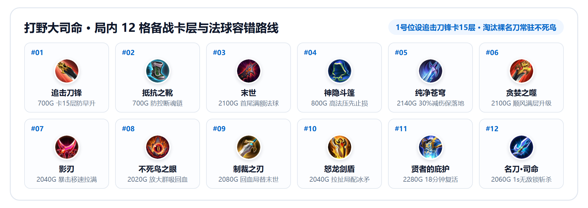

# 王者荣耀 S45 赛季打野大司命 · 双法球神巫斩杀与六套动态出装（完整真值数据版）

> **版本基线**：S45 正式服（`config/items_ground_truth.json` / `config/hero_skills_data.json` / `config/hero_base_stats.py` / `config/hero_arcana_data.py` 本地真值核验）
> **核心结论**：大司命满级裸装生命 6,695、物攻 347、双抗 402/173，被动 3 秒魂链首尾附带 100% 法球效果且一技能与魂链尾段均为法伤，大招落地回复 750~1,500（+12%额外生命，多目标最高翻倍）并开启 8 秒 10% 生命直接斩杀。本文基于本地真值拆解法球混伤基线、红刀 vs 肉刀及淘汰 273 法防裸名刀的实测账本、六套专属铭文满装与穿墙存双 2A 节奏。

---

## PART 01 · 裸装基线与法球混伤、神巫斩杀等级成长真值

**Lv1→15 裸装面板、魂链首尾 100% 法球倍率、碰墙 100% 加速与大招最高翻倍回血公式**

- 裸装基线与被动【鸣戈】法球混伤结构：大司命 Lv1→Lv15 裸装生命 3,401→6,695，物攻 177→347，物防 150→402，法防 75→173，移速 380，攻速成长 +1.0%。普攻牵出 3 秒魂链（每次 50% 物攻伤害且频率递增，结束造成 70~140 + 80%物攻法伤）；魂链起手与结束两段附带 100% 法球效果（中间段 50%），加之一技能两段全为法术伤害，决定了输出端优先适配末世、影刃、闪电匕首等法球攻速暴击装，而非暗影战斧固定物穿。
- 一技能【往生途】（CD 12.5s→10s）碰墙加速与 10% 神巫斩杀：划出路径造成 280~560（+95%额外物攻）法伤，碰到墙体或二技能生死界壁时爆发加速并额外造成 150~300（+60%额外物攻）法伤，在路径上无视地形增加 50%~100% 移速且桥面减速敌人 15%~30%；二段收戈进入 4 秒神巫状态，普攻生命低于 10% 的敌方英雄（野怪为 750~1,500）直接斩杀。
- 二技能【寂无器】（CD 10s→8s）存双强普群吸技巧：挥戈造成 200~400（+60%额外物攻）物伤与 25%~50% 减速，生成生死界壁挂印记（触碰枯枝再吃 140~280 + 45%额外物攻法伤与同额减速）；强化普攻额外造成 50% 伤害并回复 80~160（+1.5%额外生命）点生命，最多同时连接 3 个印记目标叠加回复。穿墙进场前 2~3 秒先空放二技能存好强普，贴脸平 A 接新转好的二技能再平 A，瞬间打出双印记群吸。
- 三技能【魂归忘忧】（CD 40s / 36s / 32s）翻倍回血与容错前提：跃起落地造成 380~760（+150%额外物攻）物伤与 0.5 秒击退，命中英雄回复 750 / 1,125 / 1,500（+12%额外生命）点生命（每多命中一名英雄回复增加 50%，最多 +100% 翻倍），凝聚继承 30% 物攻的高攻速灵体并进入 8 秒神巫斩杀。因大招有前摇且无霸体，必须配齐纯净苍穹主动减伤与不死鸟法防生命，防止半空未落地即被集火融化。

---

## PART 02 · 红刀 vs 肉刀双主轴与单件实测对比

**末世影刃双法球底座、为什么淘汰 273 法防裸名刀脆皮套，以及制裁/冰矛/双魔抗分工**

- 红刀收割流 vs 肉刀万血双主轴：单双排常规均衡局走贪婪之噬 + 末世 + 影刃（满级秒脆皮 12,295，打重坦 7,938）；当己方辅助为软辅缺前排吃第一波集火，或敌方爆发较高时，切换巨人之握撑至 10,495~12,245 生命，在保留末世百分比抽血与 10% 神巫斩杀的同时，将大招与二技能额外生命回血最大化。
- 淘汰旧式裸名刀脆皮套的量化依据：市面常见『红刀+抵抗鞋+末世+影刃+苍穹+名刀』满级生命仅 7,695、法防仅 273（法术抗伤 15,302），后期吃中单法师半套技能即被打穿名刀暴毙；将第 6 件常驻替换为不死鸟之眼后，法防升至 453、法术抗伤跃升至 20,458（多扛 +5,156 法伤），且残血神巫群吸回复量提高至 5,584，名刀留到大后期苍穹冷却真空期再原格秒换。

### 表1：打野大司命流派分水岭与容错单件同级实测对比表

| 对比场景与阶段 | 方案 A（推荐配置） | 方案 B（对照/旧脆皮套） | 实测关键差值与神巫机制依据 |
| :--- | :--- | :--- | :--- |
| 15级双主轴分流 (11,100金满装) | **红刀·末世影刃苍穹流** 秒脆皮 12,295 / 血量 8,545 | **肉刀·末世影刃苍穹流** 秒脆皮 10,551 / 血量 10,495 | 红刀流爆发高 +1,744 适合抓单收割；肉刀流多 +1,950 生命放大 12% 额外生命大招群吸 |
| 15级淘汰脆皮名刀 (容错底线对比) | **苍穹 + 不死鸟之眼** 453法防 / 法抗 20,458 / 回血 5,584 | 旧式苍穹 + 裸名刀套 273法防 / 法抗 15,302 / 回血 3,276 | 大招有前摇且无霸体：绑定不死鸟多扛 +5,156 法伤、多回 +2,308 血防半空蒸发 |
| 15级对策变阵 (重伤 vs 留人) | **制裁之刃替末世** (方案③) 秒脆皮 10,376 + 35%重伤 | **黄盾+冰矛三重减速** (方案④) 物抗 28,698 / 法抗 24,227 | 遇蔡文姬/狂铁/程咬金必切制裁断回血；遇公孙离/马可/火舞多位移切黄盾+冰矛防断链风筝 |

---

## PART 03 · 六套实战满装与六套专属 30 铭文面板与实测总览

**暴击红刀、攻速肉刀与双魔抗重装流各自专属 30 枚铭文阈值与十维实测总表**

- 六套流派精准定制铭文（拒绝一套铭文套到底）：① 方案①红刀常驻流配『10祸源 10鹰眼 7狩猎 3夺萃』（+9物攻 +64物穿 +7%攻速 +16%暴击 +7%移速 +4.8%物理吸血），放大影刃暴击与前中期续航；② 方案②肉刀双法球流配『10红月 10鹰眼 10狩猎』（+9物攻 +64物穿 +26%攻速 +5%暴击 +10%移速），补足肉刀缺少的攻速移速；③ 方案③制裁流因制裁自带吸血改配『10祸源 10鹰眼 10狩猎』拉满 10% 移速追击；④ 方案④黄盾冰矛流配『10红月 10鹰眼 5狩猎 5调和』（+9物攻 +64物穿 +200生命 +21%攻速 +5%暴击 +7.5%移速）；⑤⑥ 肉刀双魔抗流分别配『10宿命 10虚空 10狩猎』（+787生命 +23物防 +20%攻速 +10%移速 +5%冷却）与『10红月 10虚空 5狩猎 5调和』（+650生命 +21%攻速 +5%暴击 +7.5%移速 +5%冷却），双抗实际抗伤均突破 31,800~33,300。
- 对局选型口诀：均衡局盲选方案①；己方缺前排选方案②；对面有蔡文姬/桑启/程咬金选方案③制裁；对面公孙离/马可/火舞灵活拉扯选方案④黄盾+冰矛三重减速；法刺超神或双法核高压选方案⑤电刀双魔抗或方案⑥末世双魔抗。

### 表2：打野大司命 S45 六套实战满装实测对比总表（15级25层含30铭文）

| 评估维度 | ① 红刀末世影刃 | ② 肉刀末世影刃 | ③ 红刀影刃制裁 | ④ 红刀黄盾冰矛 | ⑤ 肉刀电刀双魔抗 | ⑥ 肉刀末世双魔抗 |
| :--- | :--- | :--- | :--- | :--- | :--- | :--- |
| 成装总价 | 11,100金 | 11,100金 | 11,080金 | 11,040金 | 11,020金 | 11,080金 |
| 核心第3~6件 | 末世+影刃+苍穹+不死鸟 | 末世+影刃+苍穹+不死鸟 | 影刃+制裁+苍穹+不死鸟 | 黄盾+苍穹+不死鸟+冰矛 | 电刀+苍穹+不死鸟+魔女 | 末世+苍穹+不死鸟+魔女 |
| 专属30铭文 | 10祸源 10鹰眼 7狩 3夺 | 10红月 10鹰眼 10狩猎 | 10祸源 10鹰眼 10狩猎 | 10红月 10鹰眼 5狩 5调 | 10宿命 10虚空 10狩猎 | 10红月 10虚空 5狩 5调 |
| 生命 / 物理攻击 | 8,545 / 686 | 10,495 / 521 | 8,045 / 721 | 10,095 / 671 | 11,882 / 467 | 12,245 / 467 |
| 物防 / 法防 | 692 / 453 | 692 / 453 | 692 / 453 | 842 / 603 | 802 / 753 | 779 / 753 |
| 无蓝 / 拿蓝冷却 | 22.5% / 40% | 20.0% / 40% | 22.5% / 40% | 22.5% / 40% | 25.0% / 40% | 25.0% / 40% |
| 物理 / 法术抗伤 | 24,059 / 20,458 | 28,288 / 24,054 | 24,041 / 20,443 | 28,698 / 24,227 | 31,829 / 32,002 | 32,651 / 33,309 |
| 秒脆皮 / 打重坦 | 12,295 / 7,938 | 10,551 / 6,942 | 10,376 / 6,912 | 8,989 / 6,130 | 7,357 / 5,407 | 7,573 / 5,386 |
| 团战总回复量 | 5,584 | 6,063 | 6,132 | 4,685 | 5,271 | 5,634 |

### 六套实战方案逐套适用场景与优劣势拆解

- **方案 ① · 单双排红刀双法球常驻底座 · 红刀·末世影刃苍穹流**（`11,100 金` ｜ `8,545血 ｜ 692物防 / 453法防 ｜ 22.5%冷却 ｜ 秒脆皮 12,295`）
  - **优势**：末世 + 影刃双法球吃满魂链首尾 100% 法球倍率，秒脆皮达 12,295；苍穹 30% 减伤配不死鸟 453 法防确保神巫状态稳按大招回血，淘汰旧名刀脆皮套仅 273 法防易猝死短板。
  - **注意**：无重伤效果，遇蔡文姬或程咬金需切换方案③制裁流。
  - **适用对局**：单双排绝大多数物法均衡、需兼顾刷野控龙与切后收割的常规对局。
- **方案 ② · 正面抱团万血双法球流 · 肉刀·末世影刃苍穹流**（`11,100 金` ｜ `10,495血 ｜ 692物防 / 453法防 ｜ 20.0%冷却 ｜ 秒脆皮 10,551`）
  - **优势**：满层肉刀将生命推至 10,495，直接放大二技能印记与大招 12% 额外生命回复，同时保留末世 + 影刃双法球高频抽血，团战容错极高。
  - **注意**：前中期移速与面板物攻略低于红刀体系。
  - **适用对局**：己方缺前排吃第一波伤害、需正面抱团持续拉扯的对局。
- **方案 ③ · 高回血阵容重伤针对 · 红刀·影刃制裁苍穹流**（`11,080 金` ｜ `8,045血 ｜ 692物防 / 453法防 ｜ 22.5%冷却 ｜ 秒脆皮 10,376`）
  - **优势**：制裁提供 35% 重伤与物理吸血，压制敌方高回复战坦与软辅连体，配合苍穹与不死鸟在持续换血中稳占上风。
  - **注意**：相比末世打高血量重坦百分比掉血略慢。
  - **适用对局**：敌方有蔡文姬、桑启、白起、狂铁、程咬金等高回血体系的对局。
- **方案 ④ · 多位移拉扯三重减速粘人 · 红刀·黄盾苍穹冰矛流**（`11,040 金` ｜ `10,095血 ｜ 842物防 / 603法防 ｜ 22.5%冷却 ｜ 秒脆皮 8,989`）
  - **优势**：一技能桥面减速 + 二技能枯枝减速 + 冰矛两层减速形成三重留人链，黄盾与不死鸟撑起 10,095 血与 842/603 双抗防止被拉扯风筝。
  - **注意**：暴击爆发低于影刃体系，主打持续黏打与残血 10% 斩杀。
  - **适用对局**：敌方公孙离、马可波罗、火舞等多位移灵活阵容。
- **方案 ⑤ · 法刺超神/电刀混伤针对 · 肉刀·电刀苍穹双魔抗流**（`11,020 金` ｜ `11,882血 ｜ 802物防 / 753法防 ｜ 25.0%冷却 ｜ 秒脆皮 7,357`）
  - **优势**：肉刀 + 魔女 + 不死鸟撑起 11,882 血与 753 法防（法术抗伤 32,002），电刀低价补足清野移速与连锁法伤，顶着双法核灌伤开出灵体。
  - **注意**：单体打重坦速度慢于末世流。
  - **适用对局**：敌方法刺打野超神、双法核消耗或射手早出闪电匕首混伤的高法压局。
- **方案 ⑥ · 逆风抗压/双前排重坦攻坚 · 肉刀·末世苍穹双魔抗流**（`11,080 金` ｜ `12,245血 ｜ 779物防 / 753法防 ｜ 25.0%冷却 ｜ 秒脆皮 7,573`）
  - **优势**：12,245 血配苍穹、魔女、不死鸟（双抗实际抗伤均超 32,000），单挂末世按敌方当前生命百分比抽血，逆风守高地与打双前排重坦极稳。
  - **注意**：追击移速偏慢，需一技能碰墙加速切入。
  - **适用对局**：己方逆风野区受压，或敌方双前排重坦抱团推进的持久战。

---

## PART 04 · 大司命专属打法思路、分期出装分水岭与保命轮换

**真假墙加速连招、慢交一技能二段细节、11级先合苍穹分水岭与18分钟换装**

- 专属核心打法思路（双流派神巫收割）：① 有真墙先 1 后 2、无墙先 2 后 1——野区有厚墙直接 1 穿墙加速贴脸，河道空旷处先放 2 技能减速并造出生死界壁假墙，秒接 1 撞界壁触发二段法伤与加速；② 贴脸先踩往生之路吃满 100% 移速黏着走 A，等敌方血线压低或交出位移后再点 1 技能二段收戈开启 4 秒神巫斩杀，切忌刚贴脸就秒收二段丢掉移速加成；③ 半血（40%~50%）提前按『纯净苍穹 + 大招』，顶着 30% 减伤安全落地吸满多目标回血并复制高攻速射手灵体反打。
- 备战预设与 11 级 1,400 金分水岭：备战第 1 格设二级追击刀锋（肉刀局设巡守利斧），前 5 分钟先做完二级野刀+抵抗鞋+末世（高回血局直转制裁之刃）。顺风叠满 15 层直升三级野刀补影刃；均逆风或敌方爆发成型快时，停在 15 层二级刀省下 1,400 金直接合出纯净苍穹（物理抗伤比先升大红刀高出 +3,707）或花 800 金垫神隐斗篷。
- 18 分钟后期保命换装：纯净苍穹主动交完进入 75 秒冷却真空期时，原格秒换复活甲 → 倒地换名刀·司命（利用 1.0 秒无敌锁血牵链走 A 直接触发神巫 10% 斩杀线） → 血魔之怒。

### 表3：打野大司命前中后期（Lv9 / Lv11 / Lv12 / 18分钟）出装分水岭实测表

| 阶段与经济预算 | 针对变序方案 | 顺风常序对照 | 实测抗伤差值与局内实战要点 |
| :--- | :--- | :--- | :--- |
| Lv9 高法伤止损 (4,300金/12层) | **小红刀+鞋+末世+神隐** 法抗 11,239 / 回血 2,269 | 小红刀+鞋+末世 (3,500金) 法抗 9,157 / 回血 2,123 | 遇法刺提前起飞花 800 金垫神隐斗篷，法术抗伤直接提升 +2,082（后续平滑合不死鸟） |
| Lv11 野刀分水岭 (约5,650金/15层) | **停小红刀先合纯净苍穹** (5,640金) 物抗 14,333 / 法抗 11,540 | 先升大红刀+长矛 (5,660金) 物抗 10,626 / 法抗 9,745 | 均逆风先拿苍穹 30% 主动减伤，物理抗伤高出 +3,707、法抗高 +1,795 |
| 18分钟保命轮换 (神巫10%斩杀) | **苍穹交完 → 原格换复活甲 → 名刀** 1.0秒无敌锁血触发 10% 斩杀 | 肉刀万血局 → 换血魔之怒 撑起近 4,900 点真实白盾 | 神巫状态普攻低于 10% 生命直接斩杀，残血名刀 1 秒无敌期内牵链走 A 极易完成反杀收割 |

