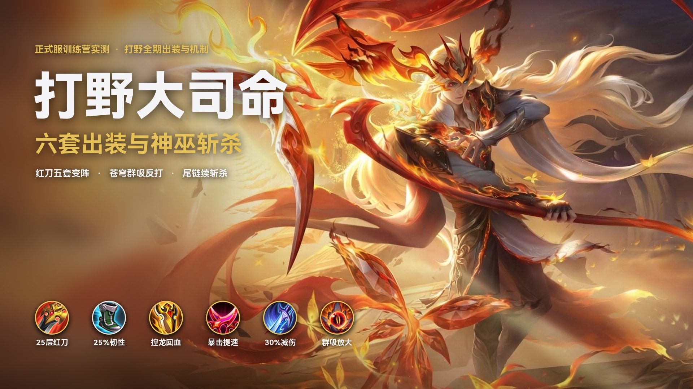
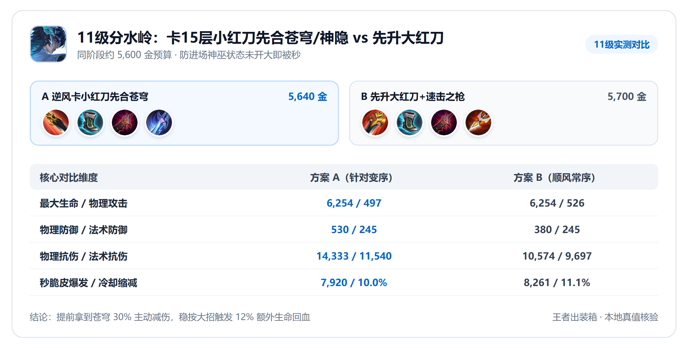

# 王者荣耀 S45 赛季打野大司命 · 双法球神巫斩杀与六套动态出装

> **版本基线**：S45 正式服（`config/items_ground_truth.json` / `config/hero_skills_data.json` / `config/hero_arcana_data.py` 本地真值核验）
> **核心结论**：大司命被动魂链首尾两段附带 100% 法球效果、一技能与魂链尾段均为法术伤害（不吃固定百穿），二技能与大招回血全部挂钩额外生命，且神巫状态对低于 10% 生命目标直接斩杀。实战摒弃仅 273 法防易猝死的纯攻名刀脆皮套，常规红刀双法球配苍穹+不死鸟守住双抗容错，高压或逆风转万血肉刀双魔抗体系。

---

## PART 01 · 核心机制与连招细节（法球倍率 / 混伤结构 / 神巫斩杀）

**魂链首尾100%法球触发、一技能碰墙加速斩杀、存双2A连招与额外生命回血伏笔**

- 混伤与法球触发规则：被动魂链持续 3 秒，起手与收尾附带 100% 法球效果（中间段折半），且一技能两段与魂链尾段均为法术伤害——因此核心输出优先末世、影刃、电刀等攻速法球与暴击，而非暗影战斧固定物穿。
- 碰墙加速与 7 秒斩杀窗口：一技能碰到墙体或二技能生死界壁会爆发加速并生成减速桥，二段收戈进入 4 秒神巫状态（叠加 3 秒不断链共 7 秒压血斩杀窗口），普攻低于 10% 生命目标直接斩杀；进场前提前空放二技能存一发强普，贴脸打出 A-2-A 双印记群吸。
- 大招额外生命容错前提：三技能落地击退并回复 750~1,500 (+12%额外生命) 生命（每多命中一名英雄再增 50%，最高翻倍），要求出装必须具备足够生命值、法防与主动减伤，防止半空或刚落地未吸上血即被法刺融化。

---

## PART 02 · 主流单件取舍推导与六套容错满装（红刀收割 vs 肉刀万血）

**末世影刃双法球底座、苍穹+不死鸟替代脆皮名刀、制裁/冰矛/双魔抗六套落位**

- 红刀与肉刀双主轴取舍：单排节奏均衡局走红刀+末世+影刃（秒脆皮 12,295）；己方缺前排或敌方爆发高时转肉刀撑破万血，放大二技能与大招 12% 额外生命回血。
- 淘汰 273 法防裸名刀脆皮套：旧式「红刀+末世+影刃+苍穹+名刀」满级法防仅 273，吃不明法伤极易暴毙；第 5~6 件绑定苍穹（30%主动减伤）+ 不死鸟（453法防+残血增疗），遇蔡文姬换制裁，遇多位移换黄盾+冰矛三重减速，遇双法核补魔女。

### 六套实战满装与专属铭文速查（全量通过容错门禁）

| 方案与定位 | 口语六件套 | 专属 30 枚铭文 | 满级关键指标 | 针对阵容与取舍逻辑 |
| :--- | :--- | :--- | :--- | :--- |
| **方案 ① · 单双排红刀双法球常驻底座** 红刀·末世影刃苍穹流 | 红刀 + 抵抗鞋 + 末世 + 影刃 + 苍穹 + 不死鸟 | 10祸源 10鹰眼 7狩猎 3夺萃 | 8,545血 ｜ 692物防 / 453法防 ｜ 22.5%冷却 ｜ 秒脆皮 12,295 | 单双排绝大多数物法均衡、需兼顾刷野控龙与切后收割的常规对局。 末世 + 影刃双法球吃满魂链首尾 100% 法球倍率，秒脆皮达 12,295；苍穹 30% 减伤配不死鸟 453 法防确保神巫状态稳按大招回血，淘汰旧名刀脆皮套仅 273 法防易猝死短板。 |
| **方案 ② · 正面抱团万血双法球流** 肉刀·末世影刃苍穹流 | 肉刀 + 抵抗鞋 + 末世 + 影刃 + 苍穹 + 不死鸟 | 10红月 10鹰眼 10狩猎 | 10,495血 ｜ 692物防 / 453法防 ｜ 20.0%冷却 ｜ 秒脆皮 10,551 | 己方缺前排吃第一波伤害、需正面抱团持续拉扯的对局。 满层肉刀将生命推至 10,495，直接放大二技能印记与大招 12% 额外生命回复，同时保留末世 + 影刃双法球高频抽血，团战容错极高。 |
| **方案 ③ · 高回血阵容重伤针对** 红刀·影刃制裁苍穹流 | 红刀 + 抵抗鞋 + 影刃 + 制裁 + 苍穹 + 不死鸟 | 10祸源 10鹰眼 10狩猎 | 8,045血 ｜ 692物防 / 453法防 ｜ 22.5%冷却 ｜ 秒脆皮 10,376 | 敌方有蔡文姬、桑启、白起、狂铁、程咬金等高回血体系的对局。 制裁提供 35% 重伤与物理吸血，压制敌方高回复战坦与软辅连体，配合苍穹与不死鸟在持续换血中稳占上风。 |
| **方案 ④ · 多位移拉扯三重减速粘人** 红刀·黄盾苍穹冰矛流 | 红刀 + 抵抗鞋 + 黄盾 + 苍穹 + 不死鸟 + 冰矛 | 10红月 10鹰眼 5狩猎 5调和 | 10,095血 ｜ 842物防 / 603法防 ｜ 22.5%冷却 ｜ 秒脆皮 8,989 | 敌方公孙离、马可波罗、火舞等多位移灵活阵容。 一技能桥面减速 + 二技能枯枝减速 + 冰矛两层减速形成三重留人链，黄盾与不死鸟撑起 10,095 血与 842/603 双抗防止被拉扯风筝。 |
| **方案 ⑤ · 法刺超神/电刀混伤针对** 肉刀·电刀苍穹双魔抗流 | 肉刀 + 抵抗鞋 + 电刀 + 苍穹 + 不死鸟 + 魔女 | 10宿命 10虚空 10狩猎 | 11,882血 ｜ 802物防 / 753法防 ｜ 25.0%冷却 ｜ 秒脆皮 7,357 | 敌方法刺打野超神、双法核消耗或射手早出闪电匕首混伤的高法压局。 肉刀 + 魔女 + 不死鸟撑起 11,882 血与 753 法防（法术抗伤 32,002），电刀低价补足清野移速与连锁法伤，顶着双法核灌伤开出灵体。 |
| **方案 ⑥ · 逆风抗压/双前排重坦攻坚** 肉刀·末世苍穹双魔抗流 | 肉刀 + 抵抗鞋 + 末世 + 苍穹 + 不死鸟 + 魔女 | 10红月 10虚空 5狩猎 5调和 | 12,245血 ｜ 779物防 / 753法防 ｜ 25.0%冷却 ｜ 秒脆皮 7,573 | 己方逆风野区受压，或敌方双前排重坦抱团推进的持久战。 12,245 血配苍穹、魔女、不死鸟（双抗等效抗伤均超 32,000），单挂末世按敌方当前生命百分比抽血，逆风守高地与打双前排重坦极稳。 |

---

## PART 03 · 大司命专属打法思路、1,400金分水岭与保命换装

**一技能穿墙转线、存双2A进场群吸、神巫10%斩杀拉扯与后期三连换**

- 专属核心打法思路（双流派神巫收割）：① 刷野转线多用一技能穿厚墙碰地形加速，进场前提前空放二技能存一发强普，贴脸打出 A-2-A 双印记回血；② 红刀局侧翼抓单压进 10% 生命线直接触发神巫普攻斩杀；肉刀局抱团顶前排吃第一波技能，半血人群中按三技能吃满多目标翻倍回血（最高 +100%），切忌满血空大浪费回复；③ 魂链牵住目标后边走边拉，卡住最远链距风筝近战战坦。
- 备战卡二段刀与 1,400 金分水岭：备战第 1 格设追击刀锋（或巡守利斧），前 5 分钟先做二级刀+抵抗鞋+末世（高回血转制裁）；顺风满 15 层升三级野刀，均逆风或法核超神先卡二级刀省 1,400 金合出纯净苍穹或垫 800 金神隐，确保半空稳开大招。
- 18 分钟保命轮换：苍穹主动交完进 75 秒冷却真空期时原格换复活甲 → 倒地秒换名刀（1 秒无敌锁血打出神巫 10% 斩杀） → 血手。

