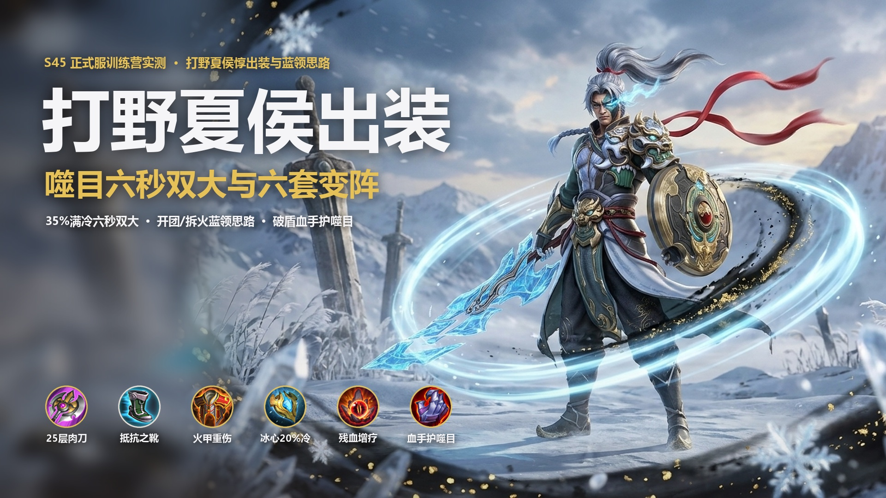

# 王者荣耀 S45 赛季打野夏侯惇 · 噬目六秒双大与蓝领六套出装（完整真值数据版）

> **版本基线**：S45 正式服（`config/items_ground_truth.json` / `config/hero_skills_data.json` / `config/hero_base_stats.py` / `config/hero_arcana_data.py` 本地真值核验）
> **核心结论**：夏侯惇满级裸装拥有 7,865 生命与 416/195 双抗，二技能护盾（12%额外生命）、被动噬目回血（6%额外生命）及大招对野怪两段伤害（共自身12.5%最大生命）全部挂钩生命值，且满级二技能三刀真伤共缩减 24% 大招冷却（35%满冷却下约 6 秒刷出双大）。本文基于本地真值拆解裸装与技能成长基线、火甲 vs 黄盾及不死鸟/魔女/永夜的同级实测账本、六套十维满装与蓝领开团/保后排实战分流。

---

## PART 01 · 裸装基线与技能等级成长真值（白盾边界 / 六秒双大 / 链刃双态）

**Lv1→15 裸装面板、破白盾亮噬目判定、大招 12.5% 生命打龙与约 6 秒双大公式**

- 裸装成长基线与生命转化乘区：夏侯惇 Lv1→Lv15 裸装生命由 3,590 成长至 7,865，物攻 183→324，物防 150→416，法防 75→195，基础移速 380，每级攻速成长 +1.0%。其生存、控龙与续航三大核心机制均以生命值为放大倍率，每多撑 1,000 点额外生命即可同步抬高二技能护盾 120 点、每次噬目回血 60 点以及大招对龙伤害 125 点。
- 被动【噬目】三态边界（破白盾扣绿血才触发）：生命低于 50% 并受到实际生命扣减时点亮 8 秒噬目，期间每次普攻或技能命中回复 220~440（+6%额外生命）点生命；注意 8 秒持续期走完后才开始转冷却（冷却随等级由 25 秒递减至满级约 15 秒）。若半血顶着二技能白盾挨打未破盾，不会点亮噬目——实战满血进场应先开二技能白盾吸收第一波消耗，等白盾被打掉扣减绿血点亮噬目后，再开启血魔之怒或纯净苍穹稳吸 8 秒回血。
- 一技能【豪气斩】（CD 8s→6.5s）与路过野怪存二段：一段刃风造成 220~440（+55%额外物攻）物伤与 25%~50% 减速（2秒），命中任意敌方单位（含野怪兵线）即可解锁二段重击，造成同额物伤、1 秒范围击飞及目标 10% 最大生命撞击伤害。支援抓边路过野怪先刮一段存出二段，大招过墙落地直接拍出 1 秒击飞。
- 二技能【龙卷闪】（CD 7s→5.5s）与三技能【不羁之刃】（CD 15s→12s）约六秒双大精算：二技能获 500~1,000（+12%额外生命）5 秒护盾，随后三次强化普攻附带 150~300（+45%额外物攻）真伤，每刀减少大招 4%~8% 冷却（满级三刀共减 24%）。凑齐 35% 冷却后满级大招为 7.8 秒，砍满三刀缩减约 1.87 秒，实战约 5.9 秒（6秒）即可刷出第二发大招。大招一段眩晕 0.75 秒并附带对野怪自身 7.5% 最大生命伤害、二段霸体击飞 0.5 秒再附带 5% 自身最大生命伤害（共 12.5%）；出钩侧拉轮盘可走弧线绕前排，连点 3-3 则原地收回链刃将刺客拽回身前拆火。

---

## PART 02 · 同槽位竞争单件实测对比（火甲 vs 黄盾 / 三冰装 / 三法防）

**为什么常规先出红莲斗篷提速刷群野，以及不死鸟、魔女、永夜守护的客观量化分工**

- 打野刀与清野首件二选一（红莲斗篷 vs 怒龙剑盾）：常规走巨人之握撑 +1,950 满层生命与 10% 冷却（仅己方已有张飞/牛魔等重坦开团缺切后伤害时换第六套贪婪之噬）。清野大件在同为 2,040 金的火甲与黄盾间二选一：单双排常规默认优先卡住二级小肉刀先出火甲——被动业炎每秒对 375 范围敌人造成 1.5% 最大生命法伤，对野怪与小兵翻倍为每秒 3.0% 最大生命法伤（9 级 9,330 血折后单怪约 223/s，刷三猪/双狼等三目标群野每秒总伤达 668/s，比黄盾内置 2.5 秒冷却的单体重创快近一倍，更比先花 1,400 金裸升大肉刀快数倍），且自带 35% 范围重伤；仅在敌方高法伤无强回血阵容或满装需单格兼顾双抗（方案③④⑤⑥）时换怒龙剑盾补 +150 法防、野怪回血与拆塔伤害。
- 三件冰系防装与冷却账本：常驻极寒风暴（+20%冷却 +360物防），配合满层肉刀（10%）与 10虚空铭文（5%冷却）整整卡准 35.0% 高冷却档位且断蓝不卡手；均顺风追击无位移后排换寒霜袭侵（+750生命 +25%攻速 +70物攻，两层减速快砍三刀真伤）；敌方墨子/王昭君/西施多硬控且配站桩射手时换冰霜冲击（+950生命 +150物防 +7.5%冷却，叠抵抗鞋达 35% 韧性且被控自动获 10% 最大生命护盾）。
- 法防三选一客观量化分工（不死鸟 vs 魔女 vs 永夜）：作为正面承伤重坦，夏侯惇吃第一波集火极易满足 2.5 秒掉 25% 血条件，因此永夜守护同样适用，三者按敌方伤害形态明确分工——单法防位默认常驻不死鸟之眼（+1,350 生命比永夜多 450 血，每损 10% 血提高 6.5% 治疗量刚好对冲敌方 35% 梦魇/制裁重伤，团战回血达 5,690）；遇干将、沈梦溪远程双法核消耗补魔女斗篷（脱战法术护盾无视重伤防压血，法抗达 40,260）；遇近身集火或凝冰之息软减速风筝多时搭永夜守护（回 10% 最大生命 + 7.5% 移速与 50% 减速抗性，双魔抗团战总回血推至 6,774）。

### 表1：打野夏侯惇核心竞争单件同级实测对比表（含30铭文折算）

| 对比组与等级 | 方案 A（推荐主选） | 方案 B（同槽位备选） | 实测关键差值与机制取舍依据 |
| :--- | :--- | :--- | :--- |
| 9级清野首件 (3,440金/12层) | **红莲斗篷** (2,040金) 物抗 20,719 / 法抗 15,379 | 怒龙剑盾 (2,040金) 物抗 18,989 / 法抗 17,245 | 火甲对野怪翻倍 3.0% 生命范围法伤（三猪 668/s 快近一倍）且挂 35% 重伤；黄盾多 +150 法防（法抗高 +1,866）与野怪回血 |
| 9级野刀时机 (约3,500金) | **停小肉刀出火甲** (3,440金) 物抗 20,719 / 秒C 4,625 | 裸升大肉刀+腰带 (3,650金) 物抗 17,638 / 秒C 4,505 | 停二级刀先成火甲省 210 金，物理抗伤反而高出 +3,081，群野效率提升数倍 |
| 15级单法防位 (11,080金满装) | **不死鸟之眼** (+1,350血) 法抗 32,004 / 回血 5,690 | 单挂永夜守护 (+900血) 法抗 29,514 / 回血 3,940 | 不死鸟多 450 基础生命且残血增幅噬目，团战总回血高出 +1,750、法抗高 +2,490 |
| 15级双魔抗局 (10,920金满装) | **不死鸟 + 魔女斗篷** 法抗 40,260 / 回血 5,861 | **不死鸟 + 永夜守护** 法抗 36,815 / 回血 6,774 | 魔女法盾无视重伤多扛 +3,445 远程消耗；永夜多回 +913 血且附带 50% 减速抗性 |

---

## PART 03 · 六套实战满装与专属 30 铭文总属性账本

**五套万血肉刀容错流与一套补伤红刀流的十维实测面板与铭文阈值**

- 两套专属五级铭文精确总属性：① 肉刀五套统一配『10宿命 10虚空 10调和』（总计 +1187生命 +23物防 +10%攻速 +5%移速 +5%冷却 +45每5秒回血），出门即多 1,187 基础生命放大一圈白盾与噬目，5% 冷却配肉刀冰心凑齐 35% 冷却，10% 攻速保障开局三刀手感；② 第六套红刀补伤流配『10宿命 10鹰眼 5狩猎 5调和』（总计 +9物攻 +64物穿 +537生命 +23物防 +15%攻速 +7.5%移速），补齐 64 物理穿透与 15% 攻速将秒脆皮拉升至 8,812。
- 槽位对齐与阵容切换准则：肉刀前五套将不死鸟之眼固定在第 5 槽位，局内前中期出完二级肉刀与清野件后，只需根据敌方突进、硬控或双法伤情况替换第 4、6 槽位即可平滑成型，全量守住 475~925 法防容错线（淘汰旧纯物防套仅 245 法防被法师一套带走的短板）。

### 表2：打野夏侯惇 S45 六套实战满装实测对比总表（15级25层含30铭文）

| 评估维度 | ① 火甲冰心血手 | ② 火甲冰矛苍穹 | ③ 黄盾冰甲不祥 | ④ 黄盾冰心魔女 | ⑤ 布甲冰心反甲 | ⑥ 红刀黄盾冰矛 |
| :--- | :--- | :--- | :--- | :--- | :--- | :--- |
| 成装总价 | 11,080金 | 11,040金 | 10,910金 | 10,920金 | 10,920金 | 11,040金 |
| 核心第3~6件 | 火甲+冰心+不死鸟+血手 | 火甲+冰矛+不死鸟+苍穹 | 黄盾+冰甲+不死鸟+不祥 | 黄盾+冰心+不死鸟+魔女 | 黄盾+冰心+不死鸟+反甲 | 黄盾+冰矛+不死鸟+苍穹 |
| 专属30铭文 | 10宿命 10虚空 10调和 | 10宿命 10虚空 10调和 | 10宿命 10虚空 10调和 | 10宿命 10虚空 10调和 | 10宿命 10虚空 10调和 | 10宿命 10鹰眼 5狩 5调 |
| 生命 / 物理攻击 | 15,202 / 399 | 14,452 / 474 | 15,602 / 324 | 15,152 / 324 | 14,752 / 369 | 11,602 / 648 |
| 物防 / 法防 | 1059 / 475 | 969 / 475 | 1179 / 625 | 1079 / 925 | 1319 / 575 | 879 / 625 |
| 无蓝 / 拿蓝冷却 | 35.0% / 40% | 25.0% / 40% | 22.5% / 40% | 35.0% / 40% | 35.0% / 40% | 22.5% / 40% |
| 物理 / 法术抗伤 | 46,638 / 32,004 | 46,008 / 33,237 | 50,078 / 35,292 | 43,539 / 40,260 | 51,101 / 29,144 | 35,525 / 29,683 |
| 秒脆皮 / 打重坦 | 6,514 / 4,793 | 6,788 / 5,052 | 5,805 / 4,327 | 5,659 / 4,226 | 5,957 / 4,426 | 8,812 / 6,216 |
| 团战总回复量 | 5,690 | 5,894 | 6,041 | 5,861 | 5,699 | 4,906 |

### 六套实战方案逐套适用场景与优劣势拆解

- **方案 ① · 单双排常驻重伤满冷底座 · 肉刀·火甲冰心血手流**（`11,080 金` ｜ `15,202血 ｜ 1059物防 / 475法防 ｜ 35.0%冷却 ｜ 秒脆皮 6,514`）
  - **优势**：火甲挂 35% 重伤配双倍野怪灼烧，冰心+肉刀+10虚空（5%）凑准 35% 冷却实现落地三刀约 6 秒刷双大；半血破白盾点亮噬目后开启血手 6,081 白盾稳吸回血。
  - **注意**：缺少额外攻速，追击多位移后排需借野怪存二段一技能或侧拉弧线大招。
  - **适用对局**：单双排常规均衡局、敌方有蔡文姬/狂铁/白起等回血前排的对局。
- **方案 ② · 顺风追击无位移后排 · 肉刀·火甲冰矛苍穹流**（`11,040 金` ｜ `14,452血 ｜ 969物防 / 475法防 ｜ 25.0%冷却 ｜ 秒脆皮 6,788`）
  - **优势**：冰矛 +25% 攻速配两层减速快砍三刀真伤粘住无位移后排；满血先开二技能白盾吃消耗，破盾亮噬目后错峰按苍穹 30% 减伤把血吸回。
  - **注意**：第 4 件冰矛无双抗，遇独肥法核需先垫 800 金神隐斗篷防送终结。
  - **适用对局**：己方均顺风、需主动切入留住敌方无位移射手与中单的对局。
- **方案 ③ · 多硬控/站桩射手开团 · 肉刀·黄盾冰甲不祥流**（`10,910 金` ｜ `15,602血 ｜ 1179物防 / 625法防 ｜ 22.5%冷却 ｜ 秒脆皮 5,805`）
  - **优势**：冰甲 +10% 韧性叠抵抗鞋达 35% 双韧性且吃硬控自动获 10% 生命护盾，不祥受击最高削减射手 40% 攻速，黄盾补齐双抗与控龙效率。
  - **注意**：无蓝冷却 22.5%，技能轮转略慢于冰心流。
  - **适用对局**：敌方王昭君、墨子、西施硬控密集，且后排为后羿、鲁班等站桩射手的团战局。
- **方案 ④ · 双法核/电刀混伤针对 · 肉刀·黄盾冰心不死鸟魔女流**（`10,920 金` ｜ `15,152血 ｜ 1079物防 / 925法防 ｜ 35.0%冷却 ｜ 秒脆皮 5,659`）
  - **优势**：神隐平滑合黄盾兼顾清野与魔抗，魔女脱战法盾防远程消耗，不死鸟放大噬目回血（若敌方以近身集火与凝冰软减速为主，可将魔女换永夜守护拿回血与 50% 减速抗性）。
  - **注意**：无自身红莲重伤，遇高回血阵容需提醒中辅出梦魇或制裁。
  - **适用对局**：敌方中单法核 + 法刺打野（诸葛/露娜/司马懿）或电刀混伤射手的双法伤局。
- **方案 ⑤ · 少控重物理菜刀针对 · 肉刀·布甲黄盾冰心反甲流**（`10,920 金` ｜ `14,752血 ｜ 1319物防 / 575法防 ｜ 35.0%冷却 ｜ 秒脆皮 5,957`）
  - **优势**：布甲鞋 12% 普攻物伤减免配冰心、反甲针对纯物理冲脸，同时保留黄盾与不死鸟撑住 575 法防，彻底规避旧纯物防套仅 245 法防被中单秒杀的短板。
  - **注意**：无韧性鞋加成，仅限敌方硬控极少的物理菜刀阵容。
  - **适用对局**：敌方少硬控、以澜/镜/宫本 + 孙尚香为主的物理菜刀阵容。
- **方案 ⑥ · 己方有重坦补切后伤害 · 红刀·黄盾冰矛苍穹流**（`11,040 金` ｜ `11,602血 ｜ 879物防 / 625法防 ｜ 22.5%冷却 ｜ 秒脆皮 8,812`）
  - **优势**：红刀配冰矛与鹰眼铭文将秒脆皮提至 8,812、打坦提至 6,216，同时靠黄盾、苍穹与不死鸟守住 879 物防与 625 法防容错底线。
  - **注意**：比肉刀体系少约 3,600 血量，不宜单独盲探无视野草丛吃第一波集火。
  - **适用对局**：己方对抗路或辅助已有张飞、牛魔、廉颇等重坦开团，需要打野补切后伤害的对局。

---

## PART 04 · 蓝领核心打法思路、分期预算分水岭与保命换装

**2分钟单控暴君、中后期让红蓝经济、「弧线开团 vs 3-3保后排」抉择与1,400金分水岭**

- 专属蓝领核心打法思路：① 前期野区碰撞与 2 分钟单开暴君——4 级拥有二技能白盾、三刀真伤与噬目，河道 2v2 不虚绝大多数刺客；2 分钟暴君刷新时凭借大招两段对龙 12.5% 自身最大生命伤害与噬目回血可无伤单控暴君，提速推塔；② 中后期主动让红蓝转蓝领——做出小肉刀+鞋+火甲/黄盾后清野坦度已够用，将红 Buff 让给射手、蓝 Buff 让给中单，自己吃危险边线扛正面第一波视野；③ 团战「弧线开团」与「3-3 保后排」二选一——己方软辅缺先手且队友跟得上时，路过野怪存好一技能二段侧拉弧线大招控敌方无位移后排；己方后羿/伽罗发育良好而敌方有澜/镜/宫本突脸时，捏住大招站在自家后排斜前方，等刺客切入瞬间连点 3-3 原地拽回击飞解围，8 秒噬目走完进 15 秒真空期时果断后撤。
- 备战预设与 1,400 金升级分水岭：备战第 1 格设为二级巡守利斧（必做二级刀拿 +20% 野怪金币与叠层；敌方少控和平刷野局可草鞋直奔火甲提前 450 金拿双倍灼烧，多控抢暴君则先合抵抗鞋）。4~6 分钟点开面板排查闪电匕首射手与法刺，高法压局先花 800 金垫神隐斗篷再合火甲；清野件做完后的 1,400 金顺风满 15 层直升巨人之握，均逆风或法核超神则停在二级肉刀先合魔女斗篷、极寒风暴或永夜守护。
- 18 分钟保命三连换：先穿复活甲吸收第一波集火 → 倒地秒换血魔之怒（残血起身挨打瞬间点亮 8 秒噬目，同时按下血手撑起 6,081 无视重伤白盾拉扯刷出第二发大招） → 血手进 75 秒冷却后再换名刀·司命靠 1 秒无敌完成收尾。

### 表3：打野夏侯惇前中后期（Lv9 / Lv11 / 18分钟）预算分水岭实测表

| 对局阶段与预算 | 针对变序方案 | 顺风常序对照 | 实测抗伤差值与局内触发条件 |
| :--- | :--- | :--- | :--- |
| Lv9 高法压过渡 (4,240金) | **小肉刀+鞋+火甲+神隐** 法抗 18,437 / 物抗 21,808 | 小肉刀+鞋+火甲 (3,440金) 法抗 15,379 / 物抗 20,719 | 敌方法刺早起或射手做电刀时，花 800 金垫神隐斗篷即可拉升 +3,058 法术抗伤 |
| Lv11 野刀分水岭 (约5,500金/15层) | **停小肉刀+火甲+魔女** (5,460金) 法抗 24,045 / 物抗 25,346 | 先升大肉刀+火甲+神隐 (5,640金) 法抗 20,565 / 物抗 24,542 | 均逆风省 180 金先做出魔女法盾，法抗高出 +3,480、物抗高 +804 |
| Lv15 破盾主动装 (满装团战) | **血魔之怒** (15,202血) 瞬间撑起 6,081 真实白盾 | 纯净苍穹 (14,452血) 3秒 30% 主动减伤免控 | 血手 40% 最大生命白盾完全无视 35% 制裁梦魇重伤；顺风粘人追击切后排则选苍穹 |

