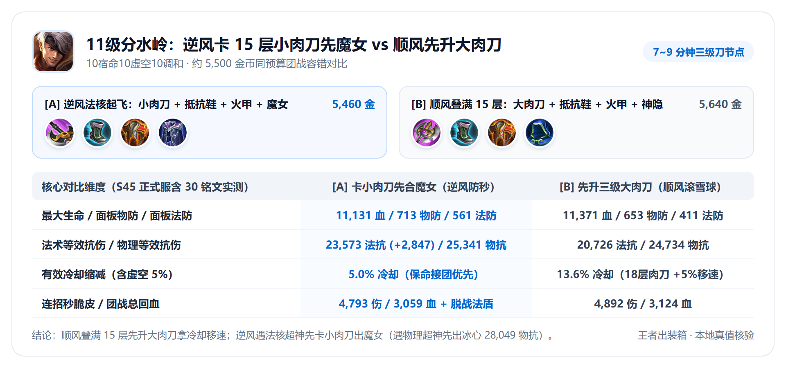

# 王者荣耀 S45 赛季打野夏侯惇深度攻略：技能等级真值、双烧底座与局内动态调装

> **版本基线**：S45 正式服（`config/items_ground_truth.json` / `config/hero_skills_data.json` / `config/hero_arcana_data.py` 本地真值核验）
> **核心结论**：夏侯惇打野以「常驻双烧底座 + 二级肉刀卡层」起步，排位容错率取决于局内四步调装：看面板查混伤与换鞋、第 3 件火甲与神隐斗篷过渡、11 级三级大肉刀升级时机、以及顺逆风防装变序与血手换装联动。

---

## PART 01：决定出装取向的五大核心实战判定与技能等级成长真值

夏侯惇的清野效率、护盾厚度、噬目回血全部随额外生命与冷却线性放大，且冷却与减CD幅度随技能/英雄等级显著变化：

### 1. 白盾扛伤不扣真血不会触发「噬目」；8 秒强化结束后才起算冷却
- **实机验证（`XHD-01`）**：被动【噬目】触发条件为**当前生命低于 `50%` 并受到扣减绿色真血的伤害**。半血附近顶着二技能白盾吃伤害，只要只掉白盾不扣绿血，底下状态栏就不会触发噬目；团战满血进场可先开二技能白盾（`500~1,000 + 12%额外生命`，随二技能 `1~6级` 成长，持续 `5秒`）扛第一波集火，等破盾掉到半血点亮 `8秒` 噬目（每次普攻或技能命中回复 **`220~440 (+6%额外生命)`**，基础值随英雄 `1~15级` 线性成长），再按苍穹 `30%` 减伤把血线抬回来。
- **冷却起算与等级缩减**：噬目 `8秒` 强化状态**完全跑完后才开始转冷却**，冷却时间随英雄等级缩减（1 级 **`25秒`**，15 级满级实测约 **`15秒`**）。

### 2. 三技能对野怪附带「自身 12.5% 最大生命」物理撞击伤害
- 三技能【不羁之刃】（基础冷却 **`15 / 13.5 / 12秒`**，随 `4/8/12级` 递减）首段造成 `370 / 555 / 740 (+100%额外物攻)` 物伤、眩晕首个目标 `0.75秒`；二段造成同额物伤与 `0.5秒` 击飞。
- **目标类型分流判定**：对敌方英雄附加**目标 `7.5% + 5% = 12.5%` 最大生命物伤**；对野怪、暴君、主宰则附加**夏侯惇自身 `7.5% + 5% = 12.5%` 最大生命物伤**。堆生命值在提升坦度、白盾与噬目回血的同时，直接拉高刷野控龙与拼惩斩杀线。

### 3. 二技能 5 秒内三刀真伤，减大招比例随技能等级由 12% 涨至 24%
- **实机验证（`XHD-03b`）**：二技能【龙卷闪】（基础冷却 **`7 / 6.7 / 6.4 / 6.1 / 5.8 / 5.5秒`**）开启造成 `300~600 (+100%额外物攻)` 法伤，5 秒内下三次强化普攻附带 **`150~300 (+45%额外物攻)` 真实伤害**，每刀命中减少三技能 **`4% / 4.8% / 5.6% / 6.4% / 7.2% / 8%` 冷却时间**（1 级三刀共减 `12%`，点满 6 级三刀共减 **`24%`**）。
- 12 级点满大招（基础 `12秒`）配 `35%` 冷却缩减压至 `7.8秒`，落地贴脸开二技能砍满三刀，不到 `5秒` 即可刷出第二发大招。

### 4. 大招双形态手法：侧拖轮盘画弧绕前排 vs 快按 `3-3` 原地拽回拆火
- **弧线绕前排（`XHD-02`）**：二段拉向链刃期间处于霸体，推动左轮盘方向可走切线弧度。正面有张飞、牛魔卡位时，链刃侧拉擦过前排，出钩瞬间左轮盘推向侧翼切线，即可画弧绕过前排贴住后排。
- **原地拽回拆火（`XHD-03a`）**：逆风保自家射手或贴脸反制镜、澜、马超时，**快速连点两段 `3-3` 收回链刃**，夏侯惇站在原地就能直接将范围内刺客拉回身前并造成同额物伤与 `0.5秒` 击飞。

### 5. 一技能借野怪或兵线存二段，进场零前摇秒拍击飞
- **实机验证（`XHD-04`）**：一技能【豪气斩】（基础冷却 **`8 / 7.7 / 7.4 / 7.1 / 6.8 / 6.5秒`**）一段减速 **`25%~50%`**（随技能等级成长，持续 `2秒`），命中英雄或野怪均可解锁二段。抓人前路过三猪或河蟹先刮一段，捏住二段重击（击飞 **`1秒`** 并对英雄额外造成**目标 `10%` 最大生命物伤**），大招过墙落地直接拍出群控。

---

## PART 02：常驻双烧底座、备战卡层技巧与六套模块化变阵

### 1. 备战预设的两个关键卡位

1. **1 号位设二级 `小肉刀（巡守利斧，700金）`，三级 `巨人之握（2,100金）` 放核心防装后**：合出二级刀后自动停手，避免前中期防装未成型时自动吃掉 `1,400` 金币升大野刀（注：`巨人之握` 基础提供 `5%` 冷却，叠满 `25层` 奖赏再加 `5%` 共 **`10%` 冷却**，11 级 `18层` 时为 `8.6%` 冷却）。
2. **想提前拿魔抗时，在黄盾前挂一件 `神隐斗篷（800金）`**：设为 `[神隐斗篷] → [怒龙剑盾]`，局内会改变默认先买护甲的合成顺序，先花 `800` 金拿到 `150` 法防与 `450` 生命过渡，再自动补齐合成黄盾。

### 2. 三件「冰」系防装与五级铭文精确分工

- **`冰心（极寒风暴，2,040金）`**：`+20%冷却 +240物防 +600生命`，单次受击超当前生命 `10%` 触发冲击（`130~260` 法伤，减 `15%` 攻速与 **`15%~30%` 移速**，持续 `2秒`，CD `2秒`），主打满档冷却刷双大招。
- **`冰矛（寒霜袭侵，2,040金）`**：`+70物攻 +25%攻速 +750生命`，普攻减 **`5%~10%` 移速**（随等级成长，叠满 2 层即 **`10%~20%` 减速**），冻伤额外 `135~270 (+45%额外AD)` 物伤（CD `3秒`），主打顺风快速打满三刀真伤粘后排。
- **`冰甲（冰霜冲击，2,030金）`**：`+150物防 +950生命 +7.5%冷却`，被动 **`+10%` 韧性**（配抵抗鞋共 `35%` 韧性）且受除压制外硬控获 `10%` 最大生命护盾（`5秒`，CD `15秒`），主动 `30%~60%` 减速后冰冻（CD `75秒`），主打多控局开团。
- **三套专属五级铭文精确总属性**：
  - `10宿命 10虚空 10调和`（千血肉铭文）：`+1,187生命 +23物防 +10%攻速 +5%移速 +5%冷却 +50每5秒回血`。
  - `10宿命 10虚空 5狩猎 5调和`（半攻速追击）：`+987生命 +23物防 +15%攻速 +7.5%移速 +5%冷却 +25每5秒回血`。
  - `10宿命 10鹰眼 5狩猎 5调和`（红刀进攻）：`+537生命 +9物攻 +64物穿 +23物防 +15%攻速 +7.5%移速 +25每5秒回血`。

### 3. 常驻底座与五大对策变阵速查表（15 级 25 层含 30 铭文实测）

| 定位与对局场景 | 口语化六件套（最终成型） | 专属 30 枚铭文 | 15级血量 / 物防 / 法防 / 冷却 | 物理抗伤 / 法术抗伤 | 连招秒脆皮 / 团战回血 | 模块化替换逻辑 |
| :--- | :--- | :--- | :--- | :--- | :--- | :--- |
| **01 常驻泛用底座** （默认盲选 / 有奶坦均衡局） | 肉刀 + 抵抗鞋 + 火甲 + 黄盾 + 不死鸟 + 冰心 | 10宿命 10虚空 10调和 | `15,402` / `1,209` / `625` / `35%` | `46,983` / `32,601` | `5,983` / `5,961` | 火甲 `35%` 重伤+黄盾清龙+冰心满档减CD |
| **02 顺风单排追击** （己方顺风 / 需留无位移C） | 肉刀 + 抵抗鞋 + 火甲 + 冰矛 + 不死鸟 + 苍穹 | 10宿命 10虚空 5狩猎 5调和 | `14,252` / `969` / `475` / `25%` | `47,067` / `34,002`（绝境 `49,586`） | `6,817` / `5,906` | `XHD-05` 实录同款，25%攻速打满三刀粘后排，苍穹防集火 |
| **03 多核控多开团** （敌方连控多 + 站桩射核） | 肉刀 + 抵抗鞋 + 火甲 + 冰甲 + 不死鸟 + 不祥 | 10宿命 10虚空 10调和 | `15,852` / `1,269` / `475` / `22.5%` | `52,471` / `32,237` | `5,436` / `5,944` | `35%` 双韧性配冰盾，不祥受击减 `20%~40%` 攻速 |
| **04 多法核双魔抗** （中单法核 + 法刺/法边/电刀） | 肉刀 + 抵抗鞋 + 黄盾 + 魔女 + 冰心 + 不死鸟 | 10宿命 10虚空 10调和 | `15,152` / `1,079` / `925` / `35%` | `43,527` / `39,493` | `5,659` / `5,861` | 魔女配不死鸟撑起 `925` 法防，留冰心保冷却与物防扛射手 |
| **05 重物理少控局** （对面硬控少 + 纯物理阵容） | 肉刀 + 布甲鞋 + 火甲 + 反甲 + 冰心 + 不祥 | 10宿命 10虚空 10调和 | `14,852` / `1,619` / `245` / `35%` | `55,250` / `22,061` | `5,605` / `3,364` | 布甲鞋 `6%~12%` 物免配三物防，针对纯物理菜刀队 |
| **06 绝活红刀进攻** （己方有重坦 / 前中期强入侵） | 红刀 + 抵抗鞋 + 火甲 + 冰矛 + 不死鸟 + 暴烈 | 10宿命 10鹰眼 5狩猎 5调和 | `12,852` / `1,029` / `475` / `12.5%` | `35,601` / `24,845` | `8,817` / `5,304` | 红刀物攻配 64 物穿切脆皮快，身板偏薄逆风不出 |

---

## PART 03：前中后期局内动态调装决策树

### 第一步：开局与中期看面板——法伤识别与鞋子切换

1. **开局明牌法伤**：中单法师，以及露娜、司马懿、诸葛亮、嫦娥、芈月等法系野边。加载界面看到两个以上法伤点，准备提前垫 `神隐斗篷`。
2. **4~6 分钟点面板必查（动态混伤/双修）**：
   - **法球混伤射手**：狄仁杰、后羿、鲁班七号、公孙离、敖隐、艾琳——中期点开经济栏看他走的是 **`电刀（闪电匕首）` 法球流**还是纯暴击流。
   - **双流派野/边**：大司命（电刀法球 vs 半肉）、铠（肉铠火甲魔伤 vs 暴击）、司空震、亚连，均按局内实际成装决定魔抗优先级。

**鞋子随阵容切换**（10 级 `小肉刀 + 鞋 + 火甲` 实测）：
- **常规有控局**：`抵抗鞋`（`25%` 韧性防连控断大招与二技能，物抗 `21,287` / 法抗 `15,790`）。
- **少控菜刀局（如澜/镜 + 孙尚香/后羿）**：换 **`布甲鞋（影忍之足）`**（被动减少 **`6%~12%`** 所受物理伤害，随英雄等级成长，10 级约 `9.9%`、15 级 `12%`；10 级物理等效抗伤升至 **`22,779`**，多抗 `1,492` 点物理伤害）。
- **前期无控顺风抢节奏**：可过渡穿 `冷静鞋`（`+15%` 冷却）提速刷大，中后期团战控制上来再换回抵抗鞋。

### 第二步：4~6 分钟第 3 件分叉——对方法师提前起飞，先火甲还是先魔抗？

打野夏侯惇第 3 件若跳过清野装直接裸 `魔女`，刷野和控龙效率会明显掉档。按对面是否有强回血分两条路线（9 级 12 层实测）：
1. **敌方法核提前起飞 + 对面无强回血前排**：第 3 件跳过火甲，直接走 **`800金神隐斗篷` → 合成 `黄盾`**（总价同为 `3,440` 金，9 级法术抗伤从 `15,376` 升至 **`17,245`**，同时保留黄盾对野怪 `7%` 最大生命重创清野速度）。
2. **敌方法核提前起飞 + 对面有蔡文姬/桑启/狂铁等强回血**：先花 **`800` 金买一件 `神隐斗篷` 过渡**，紧接着合成 **`火甲`** 挂 `35%` 重伤（`4,240` 金组合双抗均衡：物理抗伤 `21,806`、法术抗伤 **`18,436`**），随后这件 `神隐斗篷` 直接向上合成 `魔女` 或 `不死鸟`。

### 第三步：7~9 分钟关键分水岭——1,400 金先升大肉刀，还是先出防装？

11 级同约 `5,500` 金币预算实测对比：
- **顺风 / 均势，且小肉刀已叠满 15 层**：**先升三级 `巨人之握`**（`巨人之握 + 抵抗鞋 + 火甲 + 神隐斗篷`，`5,640` 金），拿到 `13.6%` 冷却与 `5%` 移速，不卡打野层数，刷野转线更快。
- **逆风局，或敌方主 C 已超神威胁秒人**：手里的 `1,400` 金别急着升三级野刀，**卡住 15 层 `小肉刀` 先把 `魔女` 或 `冰心` 做出来**。11 级 `小肉刀 + 抵抗鞋 + 火甲 + 魔女`（`5,460` 金）法术抗伤从 `20,726` 提升至 **`23,573`**（脱战法盾每 `15秒` 刷新且无视 `35%` 重伤）；遇物理野射超神时，卡小肉刀先出 `冰心`（`5,480` 金）物理抗伤达 **`28,049`** 且冷却拉到 `25%`，接住团战后再回头升三级肉刀。

### 第四步：中后期顺逆风变序与大后期血手护盾联动

1. **顺风遇独肥法师**：第 4 件别裸出无魔抗的 `冰矛`（法术抗伤仅 `19,452`，易被蹲草秒杀送出终结赏金），先垫 `800金神隐斗篷` 或做成 `不死鸟/魔女`，第 5 件再补 `冰矛` 留人。
2. **逆风防守局**：果断划掉 `冰矛`、`暴烈`，改走 `小肉刀 → 鞋 → 火甲/黄盾 → 魔女 + 冰心/不祥`，站自家后排身前用 `3-3` 原地拉回刺客拆火。
3. **18 分钟三保命换装联动**：`复活甲`（原地复活回 `2,000~3,000` 生命，每局最多 2 次，CD `150秒`）倒地 `2` 秒内卖掉秒换 **`血手（血魔之怒）`**——满装换血手后约 `15,702` 最大生命，起身按主动（扣 `30%` 当前生命换 **`40%` 最大生命护盾**，持续 `4秒`，CD `75秒`）直接撑起 **`6,281` 点大白盾**，借护盾触发噬目打出第二套大招回血；血手进冷却后再切 **`名刀`**（刚秒换时无敌 **`1.0秒`**，持满 `270秒` 最高达 `1.6秒`，CD `120秒`）。
