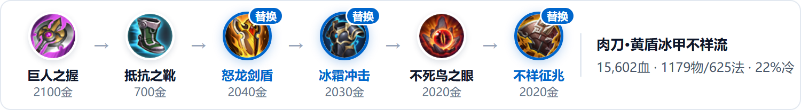
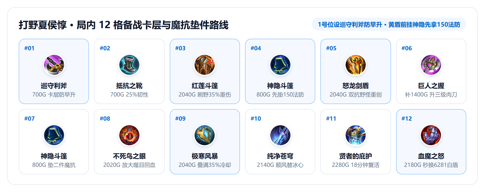

# 王者荣耀 S45 赛季打野夏侯惇 · 噬目六秒双大与蓝领六套出装

> **版本基线**：S45 正式服（`config/items_ground_truth.json` / `config/hero_skills_data.json` / `config/hero_arcana_data.py` 本地真值核验）
> **核心结论**：夏侯惇护盾厚度（12%额外生命）、噬目回血（6%额外生命）与大招两段对野怪伤害（共自身12.5%最大生命）全部挂钩生命值，满级二技能三刀真伤共减 24% 大招冷却（35%冷却下约 6 秒刷出第二发大招）。实战清野件在火甲（35%重伤）与黄盾（双抗控龙）间二选一，单魔抗常驻不死鸟对冲重伤，双法消耗补魔女、集火软减速可搭永夜；局内主打前期控龙反野、中后期让红蓝当蓝领，按阵容在弧线开团与 3-3 原地拆火间切换。

---

## PART 01 · 技能机制与连招细节（白盾边界 / 六秒双大 / 双形态链刃）

**破白盾扣绿血才点亮8秒噬目、借野存二段击飞、约六秒双大与弧线/3-3拆火**

- 白盾与噬目三态边界：半血顶着二技能白盾挨打只扣护盾不触发被动，只有白盾打破扣减绿血才会点亮 8 秒噬目（每次普攻/技能命中回 220~440 + 6%额外生命），且 8 秒走完才转冷却（满级约 15 秒真空）。满血进场应先开二技能白盾吃消耗，破盾亮噬目再开血手或苍穹。
- 借野存二段与约六秒双大：路过野怪先刮一技能一段存出二段重击，大招过墙落地直接拍出 1 秒击飞；大招两段对野怪/远古生物共附带自身 12.5%（7.5%+5%）最大生命伤害，血越厚控龙越快；35% 冷却下满级大招 7.8 秒，经二技能三刀减 24%（约 1.9 秒）后约 6 秒即可再出钩。
- 三技能双形态手法：出钩同时侧拉左方向轮盘可走霸体弧线绕过前排直贴后排；遇敌方刺客切自家射手时，快速连点 3-3 原地收回链刃即可将刺客拽回身前击飞拆火。

---

## PART 02 · 主流单件取舍推导与六套容错满装（兼顾输出与双抗容错）

**肉刀与火甲/黄盾二选一、三冰装分工、不死鸟/魔女/永夜客观取舍与六套落位**

- 打野刀与清野件二选一：常规走肉刀撑 +1,950 生命与 10% 冷却（仅己方已有张飞/牛魔重坦缺伤害时切第六套红刀）。清野件在火甲与黄盾间二选一：常规单双排默认优先先出火甲（每秒对周围野怪与兵线造成双倍即 3.0% 最大生命法术灼烧，9 级三猪群野每秒总伤约 668，比黄盾 2.5 秒冷却重创快近一倍、更远快于先花 1,400 金升大肉刀，且自带 35% 重伤）；仅在敌方高法伤无强回血或满装需补双抗格子时换黄盾（补 +150 法防、打野回血与对塔/英雄 3.5% 生命物伤）。
- 三冰装与三法防客观分工：常驻冰心（+20%冷却，配肉刀10%+10虚空5%刚好凑满 35% 冷却）；顺风追击换冰矛（+25%攻速快砍三刀）；多硬控换冰甲（35%双韧性+受控护盾）。法防单件常驻不死鸟（+1,350高血量配半血增疗对冲重伤）；双法远程消耗补魔女（脱战法盾防消耗）；敌方爆发集火或软减速风筝多也可搭永夜守护（2.5秒受击超25%回10%血 + 7.5%移速与50%抗减速，双魔抗团战回血达 6,774）。

### 六套实战满装与专属铭文速查（全量通过容错门禁）

| 方案与定位 | 口语六件套 | 专属 30 枚铭文 | 满级关键指标 | 针对阵容与取舍逻辑 |
| :--- | :--- | :--- | :--- | :--- |
| **方案 ① · 单双排常驻重伤满冷底座** 肉刀·火甲冰心血手流 | 肉刀 + 抵抗鞋 + 火甲 + 冰心 + 不死鸟 + 血手 | 10宿命 10虚空 10调和 | 15,202血 ｜ 1059物防 / 475法防 ｜ 35.0%冷却 ｜ 秒脆皮 6,514 | 单双排常规均衡局、敌方有蔡文姬/狂铁/白起等回血前排的对局。 火甲挂 35% 重伤配双倍野怪灼烧，冰心+肉刀+10虚空（5%）凑准 35% 冷却实现落地三刀约 6 秒刷双大；半血破白盾点亮噬目后开启血手 6,081 白盾稳吸回血。 |
| **方案 ② · 顺风追击无位移后排** 肉刀·火甲冰矛苍穹流 | 肉刀 + 抵抗鞋 + 火甲 + 冰矛 + 不死鸟 + 苍穹 | 10宿命 10虚空 10调和 | 14,452血 ｜ 969物防 / 475法防 ｜ 25.0%冷却 ｜ 秒脆皮 6,788 | 己方均顺风、需主动切入留住敌方无位移射手与中单的对局。 冰矛 +25% 攻速配两层减速快砍三刀真伤粘住无位移后排；满血先开二技能白盾吃消耗，破盾亮噬目后错峰按苍穹 30% 减伤把血吸回。 |
| **方案 ③ · 多硬控/站桩射手开团** 肉刀·黄盾冰甲不祥流 | 肉刀 + 抵抗鞋 + 黄盾 + 冰甲 + 不死鸟 + 不祥 | 10宿命 10虚空 10调和 | 15,602血 ｜ 1179物防 / 625法防 ｜ 22.5%冷却 ｜ 秒脆皮 5,805 | 敌方王昭君、墨子、西施硬控密集，且后排为后羿、鲁班等站桩射手的团战局。 冰甲 +10% 韧性叠抵抗鞋达 35% 双韧性且吃硬控自动获 10% 生命护盾，不祥受击最高削减射手 40% 攻速，黄盾补齐双抗与控龙效率。 |
| **方案 ④ · 双法核/电刀混伤针对** 肉刀·黄盾冰心不死鸟魔女流 | 肉刀 + 抵抗鞋 + 黄盾 + 冰心 + 不死鸟 + 魔女 | 10宿命 10虚空 10调和 | 15,152血 ｜ 1079物防 / 925法防 ｜ 35.0%冷却 ｜ 秒脆皮 5,659 | 敌方中单法核 + 法刺打野（诸葛/露娜/司马懿）或电刀混伤射手的双法伤局。 神隐平滑合黄盾兼顾清野与魔抗，魔女脱战法盾防远程消耗，不死鸟放大噬目回血（若敌方以近身集火与凝冰软减速为主，可将魔女换永夜守护拿回血与 50% 减速抗性）。 |
| **方案 ⑤ · 少控重物理菜刀针对** 肉刀·布甲黄盾冰心反甲流 | 肉刀 + 布甲鞋 + 黄盾 + 冰心 + 不死鸟 + 反甲 | 10宿命 10虚空 10调和 | 14,752血 ｜ 1319物防 / 575法防 ｜ 35.0%冷却 ｜ 秒脆皮 5,957 | 敌方少硬控、以澜/镜/宫本 + 孙尚香为主的物理菜刀阵容。 布甲鞋 12% 普攻物伤减免配冰心、反甲针对纯物理冲脸，同时保留黄盾与不死鸟撑住 575 法防，彻底规避旧纯物防套仅 245 法防被中单秒杀的短板。 |
| **方案 ⑥ · 己方有重坦补切后伤害** 红刀·黄盾冰矛苍穹流 | 红刀 + 抵抗鞋 + 黄盾 + 冰矛 + 不死鸟 + 苍穹 | 10宿命 10鹰眼 5狩猎 5调和 | 11,602血 ｜ 879物防 / 625法防 ｜ 22.5%冷却 ｜ 秒脆皮 8,812 | 己方对抗路或辅助已有张飞、牛魔、廉颇等重坦开团，需要打野补切后伤害的对局。 红刀配冰矛与鹰眼铭文将秒脆皮提至 8,812、打坦提至 6,216，同时靠黄盾、苍穹与不死鸟守住 879 物防与 625 法防容错底线。 |

---

## PART 03 · 蓝领核心打法思路、顺逆风分流与保命换装

**控龙让红蓝定位、团战「弧线开团 vs 3-3拆火」抉择、1,400金分水岭与残血血手轮换**

- 专属蓝领打法思路（拒绝刺客式闷头单干）：① 4 级有白盾真伤不怕野区 2v2 碰撞，2 分钟节点靠大招生命伤害与噬目无伤单开暴君带推塔节奏；② 做完小肉刀+鞋+清野件后主动转型蓝领，中后期把红蓝 Buff 让给双 C；③ 团战看阵容交大——己方软辅缺开团且队友跟得上就借野存二段画弧切双 C，己方呆射发育好而对面有澜/镜突脸就站双 C 斜前方捏住大招连点 3-3 原地拆火，8 秒噬目走完进 15 秒真空期时果断后撤。
- 备战卡小肉刀与 1,400 金分水岭：备战第 1 格设巡守利斧（必出二级刀拿 +20% 野怪金币与叠层，少控和平刷野局可草鞋直奔火甲提前 450 金拿双倍灼烧，多控抢 2 分钟暴君则先补抵抗鞋再合火甲）；4~6 分钟查面板电刀与法刺（高法伤又有回血时先垫 800 金神隐再合火甲，9 级法抗升至 18,436）；清野件后顺风叠满 15 层升巨人之握，均逆风卡小肉刀先合魔女（11 级法抗从 20,726 升至 24,046）、冰心或永夜。
- 18 分钟保命三连换：复活甲吃第一波集火 → 倒地秒换血魔之怒（残血起身受击点亮噬目，顶着 6,081 白盾拉扯刷第二发大招） → 血手进冷却后换名刀 1 秒无敌收尾。

