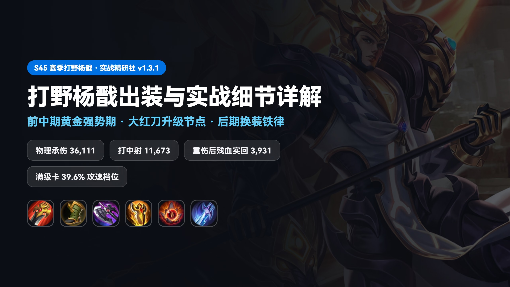
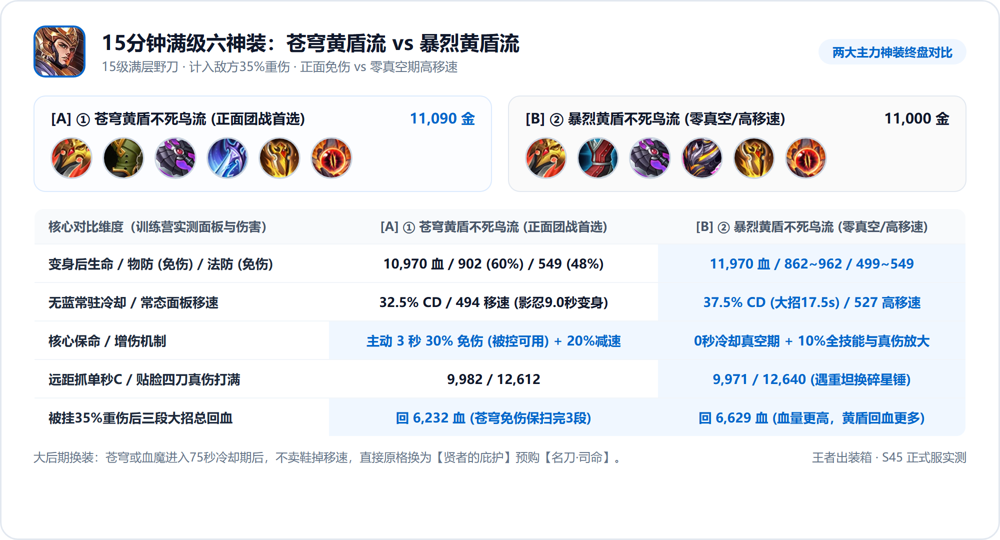
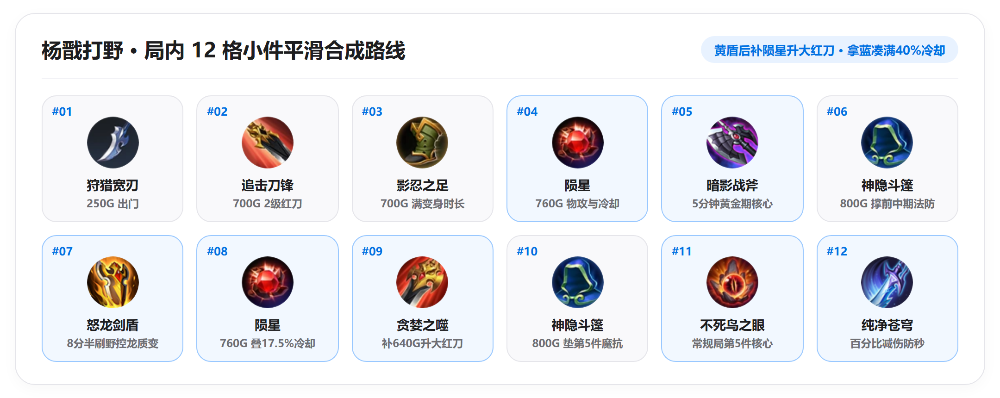
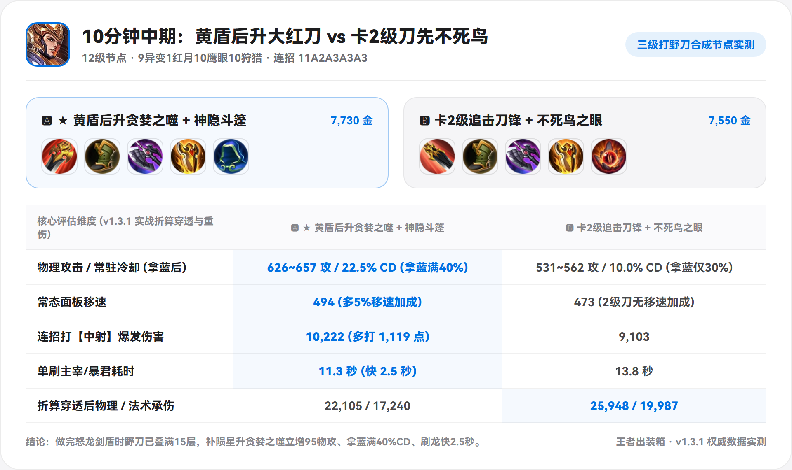

# 打野杨戬出装与实战细节详解



*(注：文中数据均计入五级百穿铭文，并按对局时期折算了敌方护甲魔抗、敌方 `破晓/碎星锤/虚无法杖` 穿透，以及 `梦魇之牙/制裁之刃` 降低 35% 回血的效果。)*

---

## 一、 英雄特点、强势期与四个实战机制

### 1. 英雄特点与强势期
* **自带 `60%~90%` 韧性上限（穿影忍之足变身延长至 `9.0秒`）+ 条件位移 + 固定真伤与群吸反打**：杨戬被动【法天象地】叠满提供 **`60%~90%` 韧性**（随大招等级从 60% 成长至 90%），且**变身持续时长取决于韧性上限（满级 90%）匀速降回初始韧性的时间——穿 `抵抗之靴` 自带 `25%` 初始韧性，满级从 `90%` 降回 `25%` 即提前结束，实测仅持续 `6.5秒`；穿 `影忍之足` 初始韧性为 `0%`，满级从 `90%` 降回 `0%` 变身直接延长至 `9.0秒`**（多出 `2.5秒` 霸体、`+600` 最大生命与 `+20%` 普攻射程，且多 `100` 物防与 `6%~12%` 物理减伤；`抵抗之靴` 仅在团战前韧性差一点时秒切用来直接开变身，单排缺蓝可选 `冷静之靴`）。其 `1技能` 必须命中目标才可突进（无法空放穿墙撤退），在铭文与出装上需补足移速与减速留人。
* **前中期（`2级 ~ 12分钟`）爆发强势，后期（`14分钟+`）转型重装群吸**：
  - **前中期（`2级 ~ 12分钟`）**：依托 `2技能` 横扫后 5 秒固定真实伤害（`125~250 + 36%额外物攻`）与 `1技能` 二段 `15%` 已损生命伤害，前中期野区碰撞与抓边一套可达 `7,600 ~ 10,200` 伤害。
  - **后期（`14分钟+`）**：2 技能真伤仅 `36%` 额外物攻加成，且后期敌方 `破晓`、`虚无法杖` 与 `35%` 重伤成型，需依靠 **“万血 + 均衡双抗 + 免伤/护盾 + 治疗增幅”** 撑过前 3 秒集火，扫完三段大招把血吸回来并利用残血 `1秒` 眩晕反打。

### 2. 四个容易忽略的实战机制
1. **被动【法天象地】卡“临界霸体”与防“空气变身”细节**：刷野或清兵叠满韧性后进入**临界霸体状态（未与敌方英雄交战前不倒计时）**，出野区抓人前先攒满可抵消迎面第一发控制，开启变身瞬间自带**范围击退、`+600` 最大生命与 `+20%` 普攻射程**。*(实战注意：攒满临界霸体后要注意走位避开敌方法师回响之杖、闪电匕首等远程电弧消耗，防止开团前被擦到被迫提前开启法天象地；此外霸体能免疫常规控制，但无法免疫东皇太一、张良压制及老夫子、弈星大招)*。
2. **2 技能「`0.5秒 → 1秒` 眩晕」与被动【天眼】拉开触发**：2 技能基础造成 `0.5秒` 晕眩，**当目标生命值百分比（绿血条比例）高于杨戬时延长至 `1秒`**（残血或开启 `血魔之怒` 扣 30% 当前绿血压低绿血条比例，均可稳定打出 `1秒` 眩晕）。技能命中最多存 3 发【天眼】激光，**贴脸站撸不发射，目标远离杨戬（或打完往后拉开一步）时自动射出补伤害并回血**。
3. **1 技能收狗减少 `25%~50%` 冷却与标记刷新**：1 技能未命中敌人会在终点停留 5 秒提供视野，**主动走过去触碰收回减少当前 `25%~50%` 冷却**；标记期间目标阵亡（含队友或小兵补刀）则立即刷新 1 技能。
4. **大招第 3 段穿兵回血翻倍**：大招第 3 段三道激光同中一人会衰减；团战时**将敌方英雄与后方小兵/野怪连成一线穿透扫射，在 `35%` 重伤下三段大招实际回复仍可从单目标的 `2,000+` 提升至 `4,000 ~ 6,600` 血**。

---

## 二、 打野位五套主流六神装全维度对比与替换细节

### 1. 打野位五套主流六神装面板与实战数据总表

半肉杨戬以 **`暗影战斧 + 怒龙剑盾 + 不死鸟之眼`** 为攻防底座——由于打野刀、黑切、苍穹、暴烈、冰痕、血魔均为 `0 法防`，若不出 `怒龙剑盾` 只出一件不死鸟，满级总法防仅 `403`（被 `虚无法杖` 穿透后仅剩 `139` 点生效法防）；**`怒龙剑盾` 补齐 `+150物防 / +150法防 / +1,100生命`**，配不死鸟把双抗配平至 **`899物防 / 553法防 / 变身后约 1.1万血`**，且 `不死鸟之眼` 同步放大【大招三段回血 + 天眼激光回血 + 黄盾每 2.5 秒回血】三个回复源：

| 评估维度 *(打野位)* | ① 苍穹黄盾不死鸟流<br>*(正面团战通用首选)* | ② 暴烈黄盾不死鸟流<br>*(0真空期高移速重装)* | ③ 血魔黄盾不死鸟流<br>*(主动压血线稳晕1秒)* | ④ 永夜/魔女双魔抗流<br>*(高法伤/多减速针对)* | ⑤ 冰痕苍穹不死鸟流<br>*(少法伤局满CD抓单)* |
| :--- | :---: | :---: | :---: | :---: | :---: |
| **核心第 6 件搭配** | **`纯净苍穹`** | **`暴烈之甲`** *(重坦换碎星锤)* | **`血魔之怒`** | **`永夜守护 / 魔女`** | **`冰痕+苍穹(无黄盾)`** |
| **推荐鞋子选择** | 影忍 *(或冷静)* | 冷静 *(控蓝选影忍)* | 影忍 *(或冷静)* | 影忍之足 | 影忍之足 |
| **变身后最大生命** | 11,173 | **12,173 (近1.2万)** | 12,073 (+4,829盾) | 12,073 | 10,073 |
| **物防 (物理免伤)** | 899 (60%) | 859~959 (59~61%) | 749 (55%) | 839 (58%) | **1,049 (64%)** |
| **法防 (法术免伤)** | 553 (48%) | 503~553 (45~48%) | 553 (48%) | **733 (55%最高)** | `403 (40%偏薄)` |
| **无蓝冷却 (拿蓝)** | **32.5%** *(冷静满40%)* | **37.5%** *(影忍22.5%)* | 22.5% *(拿蓝满40%)* | 22.5% *(拿蓝满40%)* | **40.0% (无蓝满CD)** |
| **2技能/大招CD(无蓝)** | **5.4秒 / 18.9秒** | **5.0秒 / 17.5秒** | 6.2秒 / 21.7秒 | 6.2秒 / 21.7秒 | **4.8秒 / 16.8秒** |
| **远距秒脆皮 (`112A+333`)** | **9,982** | 9,971 | 9,920 | 9,018 | **10,609** |
| **贴脸1秒晕打满真伤** | **12,612** | **12,640** | 12,580 | 11,456 | **13,410** |
| **团战重伤后总回血** | **6,232** | **6,629** | **6,588** | **8,277 (最高)** | 4,811 *(少黄盾)* |
| **保命与特殊机制** | **主动3秒30%免伤** | **527移速+10%真伤增幅** | **扣30%绿血+4,829盾稳晕1秒** | **50%减速抗性+回血** | **强击0.5秒减速(1.25sCD)** |

---

### 2. 打野位主流方案逐一拆解（优势 / 短板 / 适用对局）

#### （1）苍穹黄盾不死鸟流：正面团战综合首选


这套是 **`贪婪之噬 + 影忍之足(或冷静之靴) + 暗影战斧 + 纯净苍穹 + 怒龙剑盾 + 不死鸟之眼`**。
* **核心优势**：
  1. **主动 `30%` 免伤保障三段大招吸满血**：杨戬大招需分 3 次释放完成回复，最怕进场第一秒被秒；`纯净苍穹` 主动开启提供 **3 秒 `30%` 伤害减免（被控期间可用）**，保障稳稳扫完三段大招吸回 **`6,232` 血**。
  2. **常驻冷却与减速减伤兼备**：在主动技能冷却期，苍穹仍提供 `10%` 冷却、`80` 物攻、`150` 物防与被动【残废】（`20%` 减速并降低目标对自身 `20%` 伤害），无蓝常驻冷却达 `32.5%`（配冷静鞋满 `40%`），远距秒脆皮达 **`9,982`**、贴脸打满达 **`12,612`**。
* **主要短板**：苍穹主动免伤有 75 秒冷却真空期，常态移速（`494`）略低于暴烈之甲。
* **适用场景**：绝大多数单排与组排常规对局、需要正面进场吃第一波集火的团战局。

#### （2）暴烈黄盾不死鸟流（遇重坦换碎星锤）：零冷却真空期与高移速拉扯首选


* **将 `纯净苍穹` 替换为 `暴烈之甲` 的核心优势**：
  1. **全程无 75 秒主动冷却真空期**：变身后生命值高达 **`12,173`（近 1.2 万血）**，团战重伤后总回血升至 **`6,629`**，野区高频接团随时处于满状态；
  2. **`527` 高移速 + `10%` 真伤同步放大**：暴烈受击叠满后战斗移速达 **`527`**，且 **`+10%` 增伤会连杨戬 2 技能的真实伤害、大招激光和天眼激光一起放大**。
  3. **敌方多前排重坦时将暴烈换为 `碎星锤`**：遇到白起、廉颇等高护甲前排重坦，可将暴烈换为 **`碎星锤`**（`+30%` 物穿、`+700` 生命、`+7.5%` 移速），打重坦一套多打 **`1,800+`** 伤害。
* **鞋位搭配**：由于暴烈无冷却缩减，单排缺蓝推荐配 **`冷静之靴`**（无蓝达 `37.5%` 冷却）；能稳定拿蓝可配 **`影忍之足`**（拿蓝满 `40%` 冷却）。

#### （3）血魔黄盾不死鸟流：主动压血线稳定触发 1 秒眩晕


这套是官方推荐的 **`贪婪之噬 + 影忍之足 + 暗影战斧 + 怒龙剑盾 + 不死鸟之眼 + 血魔之怒`**。
* **核心优势（与 2 技能的底层联动）**：
  - 杨戬 2 技能只要**自身当前生命值百分比（绿血条比例）低于目标**，眩晕就从 `0.5秒` 延长至 **`1秒`**。
  - 开启 **`血魔之怒`** 时会 **主动扣除 `30%` 当前生命**（瞬间压低自身绿血条比例），而同时获得的 **`4,829` 点巨额白盾（变身后 40% 最大生命）完全不计入生命值百分比（绿血条）**！
  - **实战效果**：半血以上进场按一下血魔，虽然算上白盾实际有效血量仍在 `8,000+` 以上，但系统判定你是残血——迎面挥出 2 技能可**稳定触发整整 `1秒` 眩晕 + 真伤**，同时吃满不死鸟残血治疗加成与血魔 `+75` 物攻及半血普攻额外 `2.25%` 最大生命物伤。
* **主要短板与适用场景**：无蓝仅 `22.5%` 冷却且有 75 秒主动 CD，适合**能稳定拿蓝 Buff 补冷却**，或敌方有 **吕布、马可波罗、貂蝉** 等真实伤害英雄（真伤无视护甲但必须先打穿 `4,829` 白盾）时选用。

#### （4）永夜/魔女双魔抗流 & 冰痕苍穹变阵


* **何时换 `永夜守护 / 魔女斗篷`？** 敌方双法师（干将/火舞/沈梦溪）或多减速阵容时，选 **`永夜守护 + 不死鸟 + 黄盾`**，法防拉到 **`733（55%法免）`**，带 `527` 移速与 `50%` 减速抗性，团战回血高达 **`8,277`**。


* **何时选 `冰痕 + 苍穹 + 不死鸟`？** 仅在敌方几乎无法伤（工具人中单）、己方不给蓝且急需黏住灵活射手时选用（无蓝满 `40%` CD + 冰痕减速；但因没出黄盾法防仅 `403`）。



---

## 三、 铭文选择与出装联动

* **主力推荐（满级 `25.6%` 线性攻速）：`10狩猎、10鹰眼、9异变1红月`**（杨戬半肉装 `0%` 攻速，配合 15 级自带 `14%` 攻速成长，带 `1红月` 让满级攻速达 **`25.6%`**，线性缩短普攻前后摇，`2A` 与大招穿插真伤平 A 更顺畅，且 `10狩猎` 补足跑图移速）。
* **前期续航微调：`5狩猎5调和、10鹰眼、7异变3红月`**（补 `+225` 生命与回血续航，满级仍保持 `23.8%` 线性攻速）。

---

## 四、 三级打野刀合成节点、第 5 件应变与大后期换装

```text
狩猎宽刃 → 追击刀锋 → 影忍之足(或冷静之靴) → 陨星 → 暗影战斧 → 怒龙剑盾(或纯净苍穹/暴烈) → 补陨星升贪婪之噬 → 不死鸟之眼 / 纯净苍穹
```



| 关键节点与测试条件 | 推荐合成方案 | 对照方案 | 冷却 / 身板对比 | 连招伤害 / 团战回血或刷龙 |
| :--- | :--- | :--- | :---: | :---: |
| **10分钟（12级）野刀升级** | **第4件后升 `贪婪之噬+神隐斗篷`** | 卡2级刀先做 `不死鸟之眼` | **22.5% CD(拿蓝40%) / 494移速** *(vs 10% / 473)* | **10,222 / 主宰 11.3s** *(vs 9,103 / 13.8s)* |
| **12分钟第5件抉择（控蓝 vs 缺蓝）** | **控蓝先 `不死鸟`** ｜ **缺蓝先 `苍穹`** | — | 不死鸟 **9,961血/542法防** ｜ 苍穹 **无蓝32.5% CD/900物防** | 不死鸟重伤后回 **3,894** ｜ 苍穹3秒30%免伤 |

* **10 分钟做完第 4 件及时升 `贪婪之噬`**：二级刀上限仅 15 层（`0%` 冷却、`0%` 移速）；第 4 件后补 `陨星` 升大红刀解锁 25 层上限，相比卡二级刀先做不死鸟，**物攻净增 `+95` 点、一套多打 `1,119` 伤害、拿蓝凑满 `40%` 冷却、单刷主宰快 `2.5秒`**。


* **第 5 件看有无蓝 Buff 决定顺序**：常规控蓝局第 5 件先出 **`不死鸟之眼`**（拿蓝已满 40% CD，先撑血量与法防回血）；逆风被反蓝或让蓝局第 5 件先出 **`纯净苍穹`**（将无蓝冷却提至 `32.5%~40%` 并靠 30% 免伤抗集火）。
* **大后期 75 秒冷却原格换装（不卖鞋）**：`纯净苍穹` 或 `血魔之怒` 开启进入 75 秒冷却期后，**不要卖掉鞋子（避免移速跌至 436）**，直接将冷却中的苍穹/血魔原格换为 **`贤者的庇护`** 并预购 **`名刀·司命`**，保留 `494` 高移速同时完成双保命接力。

---

## 五、 三套标准实战连招与全期节奏

| 实战连招名称 | 按键顺序拆解 | 适用场景与实战要点 | 满装一套伤害 / 回血 |
| :--- | :--- | :--- | :---: |
| **① 远距借跳板切 C 连招** | `1(残血兵刷新) → 1(后排) → 1二段 → 2A → 3A3A3` | 距离不够时咬残血前排兵刷新 1 技能跳切后排 | **`9,982` 伤害** *(瞬秒脆皮)* |
| **② 蹲草 / 血魔 1 秒晕四刀真伤** | `2(1秒晕) → A → 3A → 3A → 3 → 11收割` | 蹲草起手或半血按血魔稳晕 1 秒，穿插 4 刀真伤最后 `11` 斩杀 | **`12,612` 伤害** *(秒半肉/战刺)* |
| **③ 正面穿兵群吸反打连招** | `开苍穹 → 2群晕 → 333(穿透前排+兵线) → 后撤触发天眼` | 敌方抱团紧密时正面连人带兵一起扫射，打完拉开一步射出 3 发天眼 | 重伤下吸回 **`4,000~6,629` 血** |

* **前期（0~4分钟）**：出野区前打野怪攒满**临界霸体**防迎面控制（避开敌方法师回响/电刀远程弹射以防提前空气变身）；抓边距离够近时先交 `2技能` 晕住打真伤平 A，等敌方交位移后再出 `1技能` 咬中跟二段收割。
* **中期（5~12分钟）**：清完野积极入侵反野、控双龙推外塔；抓后排距离不够时，**用 1 技能咬残血前排兵突进直接刷新 1 技能**，借兵线当跳板切入后排。
* **后期（12分钟+ 看敌方阵容切换两种团战打法）**：面对单核后排侧翼切入打满 `1秒` 晕四刀真伤；敌方抱团紧密不便切入时站在正面用 **2 技能群晕 + 3 段大招直线穿透，把敌方前排与后方中射/兵线连成一线同时扫射**，顶着重伤吸回 `4,000~6,600` 血后再用 1 技能收割。

> **工具地址：**
> 1. 手机端：直接搜小程序 **【王者出装箱】** 即点即用
> 2. 电脑端：[wzry.aodilab.com](https://wzry.aodilab.com)
