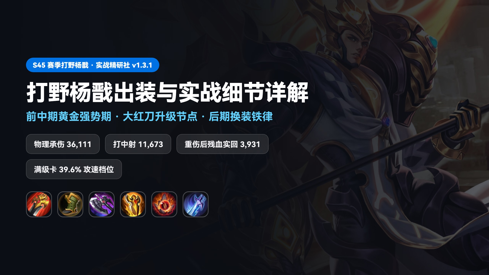
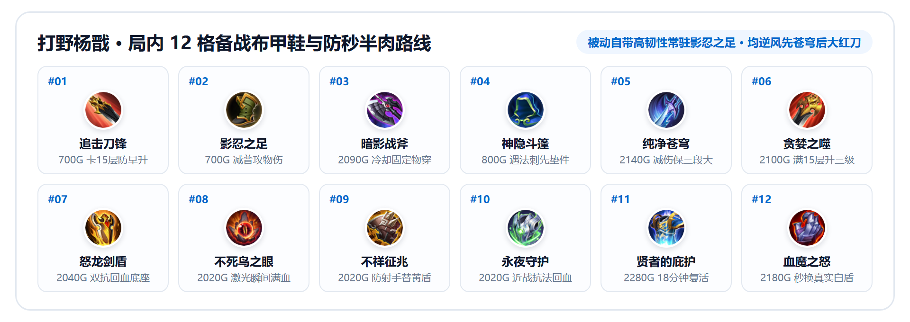

# 王者荣耀 S45 赛季打野杨戬 · 布甲鞋九秒法天象地与六套动态出装（完整真值数据版）

> **版本基线**：S45 正式服（`config/items_ground_truth.json` / `config/hero_skills_data.json` / `config/hero_base_stats.py` / `config/hero_arcana_data.py` 本地真值核验）
> **核心结论**：杨戬满级裸装生命 7,623、物攻 333、双抗 409/173，被动【法天象地】叠满自带 60%~90% 动态韧性、霸体击退与 +600 最大生命（解放影忍之足），二技能命中高血比目标翻倍 1 秒眩晕并开启 5 秒真伤普攻，三段大招穿兵群吸配不死鸟瞬间满血。本文基于本地真值拆解布甲鞋收益、淘汰 173 法防纯攻套的实测账本、六套满装与跳板刷狗节奏。

---

## PART 01 · 裸装基线与法天象地、真伤激光等级成长真值

**Lv1→15 裸装面板、60%~90% 动态韧性解放布甲鞋、15% 已损生命斩杀狗与三段激光回血**

- 裸装基线与被动【法天象地】韧性规则：杨戬 Lv1→Lv15 裸装生命 3,407→7,623，物攻 170→333，物防 150→409，法防 75→173，移速 380，攻速成长 +1.0%。普攻与技能造成伤害积攒 60%~90% 韧性（随大招等级成长），叠满进入临界霸体并与英雄交战触发法天象地（击退周围敌人、强化技能射程并增加 600 最大生命）；技能命中还叠最多 3 层天眼激光（每发 80~160 + 25%额外物攻并回血）。因被动自带高韧性且非霸体期外源韧性上限为 25%，省下抵抗鞋常驻影忍之足（减 6%~12% 普攻物伤）性价比显著更高。
- 一技能【逆转乾坤】（CD 7.5s→6s）跳板刷新与斩杀：一段哮天犬造成 200~400（+60%额外物攻）物伤并显形 5 秒（空放靠近狗可返还 25%~50% 当前冷却）；二段冲锋造成 300~600（+90%额外物攻）物伤并附加目标 15% 已损生命物理伤害，标记期间目标死亡立即刷新一技能冷却。抓边优先咬残血小兵/野怪击杀秒刷一技能做两段跳板贴脸。
- 二技能【虚妄破灭】（CD 10s→8s）条件眩晕与 5 秒真伤：横扫造成 350~700（+100%额外物攻）物伤与 15%~30% 减速，造成 0.5 秒眩晕（若目标生命百分比高于杨戬则翻倍为 1.0 秒眩晕），命中后 5 秒内普攻附带 125~250（+36%额外物攻）真实伤害。
- 三技能【根源之目】（CD 35s / 31.5s / 28s）三段激光群吸：释放 3 次激光，每道造成 340~680（+110%额外物攻）物伤并回复 300 / 450 / 600（+4.5%额外生命）点生命（非英雄减半，第三道发出 3 道激光）；要完整打满三段回复而不被半途秒杀，出装必须绑定纯净苍穹减伤与不死鸟之眼放大回复。

---

## PART 02 · 鞋子选型与防装池同级实测对比

**红刀布甲鞋黑切穿甲底座、为什么淘汰 173 法防纯攻套，以及不祥/碎星锤/永夜/魔女取舍**

- 核心三件套与淘汰纯攻破军套的数据依据：前中期以『贪婪之噬 + 影忍之足 + 暗影战斧』建立秒后排斩杀线；若中后期盲目照搬『攻速鞋+苍穹+破军+冰矛』纯攻流，满级法防仅 173（法抗仅 14,246），第一段激光刚抬手就会被中单秒杀。将后三件锁定为『纯净苍穹 + 怒龙剑盾 + 不死鸟之眼』（方案①），满级仍有 10,087 秒脆皮爆发，同时物理抗伤达 33,278、法术抗伤达 23,536。
- 对策单件模块化切换：敌方站桩射手成型将黄盾换不祥征兆（方案②，1,049 物防削减 40% 攻速）；己方控蓝肉搏将苍穹换血魔之怒撑至 11,673 血（方案③）；顺风破双前排重坦保留黄盾与苍穹补碎星锤（方案④，打坦净伤提至 6,533）；遇近身法刺与电刀射叠永夜+不死鸟（方案⑤，733 法防配 6,585 团战回血）；遇干将/沈梦溪远程消耗换魔女斗篷（方案⑥，法抗 27,764）。

### 表1：打野杨戬鞋子与核心防装同级实测对比表（含30铭文折算）

| 对比维度与阶段 | 方案 A（机制契合首选） | 方案 B（常规/高危对照） | 实测关键差值与法天象地机制依据 |
| :--- | :--- | :--- | :--- |
| 9级鞋子选型 (3,490金/12层) | **影忍之足** + 黑切 物抗 12,581 / 法抗 9,674 | 抵抗之靴 + 黑切 物抗 11,270 / 法抗 10,394 | 杨戬普攻技能命中自带 60%~90% 动态韧性（非霸体期外源韧性上限 25%），常驻布甲鞋减普攻伤多扛 +1,311 物伤 |
| 15级淘汰脆皮破军 (容错底线对比) | **苍穹+黄盾+不死鸟** (方案①) 物抗 33,278 / 法抗 23,536 | 攻速鞋+苍穹+破军+冰矛 物抗 18,553 / 法抗 14,246 | 纯攻破军套仅 173 法防易在抬手瞬间融化；半肉底座物抗高 +14,725、法抗高 +9,290 稳打三段激光 |
| 15级防装对策池 (防射 vs 反法刺) | **不祥征兆** (方案②) 1,049物防 / 物抗 37,626 | **永夜+不死鸟** (方案⑤) 733法防 / 团战回血 6,671 | 遇站桩射手换不祥减 40% 攻速；遇近身爆发法刺叠永夜+不死鸟，受击回血接三段激光瞬间回满 |

---

## PART 03 · 六套实战满装与专属 30 铭文总属性账本

**狩猎百穿与半调和百穿两套攻速真伤铭文精算，及六套满装十维实测总表**

- 两套专属五级铭文精确总属性：① 苍穹主导的四套（方案①②④）配『9异变 1红月 10鹰眼 10狩猎』（总计 +27物攻 +96.4物穿 +11.6%攻速 +0.5%暴击 +10%移速），满级配合自身 14% 成长攻速共达 25.6% 攻速，二技能横扫后 5 秒内多砍出 1~2 刀真伤平 A；② 血手、永夜、魔女三套抗压流（方案③⑤⑥）配『9异变 1红月 10鹰眼 5狩猎 5调和』（总计 +27物攻 +96.4物穿 +200生命 +6.6%攻速 +0.5%暴击 +7.5%移速），多撑 200 基础生命放大护盾与回血基数。
- 六套满装全部通过双抗容错门禁：即便是最高穿透的方案④碎星锤流，也保留了怒龙剑盾与纯净苍穹守住 9,923 生命、809 物防与 373 法防（主动开启期间等效物抗超 26,300）。

### 表2：打野杨戬 S45 六套实战满装实测对比总表（15级25层含30铭文）

| 评估维度 | ① 苍穹黄盾底座 | ② 苍穹不祥防射 | ③ 黄盾血手万血 | ④ 苍穹碎星破甲 | ⑤ 黄盾永夜反刺 | ⑥ 苍穹魔女抗法 |
| :--- | :--- | :--- | :--- | :--- | :--- | :--- |
| 成装总价 | 11,090金 | 11,070金 | 11,130金 | 11,150金 | 10,970金 | 11,070金 |
| 核心第3~6件 | 黑切+苍穹+黄盾+不死鸟 | 黑切+苍穹+不死鸟+不祥 | 黑切+黄盾+血手+不死鸟 | 黑切+苍穹+碎星锤+黄盾 | 黑切+黄盾+永夜+不死鸟 | 黑切+苍穹+魔女+不死鸟 |
| 专属30铭文 | 9异变 1红月 10鹰眼 10狩 | 9异变 1红月 10鹰眼 10狩 | 9异变 1红月 10鹰眼 5狩 5调 | 9异变 1红月 10鹰眼 10狩 | 9异变 1红月 10鹰眼 5狩 5调 | 9异变 1红月 10鹰眼 5狩 5调 |
| 生命 / 物理攻击 | 10,573 / 685 | 10,673 / 685 | 11,673 / 680 | 9,923 / 775 | 11,673 / 605 | 10,773 / 685 |
| 物防 / 法防 | 899 / 553 | 1049 / 403 | 749 / 553 | 809 / 373 | 839 / 733 | 829 / 703 |
| 无蓝 / 拿蓝冷却 | 32.5% / 40% | 32.5% / 40% | 22.5% / 40% | 32.5% / 40% | 22.5% / 40% | 32.5% / 40% |
| 物理 / 法术抗伤 | 33,278 / 23,536 | 37,626 / 22,157 | 30,772 / 23,961 | 26,335 / 17,556 | 32,004 / 26,065 | 32,355 / 27,764 |
| 秒脆皮 / 打重坦 | 10,087 / 5,023 | 9,390 / 4,678 | 10,044 / 4,995 | 11,286 / 6,533 | 9,076 / 4,496 | 9,364 / 4,659 |
| 团战总回复量 | 5,012 | 4,904 | 5,355 | 2,925 | 6,671 | 4,935 |

### 六套实战方案逐套适用场景与优劣势拆解

- **方案 ① · 单双排常驻防集火底座 · 红刀·苍穹黄盾不死鸟流**（`11,090 金` ｜ `10,573血 ｜ 899物防 / 553法防 ｜ 32.5%冷却 ｜ 秒脆皮 10,087`）
  - **优势**：杨戬被动自带动态韧性，常驻布甲鞋减免普攻物伤并将法天象地延长至 9 秒；苍穹 30% 减伤配黄盾、不死鸟撑起 10,573 血与 553 法防，进场稳打三段大招回血。
  - **注意**：打超高护甲双前排时穿透略逊于方案④碎星锤流。
  - **适用对局**：单双排常规均衡局、敌方有定点爆发需先手切入吸收火力的对局。
- **方案 ② · 多普攻射手/风筝拉扯针对 · 红刀·苍穹不祥不死鸟流**（`11,070 金` ｜ `10,673血 ｜ 1049物防 / 403法防 ｜ 32.5%冷却 ｜ 秒脆皮 9,390`）
  - **优势**：不祥征兆受击削减最高 40% 攻速与 15% 移速，配合布甲鞋与苍穹将物理抗伤推至 37,905，贴脸克制站桩与攻速型射手。
  - **注意**：相比黄盾少了野怪百分比被动伤害。
  - **适用对局**：敌方后羿、伽罗、鲁班、莱西奥等普攻射手发育成型的对局。
- **方案 ③ · 控蓝肉搏万血拉扯底座 · 红刀·黄盾血手不死鸟流**（`11,130 金` ｜ `11,673血 ｜ 749物防 / 553法防 ｜ 22.5%冷却 ｜ 秒脆皮 10,044`）
  - **优势**：黄盾 + 血手 + 不死鸟将血量撑至 11,673，残血开血手 4,669 白盾期间安心打满大招激光配不死鸟残血增疗直接回满。
  - **注意**：无蓝冷却为 22.5%，适合能控蓝 Buff 的肉搏局。
  - **适用对局**：己方稳定控蓝、敌方多战坦近身肉搏持续拉扯的对局。
- **方案 ④ · 顺风推进/双前排重坦破甲 · 红刀·苍穹碎星锤黄盾流**（`11,150 金` ｜ `9,923血 ｜ 809物防 / 373法防 ｜ 32.5%冷却 ｜ 秒脆皮 11,286`）
  - **优势**：保留黄盾与苍穹守住 9,923 血与 373 法防容错底线，补碎星锤 +30% 物穿将秒脆皮推至 11,286、打重坦推至 6,533。
  - **注意**：舍弃了不死鸟增疗，切入需捏准苍穹开启时机。
  - **适用对局**：顺风压高地推进、敌方双前排重坦早做不祥与冰心的对局。
- **方案 ⑤ · 爆发法刺/电刀混伤针对 · 红刀·黄盾永夜不死鸟流**（`10,970 金` ｜ `11,673血 ｜ 839物防 / 733法防 ｜ 22.5%冷却 ｜ 秒脆皮 9,076`）
  - **优势**：11,673 血配永夜 + 不死鸟双魔抗（733 法防，团战回血达 6,585），受法刺瞬爆超 25% 生命自动触发永夜回血再接大招反打。
  - **注意**：机动冷却略低于苍穹流。
  - **适用对局**：敌方诸葛亮、司马懿、露娜、火舞等近身爆发法刺与电刀混伤局。
- **方案 ⑥ · 均逆风高压/双长手法核消耗 · 红刀·苍穹魔女不死鸟流**（`11,070 金` ｜ `10,773血 ｜ 829物防 / 703法防 ｜ 32.5%冷却 ｜ 秒脆皮 9,364`）
  - **优势**：苍穹 30% 主动减伤 + 魔女脱战法盾 + 不死鸟（法术抗伤 27,320，无蓝 32.5% 冷却），有效抵御远程双法核消耗并防止重伤压血。
  - **注意**：清大龙速度略慢于黄盾流。
  - **适用对局**：己方均逆风，或敌方干将莫邪、沈梦溪、女娲等长手法核高频消耗局。

---

## PART 04 · 杨戬专属打法思路、分期预算分水岭与 75 秒原格轮换

**残血兵野跳板刷狗、控血比打 1 秒真伤眩晕、斜穿兵线大招群吸与 11 级先合苍穹**

- 专属核心打法思路（跳板收割与控血反打）：① 拒绝远距离裸放一技能赌命中——团战与抓边优先拿敌方前排旁边的残血小兵或野怪当跳板，一段咬接二段收掉残血秒刷一技能，再贴脸挂后排；② 故意控血线触发 1 秒长眩晕——满血被消耗一小格血后不要急着吸小怪回满，保持自身生命百分比略低于敌方后排，二技能横扫即可稳定打出翻倍 1.0 秒真伤眩晕；③ 三段大招斜向瞄准『敌方英雄 + 兵线/野怪』重合直线释放，配合不死鸟瞬间抬满血条，叠满被动进入法天象地霸体期时主动顶前排压位置。
- 备战预设与 11 级 1,400 金分水岭：备战第 1 格设追击刀锋，前 5 分钟做完小红刀+布甲鞋+黑切；因穿布甲鞋无魔抗，4~6 分钟若见敌方法刺早起先花 800 金垫神隐斗篷（法抗立涨 +2,143）。出完黑切后顺风满 15 层升贪婪之噬，均逆风或团战频繁时停在 15 层小红刀先合纯净苍穹（5,630 金即拿 30% 主动减伤）。
- 18 分钟主动装备原格轮换：纯净苍穹或血魔之怒按下打完这波团进入 75 秒冷却期间，直接原格秒换复活甲 → 倒地换名刀·司命，全程不留主动冷却空窗。

### 表3：打野杨戬前中后期（Lv9 / Lv11 / Lv12 / 18分钟）预算分水岭实测表

| 阶段与经济预算 | 针对变序方案 | 顺风常序对照 | 实测抗伤差值与局内实战要点 |
| :--- | :--- | :--- | :--- |
| Lv9 法刺起飞过渡 (4,290金/12层) | **小红刀+布甲鞋+黑切+神隐** 法抗 11,817 / 物抗 13,391 | 小红刀+布甲鞋+黑切 (3,490金) 法抗 9,674 / 物抗 12,581 | 因常驻布甲鞋前期法防偏低，遇法刺独肥花 800 金垫神隐斗篷可立涨 +2,143 法抗 |
| Lv11 野刀分水岭 (约5,630金/15层) | **停小红刀先合纯净苍穹** (5,630金) 物抗 17,426 / 秒C 8,000 | 先升大红刀+护手 (5,640金) 物抗 14,895 / 秒C 7,963 | 同预算先拿苍穹 30% 主动减伤，物理抗伤高出 +2,531、法抗高 +1,696 |
| Lv12 第5件选型 (约9,100~9,500金) | **补怒龙剑盾** (9,070金) 物抗 23,873 / 法抗 16,183 | 硬憋破军 (9,570金) 物抗 18,895 / 法抗 12,618 | 先做黄盾省 500 金且物抗高 +4,978、法抗高 +3,565，杜绝顺风掉点 |

