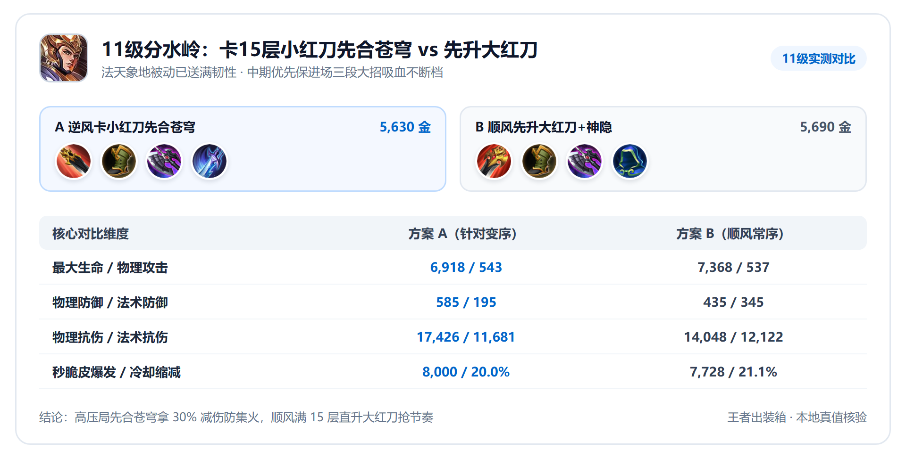

# 王者荣耀 S45 赛季打野杨戬 · 布甲鞋九秒法天象地与六套动态出装

> **版本基线**：S45 正式服（`config/items_ground_truth.json` / `config/hero_skills_data.json` / `config/hero_arcana_data.py` 本地真值核验）
> **核心结论**：杨戬被动【神智侵蚀】受伤叠满直接提供高额韧性并进入法天象地霸体状态，无需绑定抵抗之靴，常驻影忍之足可减免 6%~12% 普攻物伤并延长变身拉扯窗口；二技能破防真伤与三段大招高额激光吸血要求兼顾穿透、冷却与双抗容错，通过苍穹、黄盾、不死鸟构建进得去出得来的六套满装。

---

## PART 01 · 核心机制与连招细节（被动韧性 / 存狗收割 / 三段大招回血）

**被动自带韧性解放布甲鞋、二技能条件眩晕真伤、三段大招穿兵群吸与攻速手感**

- 被动自带韧性与布甲鞋联动：杨戬被动叠满自带高额韧性与法天象地开天眼强化，省下抵抗鞋常驻影忍之足（减少 6%~12% 物理普攻伤害），物理抗压显著更稳。
- 哮天犬刷新与二技能真伤：一技能击败目标立即刷新冷却，抓边可先咬残血兵/野怪做跳板贴脸；二技能命中生命百分比高于或等于自身的目标造成真实伤害与更长晕眩，连招中穿插 9异变1红月 10狩猎（满级 25.6% 攻速）平A刀刀附带真伤。
- 三段大招激光回复伏笔：三技能三段激光命中多个目标（含兵线野怪）回复效率翻倍，因此必须具备苍穹减伤与不死鸟增疗，防止第一段激光刚抬手就被集火融化。

---

## PART 02 · 主流单件取舍推导与六套容错满装（兼顾输出与双抗容错）

**红刀黑切穿甲底座、苍穹vs血手分工、不祥/碎星锤/永夜/魔女六套阵容落位**

- 核心底座与防装池取舍：红刀 + 布甲鞋 + 黑切提供前期秒脆皮斩杀线；第 4~6 件常驻苍穹（30%主动减伤）+ 黄盾（双抗控龙）+ 不死鸟（放大三段大招回复，满级 553 法防）。
- 针对敌方阵容六套切换：遇站桩攻速射换不祥征兆（物抗 37,905）；己方控蓝肉搏换血手万血拉扯；顺风遇双前排重坦保留黄盾+苍穹补碎星锤（打坦净伤 6,533）；遇近身法刺叠永夜+不死鸟（团战回血 6,585）；遇长手双法核换魔女护盾防重伤消耗。

### 六套实战满装与专属铭文速查（全量通过容错门禁）

| 方案与定位 | 口语六件套 | 专属 30 枚铭文 | 满级关键指标 | 针对阵容与取舍逻辑 |
| :--- | :--- | :--- | :--- | :--- |
| **方案 ① · 单双排常驻防集火底座** 红刀·苍穹黄盾不死鸟流 | 红刀 + 布甲鞋 + 黑切 + 苍穹 + 黄盾 + 不死鸟 | 9异变 1红月 10鹰眼 10狩猎 | 10,573血 ｜ 899物防 / 553法防 ｜ 32.5%冷却 ｜ 秒脆皮 10,087 | 单双排常规均衡局、敌方有定点爆发需先手切入吸收火力的对局。 杨戬被动自带动态韧性，常驻布甲鞋减免普攻物伤并将法天象地延长至 9 秒；苍穹 30% 减伤配黄盾、不死鸟撑起 10,573 血与 553 法防，进场稳打三段大招回血。 |
| **方案 ② · 多普攻射手/风筝拉扯针对** 红刀·苍穹不祥不死鸟流 | 红刀 + 布甲鞋 + 黑切 + 苍穹 + 不死鸟 + 不祥 | 9异变 1红月 10鹰眼 10狩猎 | 10,673血 ｜ 1049物防 / 403法防 ｜ 32.5%冷却 ｜ 秒脆皮 9,390 | 敌方后羿、伽罗、鲁班、莱西奥等普攻射手发育成型的对局。 不祥征兆受击削减最高 40% 攻速与 15% 移速，配合布甲鞋与苍穹将物理抗伤推至 37,905，贴脸克制站桩与攻速型射手。 |
| **方案 ③ · 控蓝肉搏万血拉扯底座** 红刀·黄盾血手不死鸟流 | 红刀 + 布甲鞋 + 黑切 + 黄盾 + 血手 + 不死鸟 | 9异变 1红月 10鹰眼 5狩猎 5调和 | 11,673血 ｜ 749物防 / 553法防 ｜ 22.5%冷却 ｜ 秒脆皮 10,044 | 己方稳定控蓝、敌方多战坦近身肉搏持续拉扯的对局。 黄盾 + 血手 + 不死鸟将血量撑至 11,673，残血开血手 4,669 白盾期间安心打满大招激光配不死鸟残血增疗直接回满。 |
| **方案 ④ · 顺风推进/双前排重坦破甲** 红刀·苍穹碎星锤黄盾流 | 红刀 + 布甲鞋 + 黑切 + 苍穹 + 碎星锤 + 黄盾 | 9异变 1红月 10鹰眼 10狩猎 | 9,923血 ｜ 809物防 / 373法防 ｜ 32.5%冷却 ｜ 秒脆皮 11,286 | 顺风压高地推进、敌方双前排重坦早做不祥与冰心的对局。 保留黄盾与苍穹守住 9,923 血与 373 法防容错底线，补碎星锤 +30% 物穿将秒脆皮推至 11,286、打重坦推至 6,533。 |
| **方案 ⑤ · 爆发法刺/电刀混伤针对** 红刀·黄盾永夜不死鸟流 | 红刀 + 布甲鞋 + 黑切 + 黄盾 + 永夜 + 不死鸟 | 9异变 1红月 10鹰眼 5狩猎 5调和 | 11,673血 ｜ 839物防 / 733法防 ｜ 22.5%冷却 ｜ 秒脆皮 9,076 | 敌方诸葛亮、司马懿、露娜、火舞等近身爆发法刺与电刀混伤局。 11,673 血配永夜 + 不死鸟双魔抗（733 法防，团战回血达 6,585），受法刺瞬爆超 25% 生命自动触发永夜回血再接大招反打。 |
| **方案 ⑥ · 均逆风高压/双长手法核消耗** 红刀·苍穹魔女不死鸟流 | 红刀 + 布甲鞋 + 黑切 + 苍穹 + 魔女 + 不死鸟 | 9异变 1红月 10鹰眼 5狩猎 5调和 | 10,773血 ｜ 829物防 / 703法防 ｜ 32.5%冷却 ｜ 秒脆皮 9,364 | 己方均逆风，或敌方干将莫邪、沈梦溪、女娲等长手法核高频消耗局。 苍穹 30% 主动减伤 + 魔女脱战法盾 + 不死鸟（法术抗伤 27,320，无蓝 32.5% 冷却），有效抵御远程双法核消耗并防止重伤压血。 |

---

## PART 03 · 杨戬专属打法思路、1,400金分水岭与主动轮换

**残血兵野跳板刷狗、控血线打真伤眩晕、三段激光穿兵群吸与75秒原格轮换**

- 专属核心打法思路（跳板收割与激光反打）：① 抓边或团战切后别直接裸放远距离一技能防走位躲开，优先咬残血小兵/野怪击杀秒刷一技能做两段跳板近身；② 故意卖少量血让敌方生命百分比高于自身，确保二技能横扫必出长眩晕并激活刀刀真伤；③ 三段大招激光尽量斜向瞄准『敌方英雄+兵线/野怪』重合直线释放，配合不死鸟瞬间吸满残血，叠满被动进入法天象地霸体期时主动顶前排压位置。
- 备战卡小红刀与 1,400 金分水岭：备战第 1 格设追击刀锋，前 5 分钟做完小红刀+布甲鞋+黑切；顺风满 15 层升贪婪之噬，均逆风或敌方爆发成型快时卡 15 层小红刀先合纯净苍穹（拿 30% 主动减伤防第一段激光抬手被秒）或垫 800 金神隐。
- 18 分钟主动装备原格轮换：苍穹或血手按下进入 75 秒冷却期间，直接原格秒换复活甲 → 名刀，零经济空窗打满残局收割。

