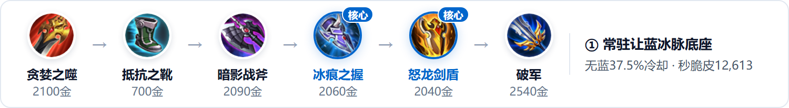
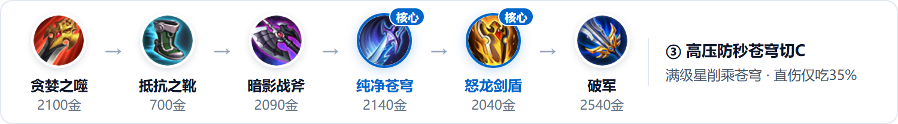
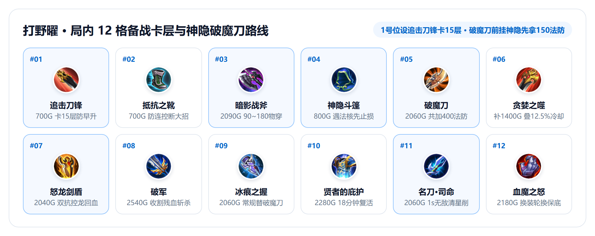

# 王者荣耀 S45 赛季打野曜 · 红刀黑切底座与六套动态出装（完整真值数据版）

> **版本基线**：S45 正式服（`config/items_ground_truth.json` / `config/hero_skills_data.json` / `config/hero_base_stats.py` / `config/hero_arcana_data.py` 本地真值核验）
> **核心结论**：曜满级裸装生命 6,976、物攻 331、双抗 395/166（自带 5% 初始攻速与每级 +1.5% 成长），三技能星削比例随 4/8/12 级按 25%/37.5%/50% 成长，且满层红刀（12.5%）+ 黑切（10%）+ 破军（5%）自带 27.5% 冷却。本文基于本地真值给出五大机制成长公式、第 4 件冰脉/暴烈/苍穹/破魔刀/魔女横向实测表、六套十维满装与 221A3 侧面拉扯分期节奏。

---

## PART 01 · 裸装基线与五大核心机制等级成长真值

**Lv1→15 裸装面板、空放减半回血、双弧交汇击飞、蹲草双大法伤与星削 25%→50% 成长**

- 裸装面板与被动【星辰之赐】回血公式：曜 Lv1→Lv15 裸装生命 3,304→6,976，物攻 163→331，物防 150→395，法防 75→166，基础移速 380。每次放技能攒 1 格星，满 3 格解锁 3 秒强化技与冲砍强普（额外造成 80~160 + 27%物攻伤害，开启头像锁敌或隔墙点野怪可直接穿厚墙）；技能命中敌方单位回复 70~140（+2%额外生命）点生命，空放未命中回复减半，强化一技能双段命中连回两次（15 级带黑切+黄盾共 +1,600 额外生命时，空放回 86、命中单段回 172、强化一双段回 344）。
- 一技能【裂空斩】（CD 6s→5s）与二技能【逐星】（CD 7.5s→6s）交汇判定：一技能每段造成 340~680（+115%额外物攻）物伤，强化一双段同时命中增加 40%~80% 攻速；二技能造成 180~360（+70%额外物攻）物伤与 25%~50% 减速（1.5秒），注意强化二技能左右双弧仅在终点交汇处同时命中才触发 0.75 秒击飞——贴脸正放易擦肩空控，近身直接转 11A 更稳；2 格星起手打 221A3 无伤消耗，按 3 退回 650 距离内原点后手里刚好重攒满 3 格星。
- 三技能【归尘】（CD 12.5s / 11.25s / 10s）法伤倍率与星削等级成长：大招回到 2 秒前位置（最远 650 距离），清除星削并对路径与终点造成 420 / 630 / 840（+140%额外物攻）法术伤害，强化大招两段同时命中减速 25%/37.5%/50%（存 2 星蹲草站定 2 秒等脚底箭头重合打 33A21A1A，15 级满装仅两段归尘法伤跳字即达 3,480，无视敌方高物防）。关键易错点：被动星削转化比例随大招 1/2/3 级（英雄 4/8/12 级）按 25% / 37.5% / 50% 成长，12 级点满大招才享 50% 星削；每次星削跳血判定为独立受击，约 0.5 秒自动续满暴烈之甲 10 层增伤移速；残血回城前务必先按大招清星削防跳血打断。
- S45 无蓝 37.5% 冷却账本（防极寒风暴溢出）：满层贪婪之噬（12.5%）+ 暗影战斧（10%）+ 破军（5%）合计已达 27.5% 冷却；若再出极寒风暴（+20%冷却）会飙至 47.5% 溢出上限且 0 物理攻击。因此单双排让蓝局补冰痕之握（10%冷却）或纯净苍穹（10%冷却）刚好卡准 37.5% 冷却，稳定控蓝局换暴烈之甲则拿蓝满 40% 零属性浪费。

---

## PART 02 · 同槽位竞争单件实测对比（冷却防装与魔抗池取舍）

**冰脉 vs 暴烈 vs 苍穹适用边界，以及为什么法防优先破魔刀/魔女而非永夜守护**

- 常驻怒龙剑盾（黄盾）双抗闭环：曜所有技能高吃额外物攻，但若走纯输出装 15 级裸法防仅 266（抵抗鞋 100 + 基础 166），吃中单一套不明 AOE 就会被直接灌穿星削；第 5 件常驻绑定怒龙剑盾（+1,100生命 +150物防 +150法防），既把法防稳抬至 416 以上放大被动百分比回血，又显著提速中后期单刷主宰暴君。
- 破魔刀 vs 魔女斗篷 vs 永夜守护实测取舍：曜带红刀黑切后总物攻轻松突破 500 点，可直接吃满破魔刀被动 250 法防上限（连同基础 150 共加 400 法防，还多 +90 物攻），12 级同预算下破魔刀秒脆皮达 8,588（比出魔女高 +864），是均顺风突脸反杀诸葛亮/露娜/火舞/电刀射的首选；遇干将、沈梦溪长手双法核消耗或逆风守高地时选魔女斗篷（脱战法盾吸收消耗不产生星削掉血）；而永夜守护需 2.5 秒扣满 25% 生命才触发，受 50% 星削拆半与曜进出拉扯影响触发不稳定，故优先级低于破魔刀与魔女。

### 表1：打野曜第 4 件防装与魔抗选型同级实测对比表（含30铭文折算）

| 对比维度与阶段 | 方案 A | 方案 B | 实测关键差值与星削机制咬合点 |
| :--- | :--- | :--- | :--- |
| 15级冷却防装选型 (无蓝 vs 控蓝) | **冰痕之握** (2,060金) 无蓝 37.5%冷却 / 物抗 23,432 | **暴烈之甲** (2,050金) 无蓝 27.5%冷却 / 物抗 24,781 | 红刀+黑切+破军自带 27.5% 冷却：让蓝补冰脉凑准 37.5% 冷却防极寒溢出；控蓝换暴烈由星削跳血 0.5s 续满 10% 增伤移速 |
| 12级法刺超神反杀 (约6,950金/18层) | **破魔刀** (646法防) 法抗 18,273 / 秒C 8,588 | 魔女斗篷 (546法防) 法抗 19,649 / 秒C 7,724 | 500+ 总物攻吃满破魔刀 250 被动（共+400法防），秒脆皮爆发比魔女高 +864；远程消耗多则选魔女法盾 |
| 12级魔抗避坑对比 (星削拆伤判定) | **破魔刀 / 魔女斗篷** 法抗 18,273 ~ 19,649 | 永夜守护 (426法防) 法抗 16,760 / 秒C 7,813 | 满级大招将 50% 伤害拆成星削缓扣且曜打 221A3 进出拉扯，实战较难在 2.5s 扣满 25% 真血稳定触发永夜 |
| 15级双前排破甲 (容错门禁对比) | **保留黄盾 + 碎星锤** 打坦 7,147 / 416法防 | 舍弃黄盾纯输出套 法防仅 266（易被AOE秒杀） | 碎星锤叠 280 固定物穿 + 30% 物穿将打重坦推至 7,147 最高，同时保留黄盾守住 9,276 血与 416 法防底线 |

---

## PART 03 · 六套实战满装与专属 30 铭文总属性账本

**隐匿百穿与卡攻速百穿两套铭文精算，及六套实战满装十维对比**

- 两套专属五级铭文精确总属性：① 冰脉、苍穹、逆风与碎星锤四套配『10异变 10鹰眼 10隐匿』（总计 +45物攻 +100物穿 +10%移速），最大化一技能（115%额外物攻）与归尘双大（140%额外物攻）爆发；② 暴烈与破魔刀两套配『9异变 1红月 10鹰眼 7隐匿 3狩猎』（总计 +38.2物攻 +96.4物穿 +4.6%攻速 +0.5%暴击 +10%移速），配合自身 5% 初始攻速顺滑卡出强化普攻冲砍收招手感。
- 六套阵容切换逻辑：默认单双排让蓝选方案①冰脉底座（秒脆皮 12,613）；全程控蓝正面拉扯选方案②暴烈底座（9,576 血）；防孙尚香/娜可露露定点瞬爆选方案③苍穹（50%星削乘算 30% 减伤，当场直伤仅吃 35%）；法刺与电刀混伤选方案④破魔刀（816 法防）；大逆风舍弃破军转方案⑤苍穹+魔女+黄盾（双抗抗伤均超 29,000）；顺风遇双前排重坦选方案⑥补碎星锤（打坦净伤 7,147）。

### 表2：打野曜 S45 六套实战满装实测对比总表（15级25层含30铭文）

| 评估维度 | ① 冰脉黄盾底座 | ② 暴烈黄盾底座 | ③ 苍穹防秒切后 | ④ 破魔刀反杀流 | ⑤ 逆风苍穹魔女 | ⑥ 顺风重坦破甲 |
| :--- | :--- | :--- | :--- | :--- | :--- | :--- |
| 成装总价 | 11,530金 | 11,520金 | 11,610金 | 11,530金 | 11,090金 | 11,550金 |
| 核心第3~6件 | 黑切+冰脉+黄盾+破军 | 黑切+暴烈+黄盾+破军 | 黑切+苍穹+黄盾+破军 | 黑切+破魔刀+黄盾+破军 | 黑切+苍穹+魔女+黄盾 | 黑切+黄盾+破军+碎星锤 |
| 专属30铭文 | 10异变 10鹰眼 10隐匿 | 9异变 1红月 10鹰眼 7隐 3狩 | 10异变 10鹰眼 10隐匿 | 9异变 1红月 10鹰眼 7隐 3狩 | 10异变 10鹰眼 10隐匿 | 10异变 10鹰眼 10隐匿 |
| 生命 / 物理攻击 | 8,576 / 826 | 9,576 / 799 | 8,576 / 851 | 9,276 / 854 | 9,676 / 701 | 9,276 / 861 |
| 物防 / 法防 | 895 / 416 | 805 / 416 | 745 / 416 | 595 / 816 | 827 / 716 | 595 / 416 |
| 无蓝 / 拿蓝冷却 | 37.5% / 40% | 27.5% / 40% | 37.5% / 40% | 27.5% / 40% | 32.5% / 40% | 27.5% / 40% |
| 物理 / 法术抗伤 | 23,432 / 17,029 | 24,781 / 19,061 | 24,751 / 19,809 | 20,822 / 23,452 | 29,577 / 29,167 | 20,822 / 18,540 |
| 秒脆皮 / 打重坦 | 12,613 / 6,439 | 12,501 / 6,449 | 11,766 / 6,049 | 11,836 / 6,095 | 9,060 / 4,656 | 12,369 / 7,147 |
| 团战总回复量 | 579 | 646 | 579 | 626 | 652 | 626 |

### 六套实战方案逐套适用场景与优劣势拆解

- **方案 ① · 单双排让蓝常驻底座 (重坦转方案⑥) · 红刀·冰脉黄盾破军流**（`11,530 金` ｜ `8,576血 ｜ 895物防 / 416法防 ｜ 37.5%冷却 ｜ 秒脆皮 12,613`）
  - **优势**：无蓝 Buff 常驻 37.5% 冷却（满级 1/3 技能仅 3.12s/6.25s），冰痕之握强普 0.5 秒范围减速留人配怒龙剑盾刷野控龙回血；遇双前排重坦可保留黄盾将冰脉换碎星锤（打坦净伤提至 7,147 且保住 416 法防）。
  - **注意**：15 级法防 416 属均衡配置，遇超神法刺或电刀射手需将第 4 件换为破魔刀。
  - **适用对局**：单双排中单需拿蓝 Buff、敌方物法均衡的绝大多数常规对局。
- **方案 ② · 稳定控蓝多轮拉扯底座 · 红刀·暴烈黄盾破军流**（`11,520 金` ｜ `9,576血 ｜ 805物防 / 416法防 ｜ 27.5%冷却 ｜ 秒脆皮 12,501`）
  - **优势**：受击转星削分段跳血约 0.5 秒自动叠满暴烈之甲 10 层被动（+10% 伤害与 +10% 移速，同步放大归尘法伤），拿蓝 Buff 恰好打满 40% 冷却零溢出，9,576 高血量拉扯容错稳。
  - **注意**：断蓝期冷却为 27.5%，让蓝局技能衔接略慢于冰脉或苍穹流。
  - **适用对局**：打野可稳定控蓝 Buff、需要高频进出拉扯敌方战坦前排的对局。
- **方案 ③ · 高压集火防秒切C · 红刀·苍穹黄盾破军流**（`11,610 金` ｜ `8,576血 ｜ 745物防 / 416法防 ｜ 37.5%冷却 ｜ 秒脆皮 11,766`）
  - **优势**：12 级点满大招（50% 星削）后开启苍穹主动 30% 减伤，当场直扣血条伤害仅剩 35%，确保顶着集火按出大招清星削反打，平时同享 37.5% 无蓝准满冷却。
  - **注意**：主动驱散有 75 秒冷却真空期，切入有闪现射手前仍需先用 221A3 骗出位移。
  - **适用对局**：敌方有孙尚香、干将莫邪、娜可露露、铠等高瞬间定点爆发的对局。
- **方案 ④ · 法刺超神/电刀混伤反杀 · 红刀·破魔刀黄盾破军流**（`11,530 金` ｜ `9,276血 ｜ 595物防 / 816法防 ｜ 27.5%冷却 ｜ 秒脆皮 11,836`）
  - **优势**：500 总物攻直接吃满破魔刀被动 250 法防上限（连同基础 150 共加 400 法防），12 级总法防即达 646 且秒脆皮比出魔女高 +864，配合怒龙剑盾保住 595 物防扛射手普攻。
  - **注意**：缺少冰脉强普减速，抓单需卡准强化 2 技能双弧交汇点留人。
  - **适用对局**：敌方诸葛亮、露娜、不知火舞、司马懿提前起飞，或狄仁杰/后羿出闪电匕首混伤的对局。
- **方案 ⑤ · 逆风高压/双法核弃破军拉扯 · 红刀·苍穹魔女黄盾双抗流**（`11,090 金` ｜ `9,676血 ｜ 827物防 / 716法防 ｜ 32.5%冷却 ｜ 秒脆皮 9,060`）
  - **优势**：逆风果断舍弃 2,540 金合成断档长的破军，魔女脱战法盾吸收消耗不触发星削掉血，配合苍穹减伤与归尘清星削在团战打出两到三套技能翻盘。
  - **注意**：满级秒脆皮降至 9,060，不再追求单套满血瞬秒，主打骗技能与残局收割。
  - **适用对局**：己方逆风野区受压、缺前排吃技能，或敌方干将+沈梦溪长手高频消耗局。
- **方案 ⑥ · 顺风推进/双前排破甲攻坚 · 红刀·黄盾破军碎星锤流**（`11,550 金` ｜ `9,276血 ｜ 595物防 / 416法防 ｜ 27.5%冷却 ｜ 秒脆皮 12,369`）
  - **优势**：280 固定物穿叠加碎星锤 +30% 物理穿透与 +7.5% 移速（527 战斗移速），打重坦净伤提至 7,147（六套最高）且秒脆皮达 12,369；保留怒龙剑盾撑起 9,276 生命与 416 法防保住容错底线。
  - **注意**：无蓝冷却为 27.5%，且少了冰脉强普减速，适合己方有前排留人或能拿蓝推进的对局。
  - **适用对局**：顺风压高地推进、敌方双前排重坦早做不祥征兆与极寒风暴的对局。

---

## PART 04 · 曜专属拉扯打法思路、分期预算分水岭与名刀清星削

**发育拉经济差、团前 221A3 侧面骗技能、11级省 1,400 金分水岭与 1.0 秒名刀锁星削**

- 专属核心打法思路（发育拉扯型战刺）：① 前中期高效连刷保经济差——曜高吃额外物攻且 12 级点满大招才迎来 50% 星削质变，前中期以野区连刷+顺路补边线拉开经济等级为主，拒绝低等级盲目越塔硬换；② 团战严禁满星正面硬冲满技能后排——排位射手手里捏着闪现与辅助控制，先存两格星从侧面打 221A3 无伤消耗逼出位移或闪现，落回原点重攒满三星后第二波蹲草或绕后完成收割；③ 逆风牵制——多用强化大招高法伤断兵线，被包夹时开锁敌借野怪冲砍穿厚墙脱身。
- 备战预设与 5 分钟查面板分流：备战第 1 格设二级追击刀锋防自动吃掉 1,400 金，出破魔刀方案时前挂一件 800 金神隐斗篷（改默认先买风暴巨剑为先拿 150 法防止损）。5 分钟出完黑切点开面板必查敌方狄仁杰/后羿/鲁班/敖隐是否做闪电匕首；顺风满 15 层升大红刀，均逆风或法刺起飞则停在小红刀先合破魔刀或冰脉。
- 18 分钟保命换装联动：复活甲起身秒换名刀·司命——刚秒换买出的名刀无敌时长为 1.0 秒，无敌期内星削分段跳血同样锁 1 血不致死，赶在 1.0 秒结束前按出三技能清空星削回血反打，名刀进冷却后再轮换血魔之怒。

### 表3：打野曜局内关键节点（Lv10 / Lv11 / Lv12 / 18分钟）预算分水岭实测表

| 阶段与经济预算 | 针对变序方案 | 顺风常序对照 | 实测净差值与局内操作要点 |
| :--- | :--- | :--- | :--- |
| Lv11 法刺/电刀起飞 (约5,550金/15层) | **停小红刀+破魔刀** (5,550金) 法抗 16,059 / 秒C 7,484 | 先升大红刀+护手 (5,640金) 法抗 10,725 / 秒C 7,705 | 省 90 金直接成型破魔刀（640法防），法术抗伤暴涨 +5,334，同时保留 7,484 反杀爆发 |
| Lv11 物理刺客冲脸 (约5,550金/15层) | **停小红刀+冰痕之握** (5,550金) 物抗 14,887 / 秒C 7,884 | 先升大红刀+护手 (5,640金) 物抗 13,325 / 秒C 7,705 | 物理抗伤高出 +1,562，且提前拿到强普范围减速冰圈提升抓边留人率 |
| 18分钟保命换装 (残局清星削) | **复活甲 → 秒换名刀·司命** 1.0 秒无敌锁住星削跳血 | 名刀进冷却 → 换血魔之怒 撑起 40% 最大生命白盾 | 刚秒换买出的名刀无敌时长为 1.0 秒，无敌期内星削跳血锁 1 血不死，赶在结束前按大招清星削回血反打 |

