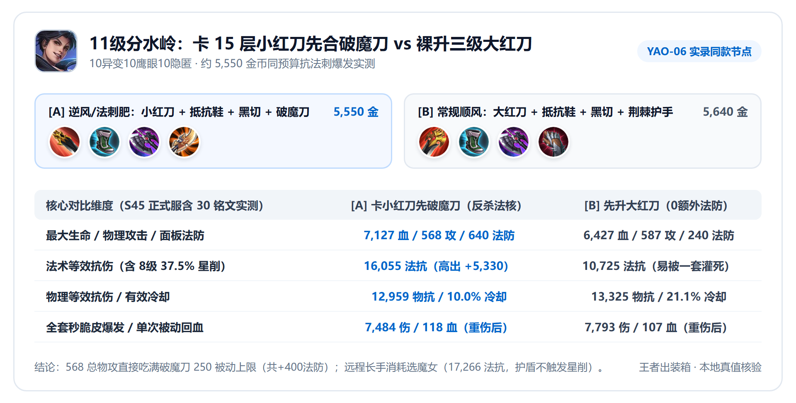
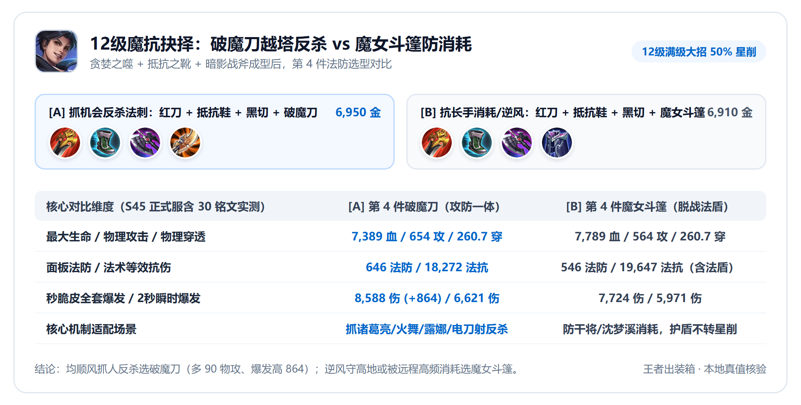

# 王者荣耀 S45 赛季打野曜深度攻略：技能等级真值、冷却精算与局内动态调装

> **版本基线**：S45 正式服（`config/items_ground_truth.json` / `config/hero_skills_data.json` / `config/hero_arcana_data.py` 本地真值核验）
> **核心结论**：S45 打野曜以「小红刀 + 鞋 + 黑切」起步，排位容错率取决于中后期的动态变序：5 分钟点面板查电刀与双修、黑切之后 1,400 金先升大红刀还是先合破魔刀/冰脉、顺风防独肥法核送终结、以及逆风舍弃破军转双抗拉扯。

---

## PART 01：决定出装取向的五大核心实战判定与技能等级成长真值

曜的生存与爆发绑定星辰周转、星削比例成长、法伤大招与额外 AD 倍率，多项核心数值随英雄或技能等级变化：

### 1. 空放技能减半回血 + 命中单位全额回复，满星锁敌穿厚墙
- **等级成长公式与实机验证**：被动【星辰之赐】在技能命中敌方单位时回复 **`70~140 (+2%额外生命)`** 点生命（基础值随英雄 `1~15级` 线性成长，1 级无额外生命时命中回 `70`、空放回 `35`），**未命中目标时回复效果减半**；强化 1 技能双段命中触发 2 次回复。在训练营 15 级带 `+1,600` 额外生命（黑切 `+500` + 黄盾 `+1,100`）实机中，河道空放一技能跳 **`+86`**，二技能刮中三猪单段跳双倍 **`+172`**（满星强化技双段命中回 `344`）。
- 残血撤退路过野区顺手刮三猪即可拉起血线；遇追杀开启头像锁敌或满 3 格星隔墙点野怪，强化普攻冲砍（额外造成 `80~160 + 27%物理攻击` 物伤）可直接穿过边路与龙坑厚墙。

### 2. 强化二技能仅在「双弧终点交汇处」击飞，`221A3` 回塔刚好满 3 星
- **实机验证**：二技能【逐星】（基础冷却 **`7.5 / 7.2 / 6.9 / 6.6 / 6.3 / 6秒`**）附带 **`25%~50%` 减速**（持续 `1.5秒`）；强化二技能左右两道弧光只有在**终点交汇处**同时命中才击飞 **`0.75秒`**。贴脸正放易擦肩空控，近身直接打 `11A`（一技能基础冷却 **`6 / 5.8 / 5.6 / 5.4 / 5.2 / 5秒`**，强化 1 命中增加 **`40%~80%` 攻速**，随技能 `1~6级` 成长）更稳。
- 2 格星起手打 `221A3` 无伤消耗时，强化二清空星辰后重计第 1 格，`1` 技能计第 2 格，按 `3` 退回 2 秒前原点（最远移动距离不超 **`650`**）刚好叠满 **3 格星**，骗出敌方位移或闪现后随时反打。

### 3. 蹲草存 2 星站定 2 秒：`33A21A1A` 瞬爆归尘纯法伤
- **实机验证**：三技能【归尘】（基础冷却 **`12.5 / 11.25 / 10秒`**，随 `4/8/12级` 递减）清除星削并对路径与终点造成 **`420 / 630 / 840 (+140%额外物攻)` 法术伤害**（强化 3 为 `420~840 + 140%物攻` 两段法伤，同时命中造成 **`25% / 37.5% / 50%` 减速**，持续 `2秒`）。
- 存 2 格星蹲草站定 `2` 秒，等脚底大招箭头压回自身重合，敌人进草瞬间打 `33A21A1A`（打无位移目标贴脸改 `33A121A` 更稳），15 级满装实机仅 `33` 归尘法伤跳字合计达 **`3,480`**（无视敌方布甲鞋与不祥高物防），常驻底座全套秒脆皮爆发 **`12,613`**。

### 4. 星削比例随大招等级 `25% → 37.5% → 50%` 成长，0.5 秒自动叠满暴烈
- **等级成长前提（易错点）**：三技能被动星削转化比例并非全期固定 `50%`，而是随大招 1/2/3 级（英雄 `4/8/12级`）按 **`25% / 37.5% / 50%`** 成长——4 级刚点 1 级大招时仅转 `25%` 星削，**12 级点满 3 级大招后才将所受伤害（含吕布、马可真实伤害）的 `50%` 转为 2 秒星削**。
- **实机验证**：每次星削分段跳血均判定为独立受击，约 `0.5` 秒即可将 **`暴烈之甲` 10 层被动（`+10%` 伤害、`+10%` 移速）** 自动续满，随后按三技能清掉星削即可白拿满层移速与增伤；注意残血回城前记得先按 `3` 清掉星削，否则跳血会打断回城。

### 5. S45 冷却上限精算：无蓝 `37.5%` 防冰心溢出
- 三级 `红刀（贪婪之噬）` 基础冷却 `7.5%`，叠满 `25层` 再加 `5%` 共 **`12.5%` 冷却**（18 层时为 `11.1%`）；`黑切（暗影战斧）` 提供 `10%` 冷却与 **`90~180` 物理穿透**（随英雄 `1~15级` 成长），S45 `破军` 再加 **`5%` 冷却**，输出三件底座满层合计已达 **`27.5%` 冷却**。
- 若再补 `20%` 冷却的 `冰心`，冷却飙至 `47.5%` 溢出上限且 `0` 物攻；让蓝局补 `冰脉（冰痕之握，10%冷却，强普 0.5 秒 15%~30% 减速）` 或 `苍穹（10%冷却）` 刚好凑到 **`37.5%`** 准满档，控蓝局改出 `暴烈` 则零冷却浪费。

---

## PART 02：常驻底座、备战卡层改序与六套模块化变阵

### 1. 备战预设的两个关键卡位

1. **1 号位设二级 `小红刀（追击刀锋，700金）`**：合出二级刀后自动停手，顺风做完黑切再升大红刀，逆风可直接卡 15 层先做防装，避免前中期自动吃掉 `1,400` 金币。
2. **逆风或多法伤出 `破魔刀（2,060金）` 时，前挂一件 `神隐斗篷（800金）`**：破魔刀默认先买风暴巨剑，备战设为 **`[神隐斗篷] → [破魔刀]`** 可先花 `800` 金拿到 `150` 法防与 `450` 生命止损，后续自动补齐巨剑合出破魔刀。

### 2. 两套专属五级铭文精确总属性

- `10异变 10鹰眼 10隐匿`（隐匿百穿）：`+45物攻 +100物穿 +10%移速`（适配冰脉、苍穹、逆风与碎星锤流，最大化技能与大招 AD 倍率）。
- `9异变1红月 10鹰眼 7隐匿3狩猎`（卡手感百穿）：`+38.2物攻 +96.4物穿 +4.6%攻速 +0.5%暴击 +10%移速`（适配暴烈、破魔刀流，顺滑衔接冲砍平A）。

### 3. S45 六套实战满装速查表（15 级 25 层含 30 铭文实测）

| 定位与对局场景 | 口语化六件套（最终成型） | 专属 30 枚铭文 | 15级血量 / 攻击 / 物防 / 法防 / 冷却 | 物理抗伤 / 法术抗伤 | 秒脆皮 / 打坦净伤 | 模块化替换逻辑 |
| :--- | :--- | :--- | :--- | :--- | :--- | :--- |
| **01 常驻让蓝底座** （单双排中单拿蓝 / 默认盲选） | 红刀 + 抵抗鞋 + 黑切 + 冰脉 + 黄盾 + 破军 | 10异变 10鹰眼 10隐匿 | `8,576` / `826` / `895` / `416` / `37.5%` | `23,432` / `17,029` | `12,613` / `6,439` | 无蓝 `37.5%` 冷却，冰脉强普留人配黄盾刷龙回血 |
| **02 控蓝拉扯底座** （全程稳定拿蓝 / 多战坦拉扯） | 红刀 + 抵抗鞋 + 黑切 + 暴烈 + 黄盾 + 破军 | 9异变1红月 10鹰眼 7隐匿3狩猎 | `9,576` / `799` / `805` / `416` / `27.5%`（拿蓝满40%） | `24,781` / `19,061` | `12,501` / `6,449` | 星削跳血秒叠满暴烈 `10%` 增伤移速，拿蓝综合分第 1 |
| **03 高压防秒切 C** （敌方孙尚香/干将/娜可定点高爆） | 红刀 + 抵抗鞋 + 黑切 + 苍穹 + 黄盾 + 破军 | 10异变 10鹰眼 10隐匿 | `8,576` / `851` / `745` / `416` / `37.5%` | `24,751` / `19,809`（进场 `24,044`） | `11,766` / `6,049` | 12级满级大招 `50%` 星削乘算苍穹 `30%` 减伤，当场直伤仅吃 `35%` |
| **04 法刺/电刀反杀** （均顺风遇诸葛/露娜/火舞/电刀射） | 红刀 + 抵抗鞋 + 黑切 + 破魔刀 + 黄盾 + 破军 | 9异变1红月 10鹰眼 7隐匿3狩猎 | `9,276` / `854` / `595` / `816` / `27.5%` | `20,822` / `23,452` | `11,836` / `6,095` | 吃满破魔刀 `250` 被动（含基础 `150` 共 `+400` 法防），反杀法核 |
| **05 逆风多法抗压** （逆风局 / 长手双法核高频消耗） | 红刀 + 抵抗鞋 + 黑切 + 苍穹 + 魔女 + 黄盾 | 10异变 10鹰眼 10隐匿 | `9,676` / `701` / `827` / `716` / `32.5%` | `29,577` / `29,167` | `9,060` / `4,656` | 逆风舍弃破军，魔女护盾不触发星削，靠多套拉扯翻盘 |
| **06 顺风/重坦破甲** （顺风推进 / 双前排早做不祥冰心） | 红刀 + 抵抗鞋 + 黑切 + 黄盾 + 破军 + 碎星锤 | 10异变 10鹰眼 10隐匿 | `9,276` / `861` / `595` / `416` / `27.5%` | `20,822` / `18,540` | `12,369` / `7,147` | 保留黄盾 `416` 法防保容错，配碎星锤 `+30%` 物穿打重坦最高 |

> **重坦破甲容错边界**：旧式去掉黄盾硬出纯输出或 `暴烈+破军+宗师` 的配法满级法防仅 `266`，双抗容错偏低易被不明法伤秒杀；遇双前排重坦时保留 `黄盾` 把防装位换为 **`碎星锤`**（`2,080金`，`+90物攻 +700生命 +7.5%移速 +30%物穿`，S45 无冷却缩减），既把打坦净伤推至 **`7,147`**，也保住 `9,276` 生命与 `416` 法防。
> **实机节奏边界**：训练营贴脸单套带走后羿用于验证满装爆发线；排位里射手手里捏着位移与闪现，先用 `221A3` 骗出技能，靠半肉身板扛过第一波再进场收割。

---

## PART 03：曜专属拉扯打法思路与前中后期局内调装决策树

### 零、打野曜三大核心打法思路（发育拉扯型战刺）
1. **刷钱保经济差，12 级迎星削质变**：曜技能全吃额外物理攻击且满级大招才享 `50%` 星削，前中期以高效连刷野区 + 顺路补边线拉开经济差为主，不打无把握的低等级硬拼。
2. **团前侧翼 `221A3` 骗技能，第二波再切入收割**：面对手里捏着闪现、净化的满状态射手，切忌满星正面硬冲白给；先存两格星从侧面打 `221A3` 无伤消耗逼出保命技能，落回原点刚好重攒满 3 格星，再蹲草或绕后打第二套完成收割。
3. **逆风双大带线牵制与回城清星削纪律**：中后期逆风局利用强化大招高额纯法伤快速断兵线，被包夹时开锁敌点野怪借冲砍穿厚墙脱身；残血脱战回城前务必先按大招清空星削，防止星削分段跳血打断回城。

### 第一步：5 分钟点面板识伤与鞋子切换

1. **开局明牌法伤**：中单法师与露娜、司马懿、诸葛亮、嫦娥、芈月。
2. **5 分钟出完黑切点面板必查**：看狄仁杰、后羿、鲁班七号、公孙离、敖隐、艾琳有没有出 **`电刀（闪电匕首）`**，以及大司命、铠、司空震走哪套流派；一旦电刀成型或法刺起飞，第 4 件直接补 `破魔刀` 或 `魔女`。

**鞋子切换**（10 级 `小红刀 + 鞋 + 黑切` 实测）：
- **常规默认 `抵抗鞋`**：曜无霸体免控，需 `25%` 韧性保证连控间隙按出三技能清星削（物抗 `11,323` / 法抗 `10,434`）。
- **少控菜刀局（如澜 + 孙尚香 + 明世隐）**：换 **`布甲鞋（影忍之足）`**（被动减少 **`6%~12%`** 所受物理伤害，随英雄等级成长，10 级物理抗伤升至 **`12,276`**，在伤害转入星削前先减免物理实伤）。

### 第二步：黑切之后分水岭——1,400 金先升大红刀，还是先出防装？

11 级同约 `5,550` 金币预算实测对比：
1. **顺风 / 均势，且小红刀叠满 15 层**：**先升三级 `贪婪之噬`（配 `750金荆棘护手`）**，拿到 `21.1%` 冷却与 `5%` 移速滚雪球。
2. **逆风局，或敌方法刺/中核提前起飞**：手里的 `1,400` 金别急着升大红刀，**卡住 15 层 `小红刀` 先用 `800金神隐斗篷` 合成 `破魔刀` 或 `魔女`**。
   - **实测对比**：11 级卡小红刀先合 `破魔刀`（`5,550` 金，`568` 物攻直接吃满被动 `250` 法防上限，连同基础 `150` 共加 `400` 法防），面板法防达 **`640`**，法术等效抗伤从先升大红刀的 `10,725` 跃升至 **`16,055`（`+5,330`）**，同时保留 `7,484` 秒脆皮爆发；面对干将、沈梦溪远程消耗则选 `魔女`（法抗 **`17,266`**，护盾吸收消耗不触发星削）。
3. **逆风且敌方物理野射起飞**：同样卡住 15 层 `小红刀`，用 `750金荆棘护手` 先合 **`冰脉`**（物抗 **`14,933`**、冷却 `20%`），站稳后再补大红刀。

### 第三步：12 级魔抗选型、顺逆风变序与名刀锁星削联动

1. **12 级破魔刀 vs 魔女**：12 级红刀+抵抗鞋+黑切配 **`破魔刀`**（`654` 物攻吃满被动 `250` 上限，连同基础 `150` 共加 `400` 法防，总法防 **`646`**），秒脆皮爆发 **`8,588`**（比同级出魔女 `7,724` 高 **`+864`**），适合抓机会越塔反杀诸葛亮、火舞、电刀射手；大逆风守高地或被长手消耗选 **`魔女`**（总法抗 `19,647`）。
2. **顺风防独肥 / 逆风舍破军**：顺风遇独肥法师，黑切后别裸憋两把风暴巨剑的 `破军`（合成真空期长、易送终结赏金），先垫 `800金神隐` 或先成 `破魔刀`；逆风直接放弃 `破军`、`宗师`，改走 `冰脉/苍穹 + 魔女 + 黄盾` 反复拉扯。
3. **18 分钟换装与名刀锁星削等级注意**：`复活甲`（回 `2,000~3,000` 血，每局最多 2 次）起身秒换 **`名刀（名刀·司命）`**——注意**刚秒换买出的名刀无敌时长为 `1.0秒`**（购买后每满 `90/180/270秒` 各加 `0.2秒` 至最高 `1.6秒`，CD `120秒`），在这 `1.0秒` 无敌期内星削跳血同样锁 `1` 血不致死，需赶在 `1秒` 结束前按出三技能清空星削回血反打，冷却后再轮换 `血手`。
