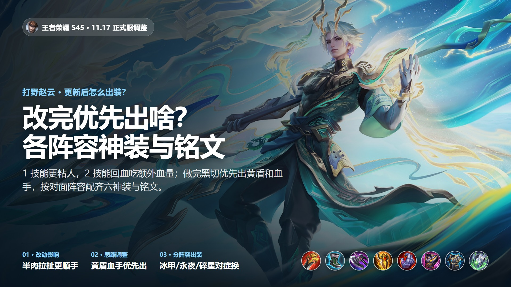

# 王者荣耀S45赵云11.17更新攻略：调整影响、出装优先级与各阵容配装

> **版本基线**：S45 正式服 11.17 调整同步版（基于 `config/` 本地真值核验）
> **核心思路**：11 月 17 日正式服对赵云做了三处调整：1 技能冷却缩到 7.5~6 秒更好留人，2 技能回血改成 70~140（+1% 额外生命），3 技能伤害微调到 450~900（+135% 额外物攻）。改完之后，纯输出装刷野回血和攒被动白盾会变慢，做完黑切优先补黄盾（怒龙剑盾）撑血量和续航，再配血手（血魔之怒）半血打反手，最后按对面阵容选择爆裂、冰甲、永夜或碎星锤最顺手。

---

## PART 01 · 先看 11.17 调整对赵云的影响

**1 技能更粘人，但 2 技能回血和 3 技能伤害微调后更吃血量与拉扯**

- 1 技能【惊雷之龙】冷却缩短 0.5 秒（8~6.5 秒 → 7.5~6 秒）：冲锋转得更快，加上强化普攻额外造成 120~240（+40% 额外物攻）物理伤害和 25%~50% 减速持续 2 秒，自己留人和追人就已经很够用了。
- 2 技能【破云之龙】回血下调（1.5% → 1% 额外生命）：连刺 5 枪每枪回复 70~140（+1% 额外生命，后续每枪降低 8%）。纯出输出装时刷野回血变慢，被动白盾也攒得更慢，需要带血量的装备帮着补回续航。
- 3 技能【天翔之龙】伤害微调（480~960 +145%额外物攻 → 450~900 +135%额外物攻）：大招中心击飞 1 秒并挂 5 秒感电，没打中英雄返还 50% 冷却。一套直接秒满血脆皮稍微吃力一点，更靠多打一轮 1 技能和被动反打。
- 被动【龙鸣】与基础属性：赵云 Lv1→Lv15 裸装生命 3,468→7,150、物攻 175→379、物防 150→395、法防 75→166、基础移速 385。血量处于 >70% / 40%~70% / ≤40% 分别获得 5% / 10% / 20% 免伤；血量跨过档位会立刻白送一次 1 技能，溢出当前档位上限的回复会转成永久白盾。

---

## PART 02 · 针对改动，出装优先级怎么调

**前期先出黑切不变，后面黄盾、血手优先出，冰脉与破军看局势选**

- 前期还是得先出黑切，先别裸黄盾：只靠百穿铭文前期伤害不够，9 级时先出黑切一套打脆皮能到 5,259（3 秒刷野 5,433），直接裸黄盾只有 4,170（少打 1,089，刷野也更慢）。做完黑切先停在 15 层小红刀，直接优先出黄盾（5,530 金，比先升大红刀省 110 金，物理抗伤高 +2,053、法术抗伤高 +3,123），靠黄盾重创把单组野怪回血从 525 翻倍到 1,110，路过野区刮两枪就能攒出永久白盾。
- 黄盾之后优先补血手，不再每把无脑先出冰脉：团战在半血左右（55%~65%）主动按血手，扣掉 30% 当前生命换 40% 最大生命白盾，顺势压进 40% 血线拿满 20% 免伤并白送一次 1 技能。而冰脉（+300 物防 +55 物攻 +10% 冷却）提供 0 生命值，1 技能自己又够粘人、拿蓝冷却还会溢出（25 层红刀 12.5% + 黑切 10% + 蓝 Buff 20% 已满 40%），所以平时不用硬绑冰脉，只在常让蓝缺冷却时出。
- 对面硬控特别多时，可以把爆裂换成冰甲（冰霜冲击）：冰甲（2,030 金，+150 物防 +950 生命 +7.5% 冷却）自带 10% 韧性（配抵抗鞋合计 35% 韧性）和受硬控触发 10% 最大生命护盾（5 秒，CD 15 秒），满级 10,600 血、危机态抗伤 26,199。注意冰甲和血手都是主动装，局内快捷主动键只能留给血手，主要吃冰甲的韧性和受控护盾被动（会少爆裂的 10% 移速增伤，打脆皮少 914）。

### 表1：赵云关键装备顺序与单件实测对比（含30铭文）

| 对比场景 | 推荐出装思路 | 常见对照做法 | 实测差值与实战原因 |
| :--- | :--- | :--- | :--- |
| 前期先出黑切 vs 裸黄盾 (9级经济对比) | **先出黑切** (3,490金) 打脆皮 5,259 / 3秒刷野 5,433 | 先出黄盾 (3,440金) 打脆皮 4,170 / 3秒刷野 5,081 | 先出黑切多打 +1,089 爆发且刷野更快，不缺抓人伤害 |
| 做完黑切后停小红刀出黄盾 (11级经济对比) | **停小红刀先出黄盾** (5,530金) 物理抗伤 13,901 / 单组野回 1,110 | 先升大红刀再补防装 (5,640金) 物理抗伤 11,848 / 单组野回 544 | 省 110 金的同时刷野回血翻倍，路过野区就能攒白盾 |
| 常规补爆裂 vs 常让蓝补冰脉 (15级满装对比) | **黄盾+血手+爆裂** 10,650血 / 物理抗伤 24,615 / 法术抗伤 18,933 | **冰脉+黄盾+血手** 9,650血 / 物理抗伤 23,573 / 法术抗伤 17,132 | 爆裂多 1,000 血撑厚白盾，拿蓝满 40% 冷却；让蓝缺冷却再出冰脉 |
| 硬控极多补冰甲 vs 爆裂 (15级满装对比) | **黄盾+血手+冰甲** 10,600血 / 35%韧性 / 危机抗伤 26,199 | **黄盾+血手+爆裂** 10,650血 / 25%韧性 / 打脆皮 10,087 | 冰甲多 10% 韧性与受控护盾（主动键留给血手）；少爆裂移速增伤 |

---

## PART 03 · 不同敌方阵容的出装与铭文匹配

**不靠一套出装打到底，看对面阵容选对应的 6 神装与 30 铭文**

- 两套专属五级铭文怎么选：① 爆裂、冰甲、永夜、破魔刀、冰脉偏持续拉扯的对局，带『10异变 10鹰眼 7隐匿 3狩猎』（总计 +40.2物攻 +100物穿 +3%攻速 +10%移速），3% 攻速配合等级成长让 13A2A 两次强化普攻收枪更顺滑；② 破军和碎星锤偏技能爆发或打肉的对局，带『10异变 10鹰眼 10隐匿』（总计 +45物攻 +100物穿 +10%移速），拉满一、三技能额外物攻加成。
- 看阵容选装规律：先出小红刀 → 抵抗鞋 → 黑切，之后大多数对局优先做黄盾、升满红刀接血手（法刺超神可先做破魔刀），最后一件按对面阵容选爆裂（均衡物理）、冰甲（连环硬控极多）、永夜/魔女（多法师）或碎星锤（双前排重坦）；只有大顺风碾压或单排常让蓝时，才在黑切后先做破军或冰脉。

### 表2：打野赵云 S45 不同阵容满级神装与铭文实测对比（15级25层）

| 对比项 | ① 常规均衡(爆裂) | ② 常让蓝(冰脉) | ③ 大顺风(破军) | ④ 双重坦(碎星锤) | ⑤ 法刺猛(破魔刀) | ⑥ 逆风多法(永夜) |
| :--- | :--- | :--- | :--- | :--- | :--- | :--- |
| 成装总价 | 11,160金 | 11,170金 | 11,650金 | 11,190金 | 11,170金 | 11,130金 |
| 核心出装顺序 | 黑切+黄盾+血手+爆裂 | 黑切+冰脉+黄盾+血手 | 黑切+破军+黄盾+血手 | 黑切+黄盾+血手+碎星锤 | 黑切+黄盾+破魔刀+血手 | 黑切+黄盾+血手+永夜 |
| 专属30铭文 | 10异变 10鹰眼 7隐 3狩 | 10异变 10鹰眼 7隐 3狩 | 10异变 10鹰眼 10隐匿 | 10异变 10鹰眼 10隐匿 | 10异变 10鹰眼 7隐 3狩 | 10异变 10鹰眼 7隐 3狩 |
| 生命 / 物理攻击 | 10,650 / 774 | 9,650 / 794 | 9,650 / 894 | 10,350 / 834 | 10,350 / 829 | 10,550 / 739 |
| 物防 / 法防 | 805 / 416 | 895 / 416 | 595 / 416 | 595 / 416 | 595 / 816 | 685 / 596 |
| 无蓝 / 拿蓝冷却 | 22.5% / 40% | 32.5% / 40% | 27.5% / 40% | 22.5% / 40% | 22.5% / 40% | 22.5% / 40% |
| 物理 / 法术抗伤 | 24,615 / 18,933 | 23,573 / 17,132 | 19,366 / 17,244 | 20,756 / 18,482 | 20,756 / 23,377 | 23,709 / 22,133 |
| 打脆皮 / 打重坦 | 10,087 / 4,901 | 10,374 / 4,964 | 11,473 / 5,492 | 10,178 / 5,681 | 9,681 / 4,636 | 9,126 / 4,374 |
| 团战总回复量 | 572 | 534 | 534 | 561 | 561 | 1,253 |

### 各阵容神装方案拆解

- **方案 ① · 对面常规均衡 · 偏物理输出 · 红刀·黄盾血手爆裂流**（`11,160 金` ｜ `10,650血 ｜ 805物防 / 416法防 ｜ 22.5%冷却 ｜ 秒脆皮 10,087`）
  - **优势**：做完黑切优先出黄盾补足血量和刷野续航，接着补血手在半血时直接压进 40% 血线吃满 20% 免伤并多拿一次 1 技能；满级 10,650 血配合爆裂叠满 10% 增伤移速，拿蓝满 40% 冷却。
  - **注意**：无蓝时冷却 22.5%（满级 1 技能 4.65 秒），留人主要靠 1 技能自带的 2 秒 50% 减速和大招击飞。如果对面连环硬控特别多，可以把最后的爆裂换成冰甲（冰霜冲击），吃 10% 韧性与受控护盾，快捷主动键依然留给血手。
  - **适用**：对面阵容比较均衡、物理爆发较多、自己能控蓝的常规对局。
- **方案 ② · 单排经常让蓝 / 抓单缺冷却 · 红刀·冰脉黄盾血手流**（`11,170 金` ｜ `9,650血 ｜ 895物防 / 416法防 ｜ 32.5%冷却 ｜ 秒脆皮 10,374`）
  - **优势**：把蓝让给中单时，无蓝 32.5% 冷却能把满级大招压到 10.8 秒，两次强化普攻顺手，打脆皮 10,374、物防 895。
  - **注意**：冰脉（冰痕之握）不加最大生命，拿蓝时冷却会溢出 10%，且血手需要放到最后出。
  - **适用**：单排经常把蓝 Buff 让给法核中单，前期顺风需要高频抓单边射的对局。
- **方案 ③ · 大顺风碾压切后排 · 红刀·破军黄盾血手流**（`11,650 金` ｜ `9,650血 ｜ 595物防 / 416法防 ｜ 27.5%冷却 ｜ 秒脆皮 11,473`）
  - **优势**：高额物攻补回大招下调后的爆发，一套打脆皮 11,473，后面补黄盾和血手守住 9,650 血和 416 法防，不会一进场就被法师秒。
  - **注意**：破军（强者破军）2,540 金偏贵，均势局早出容易卡钱，拖慢半肉成型节奏。
  - **适用**：前期已经大顺风、需要单人一套秒掉对面无位移射手法师的滚雪球对局。
- **方案 ④ · 对面双前排 / 重坦特别肉 · 红刀·黄盾血手碎星流**（`11,190 金` ｜ `10,350血 ｜ 595物防 / 416法防 ｜ 22.5%冷却 ｜ 秒脆皮 10,178`）
  - **优势**：先用黄盾和血手撑出 10,350 血量，再补碎星锤 30% 百分比穿甲，打重坦一套 5,681、打脆皮 10,178。
  - **注意**：物防 595 偏中等，团战别顶着对面满装射手正面站撸吃平 A。
  - **适用**：对面白起、项羽、张飞这类双前排很肉，既要打前排又要绕后切 C 的对局。
- **方案 ⑤ · 对面法刺超神 / 电刀混伤 · 红刀·黄盾破魔血手流**（`11,170 金` ｜ `10,350血 ｜ 595物防 / 816法防 ｜ 22.5%冷却 ｜ 秒脆皮 9,681`）
  - **优势**：高物攻吃满破魔刀 250 点被动法防，总法防直接拉到 816（法术抗伤 23,377），顶着法刺爆发和电刀混伤也能反杀。
  - **注意**：面对纯物理菜刀阵容时法防属性容易闲置，改回爆裂或冰甲更合适。
  - **适用**：对面诸葛亮、露娜、不知火舞早早起飞，或狄仁杰、公孙离出电刀打混伤的对局。
- **方案 ⑥ · 均逆风持久团 / 多法师消耗 · 红刀·黄盾血手永夜流**（`11,130 金` ｜ `10,550血 ｜ 685物防 / 596法防 ｜ 22.5%冷却 ｜ 秒脆皮 9,126`）
  - **优势**：10,550 血配永夜受击回血，团战总回复达到 1,253，还带 50% 减速抗性，能反复进出打拉扯。
  - **注意**：爆发略低于输出向出装，遇到干将莫邪、沈梦溪纯远程不接触的消耗阵容可把永夜换成魔女。
  - **适用**：己方均逆风要接持久团，或者对面多法师集火需要站住反复拉扯的对局。

---

## PART 04 · 1~12 格局内备战与实战节奏

**4 级出陨星再抓边、出黄盾路过野区攒白盾、大后期保留抵抗鞋用血手原地换复活甲**

- 局内 3 个顺手节奏：① 4 级前稳刷别硬拼，做出抵抗鞋和 760 金陨星伤害就够，再去抓边控龙；② 黄盾做出来之后，打团前路过野怪或兵线刮一发 1A2，触发黄盾+2 技能双回血（单组 1,110），溢出部分会自动存成永久白盾再进场；③ 半血开血手打完送的 1 技能反刺收割，残血撤退时往墙外空放 3 技能穿墙（没命中返还一半冷却，后期只要 5~6 秒）。
- 1~12 格局内备战预设：前 7 格按『追击刀锋 → 抵抗之靴 → 暗影战斧 → 怒龙剑盾 → 贪婪之噬 → 血魔之怒 → 暴烈之甲』放好，后 5 格放『永夜守护、冰霜冲击（冰甲）、破魔刀/碎星锤、冰痕之握、贤者的庇护（复活甲）』；如果大后期要换名刀，先开完血手打完技能进入 75 秒冷却后，留着抵抗鞋别卖，直接用血手原地换复活甲，倒地起身再换名刀反刺。

### 表3：打野赵云中后期出装节点实测对比

| 阶段与经济 | 推荐做法 | 常见对照做法 | 实测差值与理由 |
| :--- | :--- | :--- | :--- |
| 中期 5,530~5,640 金 (做完黑切后) | **停小红刀先出黄盾** (5,530金) 物理抗伤 13,901 / 单组野回 1,110 | 先升大红刀+小护手 (5,640金) 物理抗伤 11,848 / 单组野回 544 | 省 110 金的同时双抗高出 +2,053/+3,123，刷野回血翻倍 |
| 中期 5,550 金 (对面法师猛 vs 让蓝) | **法刺起飞先出破魔刀** (5,550金) 法术抗伤 14,211 / 打脆皮 6,113 | 常让蓝先出冰脉 (5,550金) 物理抗伤 13,237 / 20%冷却 / 打脆皮 6,611 | 诸葛亮/露娜超神优先破魔刀拉高法防；让蓝抓单才选冰脉 |
| 中后期 8,990~9,110 金 (10分钟龙团) | **黄盾+血手先成型** (9,110金) 危机抗伤 20,309 / 法术抗伤 16,813 | 冰脉+黄盾组合 (8,990金) 危机抗伤 16,256 / 法术抗伤 13,022 | 10~12 分钟龙团提前开出血手压血拿 20% 免伤，危机抗伤高 +4,053 |

