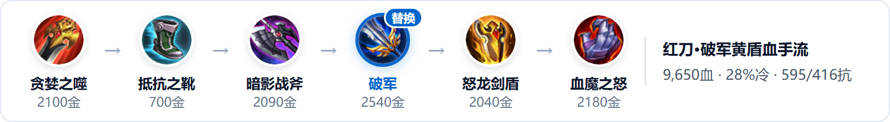
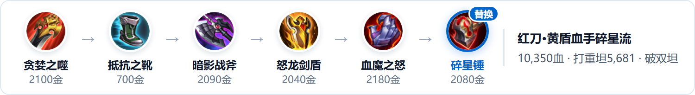
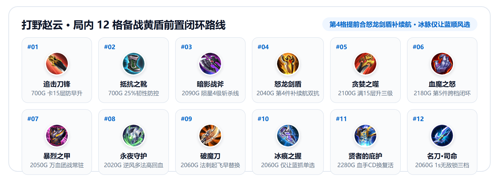

# 王者荣耀 S45 赛季打野赵云 · 黄盾前置血手跨档闭环与六套动态出装（完整真值数据版）

> **版本基线**：S45 正式服 11.17 调整同步版（`config/items_ground_truth.json` / `config/hero_skills_data.json` / `config/hero_base_stats.py` / `config/hero_arcana_data.py` 本地真值核验）
> **核心结论**：11 月 17 日正式服将赵云一技能冷却缩至 7.5~6 秒、二技能回血调为 1% 额外生命、三技能伤害微调至 450~900（+135%额外物攻）。二技能回血下调后，黑切后第 4 件提前做出黄盾可借重创被动将单组野怪回血翻倍至 1,110 并加速二档攒永久白盾，第 5 件连出血手即可在龙团提前解锁扣血跨档送一技能闭环；而 0 生命的冰脉不再全对局硬绑，仅作让蓝顺风抓单分支。

---

## PART 01 · 裸装基线与 11.17 调整后龙鸣三档、惊雷减冷却真值

**Lv1→15 裸装面板、5%/10%/20% 三档免伤跨档送位移、二技能 1% 额外生命回血与空大返 CD**

- 裸装基线与被动【龙鸣】三档免伤规则：赵云 Lv1→Lv15 裸装生命 3,468→7,150，物攻 175→379，物防 150→395，法防 75→166，基础移速 385（刺客档），攻速成长 +1.5%/级。生命处于 >70% / 40%~70% / ≤40% 分别获得 5% / 10% / 20% 免伤；每当生命档位跨越时立即额外存储一次一技能，且溢出当前档位上限的回复量会转化为永久护盾。
- 一技能【惊雷之龙】（CD 7.5s→6s）与二技能【破云之龙】（CD 6s→5s）调整影响：11 月 17 日更新将一技能冷却缩短 0.5 秒，冲锋造成 350~700（+120%额外物攻）物伤，强化普攻额外造成 120~240（+40%额外物攻）物伤并附带 25%~50% 持续 2 秒减速，自身黏人留人能力明显增强；二技能连刺 5 枪每枪造成 210~420（+65%额外物攻）物伤，回血由 1.5% 下调为 70~140（+1%额外生命，每枪递减 8%），纯靠自身刺野续航与攒白盾变慢，亟需装备被动接力续航。
- 三技能【天翔之龙】（CD 20s / 18s / 16s）与血手跨档伏笔：跃击造成 450 / 675 / 900（+135%额外物攻）物伤、中心 1 秒击飞并挂 5 秒感电，未命中英雄直接返还 50% 冷却。血手主动扣除 30% 当前生命换取 40% 最大生命真实白盾，在 55%~65% 血线按下即可主动压进 ≤40% 最高 20% 免伤档位白拿一发一技能，近四千点白盾全程享受双抗与 20% 免伤折算。

---

## PART 02 · 黄盾前置第 4 件逻辑与冰脉去绑定实测对比

**为什么黑切后提前出黄盾接血手，以及为什么冰脉不再是全对局必出装**

- 黄盾提前到第 4 件（但不提前到第 3 件）的真值账本：第 3 件若跳过黑切裸出黄盾（3,440 金），仅靠百穿铭文 100 物穿，Lv9 全套秒脆皮跌至 4,170（低于 4,800 脆皮基准血线，比同预算黑切少打 1,089 点），3 秒刷野伤害（5,081）也慢于黑切（5,433）。而在黑切之后第 4 件立刻做黄盾（Lv11 共 5,530 金），既有 254.3 物穿保住 5,955 脆皮斩杀线，又能靠黄盾【重创】（每 2.5 秒对野怪/兵线造成 7% 最大生命物伤并回 50% 血）把单组野怪总回血从 525 翻倍至 1,110，彻底填平二技能回血下调缺口，路过野区两枪即可攒出二档永久白盾；第 5 件连出血手还能在 10~12 分钟龙团提前一格完成跨档闭环。
- 为什么冰脉不再全对局硬绑（退居 20% 让蓝顺风抓单分支）：① 正式服冰脉（+300物防 +55物攻 +10%冷却）提供 0 最大生命，对黄盾重创/神力、血手 40% 白盾与二技能回血三项生命挂钩机制加成为零；② 冰脉强击减速仅持续 0.5 秒（15%~30%），与赵云一技能自带 2 秒 50% 强普减速重叠度高；③ 满层红刀（12.5%）+ 黑切（10%）拿蓝已满 40% 冷却（冰脉 10% 冷却溢出），无蓝时满级一技能也仅差 0.6 秒（4.65s vs 4.05s）。因此 80% 常规局用爆裂、永夜、破军或碎星锤替代冰脉，坦度或终结效率均更优。

### 表1：打野赵云核心顺序与同槽位单件实测对比表（含30铭文折算）

| 对比维度与阶段 | 方案 A（推荐路线） | 方案 B（对照/旧惯性套） | 实测关键差值与龙鸣三档机制依据 |
| :--- | :--- | :--- | :--- |
| Lv9 第3件铁律 (黑切 vs 裸黄盾) | **先出暗影战斧** (3,490金) 秒C 5,259 / 3s刷野 5,433 | 提前第3件黄盾 (3,440金) 秒C 4,170 / 3s刷野 5,081 | 裸黄盾仅 100 物穿跌破 4,800 脆皮斩杀线；先黑切多打 +1,089 且刷野更快 |
| 15级常驻底座对比 (爆裂 vs 冰脉) | **黄盾+血手+爆裂** (方案①) 10,650血 / 物抗 24,615 / 法抗 18,933 | **冰脉+黄盾+血手** (方案②) 9,650血 / 物抗 23,573 / 法抗 17,132 | 冰脉 0 生命且拿蓝冷却溢出；爆裂多 1,000 血撑厚白盾，物抗高 +1,042、法抗高 +1,801 |
| 15级切C容错底线 (黄盾破军 vs 旧脆皮) | **破军+黄盾+血手** (方案③) 416法防 / 法抗 17,244 / 秒C 11,473 | 旧式冰脉+破军+血手套 266法防 / 法抗 13,610 / 8,550血 | 旧套 266 法防吃法师不明 AOE 即漏光白盾；绑黄盾法抗高 +3,634 守住三档底线 |
| 15级续航与反法对策 (永夜 vs 破魔刀) | **黄盾+血手+永夜** (方案⑥) 团战回血 1,253 / 危机抗伤 26,158 | **黄盾+破魔刀+血手** (方案⑤) 816法防 / 法抗 23,377 / 秒C 9,681 | 均逆风持久战选永夜补回二技能续航；遇诸葛/露娜超神或电刀射选破魔刀反杀 |

---

## PART 03 · 六套实战满装与专属 30 铭文总属性账本

**五件黄盾血手前置底座 + 第 6 件六向变阵，及两套专属 30 铭文精算**

- 两套专属五级铭文精确总属性：① 爆裂、冰脉、破魔刀、永夜四套持续拉扯流配『10异变 10鹰眼 7隐匿 3狩猎』（总计 +40.2物攻 +100物穿 +3%攻速 +10%移速），3% 攻速配合等级成长让 13A2A 两次强普收枪利落不卡手；② 破军与碎星锤两套重技能穿透流配『10异变 10鹰眼 10隐匿』（总计 +45物攻 +100物穿 +10%移速），拉满一、三技能额外物攻收益。
- 成型槽位规律：除『全程让蓝顺风抓单（方案②第 4 件冰脉）』与『大顺风碾压切 C（方案③第 4 件破军）』外，其余四套均以『小红刀 → 抵抗鞋 → 黑切 → 黄盾 → 大红刀 → 血手』提前完成核心闭环（法刺超神时方案⑤可在黄盾后先合破魔刀），最后第 6 件按阵容在爆裂、碎星锤、永夜（纯远程消耗可换魔女）间落位。

### 表2：打野赵云 S45 六套实战满装实测对比总表（15级25层含30铭文）

| 评估维度 | ① 黄盾血手爆裂 | ② 冰脉黄盾血手 | ③ 破军黄盾血手 | ④ 黄盾血手碎星 | ⑤ 黄盾破魔血手 | ⑥ 黄盾血手永夜 |
| :--- | :--- | :--- | :--- | :--- | :--- | :--- |
| 成装总价 | 11,160金 | 11,170金 | 11,650金 | 11,190金 | 11,170金 | 11,130金 |
| 核心第3~6件顺序 | 黑切+黄盾+血手+爆裂 | 黑切+冰脉+黄盾+血手 | 黑切+破军+黄盾+血手 | 黑切+黄盾+血手+碎星锤 | 黑切+黄盾+破魔刀+血手 | 黑切+黄盾+血手+永夜 |
| 专属30铭文 | 10异变 10鹰眼 7隐 3狩 | 10异变 10鹰眼 7隐 3狩 | 10异变 10鹰眼 10隐匿 | 10异变 10鹰眼 10隐匿 | 10异变 10鹰眼 7隐 3狩 | 10异变 10鹰眼 7隐 3狩 |
| 生命 / 物理攻击 | 10,650 / 774 | 9,650 / 794 | 9,650 / 894 | 10,350 / 834 | 10,350 / 829 | 10,550 / 739 |
| 物防 / 法防 | 805 / 416 | 895 / 416 | 595 / 416 | 595 / 416 | 595 / 816 | 685 / 596 |
| 无蓝 / 拿蓝冷却 | 22.5% / 40% | 32.5% / 40% | 27.5% / 40% | 22.5% / 40% | 22.5% / 40% | 22.5% / 40% |
| 物理 / 法术抗伤 | 24,615 / 18,933 | 23,573 / 17,132 | 19,366 / 17,244 | 20,756 / 18,482 | 20,756 / 23,377 | 23,709 / 22,133 |
| 秒脆皮 / 打重坦 | 10,087 / 4,901 | 10,374 / 4,964 | 11,473 / 5,492 | 10,178 / 5,681 | 9,681 / 4,636 | 9,126 / 4,374 |
| 团战总回复量 | 572 | 534 | 534 | 561 | 561 | 1,253 |

### 六套实战方案逐套适用场景与优劣势拆解

- **方案 ① · 常规团战/控蓝万血首选底座 · 红刀·黄盾血手爆裂流**（`11,160 金` ｜ `10,650血 ｜ 805物防 / 416法防 ｜ 22.5%冷却 ｜ 秒脆皮 10,087`）
  - **优势**：第 4 件提前出黄盾补平二技能续航缺口，第 5 件接血手在中期龙团提前成型跨档闭环；满级 10,650 高血量撑厚白盾与黄盾重创，叠满爆裂 10% 增伤移速，拿蓝满 40% 冷却。
  - **注意**：无蓝期冷却 22.5%（满级一技能 4.65 秒），留人主要靠一技能 2 秒 50% 强普减速与大招内圈击飞。
  - **适用对局**：覆盖 80% 常规团战、己方能控蓝或野区频繁碰撞的首选万血底座。
- **方案 ② · 单排全程让蓝/顺风抓单分支 · 红刀·冰脉黄盾血手流**（`11,170 金` ｜ `9,650血 ｜ 895物防 / 416法防 ｜ 32.5%冷却 ｜ 秒脆皮 10,374`）
  - **优势**：全程让蓝时靠无蓝 32.5% 冷却将满级大招压至 10.8 秒，13A2A 两次强击补足秒脆皮 10,374 与 895 高物防。
  - **注意**：冰脉 0 最大生命不加成黄盾与血手，且拿蓝时 10% 冷却溢出，血手闭环推迟到第 6 件。
  - **适用对局**：单排全程让蓝给工具人/法核中单，且前中期顺风需高频抓落单物理边射的对局。
- **方案 ③ · 顺风切C高爆发收割 · 红刀·破军黄盾血手流**（`11,650 金` ｜ `9,650血 ｜ 595物防 / 416法防 ｜ 27.5%冷却 ｜ 秒脆皮 11,473`）
  - **优势**：补回大招下调的基础与加成伤害，秒脆皮爆发拉至 11,473（无蓝 27.5% 冷却），同时保留黄盾与血手守住 9,650 血与 416 法防，杜绝旧纯输出套 266 法防进场蒸发。
  - **注意**：破军 2,540 金合成真空期较长，均势局建议先出黄盾血手再在第 6 件补破军。
  - **适用对局**：己方顺风经济领先、需单人一套瞬秒敌方无位移双 C 的滚雪球对局。
- **方案 ④ · 双前排重坦高穿破甲 · 红刀·黄盾血手碎星流**（`11,190 金` ｜ `10,350血 ｜ 595物防 / 416法防 ｜ 22.5%冷却 ｜ 秒脆皮 10,178`）
  - **优势**：先用黄盾血手稳住 10,350 血量底座，再叠 280 固穿与碎星锤 30% 物穿（附 +7.5% 移速）将打坦净伤提至 5,681 全系最高。
  - **注意**：物防 595 偏中等，团战切忌正面硬吃敌方满装射手持续平 A。
  - **适用对局**：敌方白起、项羽、张飞等双前排重坦成型，需兼顾打前排与绕后切 C 的对局。
- **方案 ⑤ · 法刺超神/电刀混伤反杀 · 红刀·黄盾破魔刀血手流**（`11,170 金` ｜ `10,350血 ｜ 595物防 / 816法防 ｜ 22.5%冷却 ｜ 秒脆皮 9,681`）
  - **优势**：高物攻直接吃满破魔刀 250 被动法防（总法防达 816，法术抗伤 23,377），顶着法刺爆发与电刀法球反刺收割。
  - **注意**：面对纯物理菜刀阵容时破魔刀法防收益闲置，应切回方案①爆裂甲。
  - **适用对局**：敌方诸葛亮、露娜、火舞早早起飞，或狄仁杰、公孙离出电刀法球混伤的对局。
- **方案 ⑥ · 均逆风持久战/双法核抗消耗 · 红刀·黄盾血手永夜流**（`11,130 金` ｜ `10,550血 ｜ 685物防 / 596法防 ｜ 22.5%冷却 ｜ 秒脆皮 9,126`）
  - **优势**：10,550 血配永夜受击回血将团战总回复拉升至 1,253（附 +7.5% 移速与 50% 减速抗性），危机态抗伤高达 26,158，彻底补回二技能回血削弱缺口。
  - **注意**：秒脆皮 9,126 主打多轮进出拉扯；若遇干将、沈梦溪纯远程无接触消耗可将永夜平替为魔女保一档位。
  - **适用对局**：己方均逆风打持久团战，或敌方多法伤、高爆发集火需反复七进七出的对局。

---

## PART 04 · 赵云专属打法思路、分期预算分水岭与 18 分钟换装

**4级陨星发力节点、黄盾重创双回血攒白盾、Lv11/Lv13 提前闭环账本与保命三换**

- 专属核心打法思路（重创攒盾与血手跨档）：① 1~3 级稳刷保陨星节点——未点大招前不盲目反野硬拼，4 级做出陨星握住斩杀线再抓边控龙；② 黄盾成型后二档路过野怪速攒白盾——二技能调为 1% 额外生命后，做出黄盾路过野怪或兵线打一发 1A2，触发重创+二技能双回血（单组回血 1,110），溢出部分瞬间挂成永久白盾，带着 10% 免伤+厚白盾进场；③ 侧翼切入半血按血手主动压进 ≤40% 三档白拿一技能追击收割，残血脱身果断向墙外空放三技能（返还 50% 冷却仅约 5~6 秒）。
- 12 格备战预设与 11 级分水岭：第 1~7 格依次预设『追击刀锋 → 抵抗之靴 → 暗影战斧 → 怒龙剑盾 → 贪婪之噬 → 血魔之怒 → 暴烈之甲』，后 5 格备好永夜、破魔刀、冰脉、复活甲与名刀。做完黑切（约 5 分钟）查局势：常规/控蓝/均逆风直接停 15 层小红刀第 4 件合黄盾，满 15 层再升红刀接血手；仅全程让蓝顺风抓单才手动点选冰脉。
- 18 分钟保命三连换：团战开启血手打完赠送的一技能进入 75 秒冷却后，原格秒换复活甲 → 倒地起身秒换名刀（1.0 秒无敌锁死 ≤40% 最高 20% 免伤档位反刺收尾）。

### 表3：打野赵云前中后期（Lv11 / Lv13 / 18分钟）预算分水岭实测表

| 阶段与经济预算 | 推荐前置闭环方案 | 旧常序对照方案 | 实测抗伤续航差值与调整后机制依据 |
| :--- | :--- | :--- | :--- |
| Lv11 第4件常规分水岭 (约5,530~5,640金) | **停小红刀先合黄盾** (5,530金) 物抗 13,901 / 法抗 12,660 / 单组野回 1,110 | 先升大红刀+护手 (5,640金) 物抗 11,848 / 法抗 9,537 / 单组野回 544 | 省 110 金物抗高 +2,053、法抗高 +3,123，重创令刷野回血翻倍且保住 5,955 秒 C 线 |
| Lv11 让蓝/反法特化 (约5,550金/15层) | **法刺起飞合破魔刀** (5,550金) 法抗 14,211 / 秒C 6,113 | 让蓝顺风合冰痕之握 (5,550金) 物抗 13,237 / 20%冷却 / 秒C 6,611 | 诸葛/露娜超神第 4 件直奔破魔刀拉满 640 法防；冰脉仅在全程让蓝物理顺风抓单时出 |
| Lv13 第5件龙团闭环 (约8,990~9,110金) | **黄盾+血手提前闭环** (9,110金) 危机抗伤 20,309 / 法抗 16,813 / 秒C 8,921 | 旧常序冰脉+黄盾 (8,990金) 危机抗伤 16,256 / 法抗 13,022 / 秒C 8,228 | 10~12 分钟主宰团提前一格解锁血手扣血跨档送一技能，危机抗伤高 +4,053、秒 C 高 +693 |

