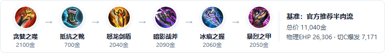
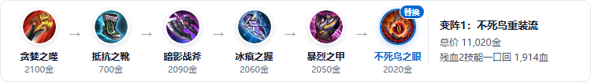
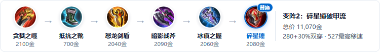
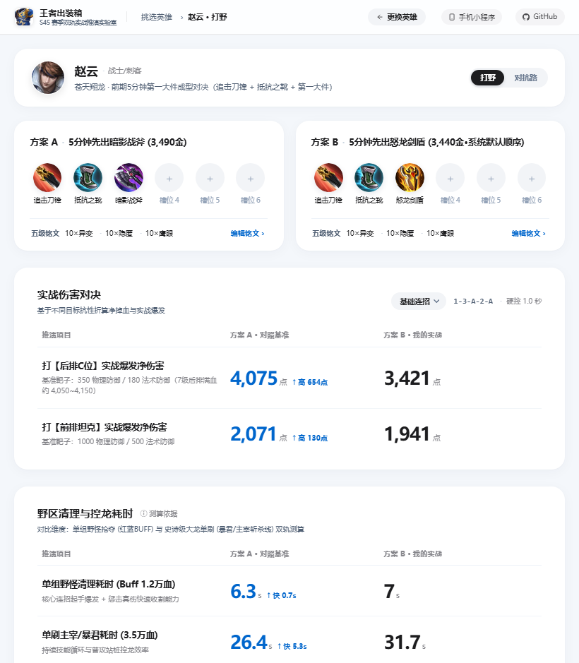
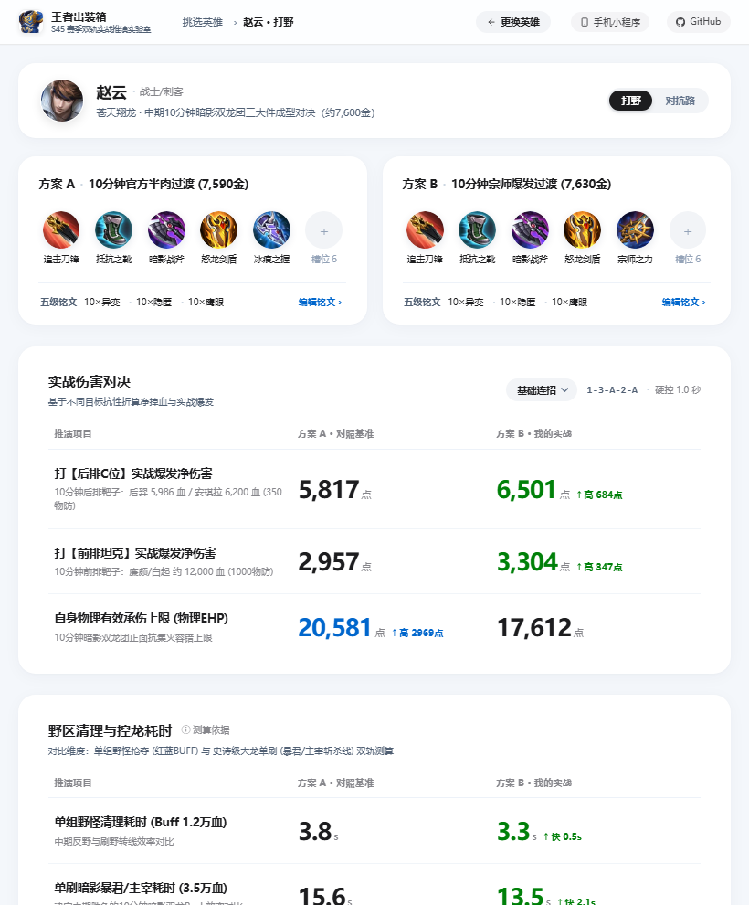
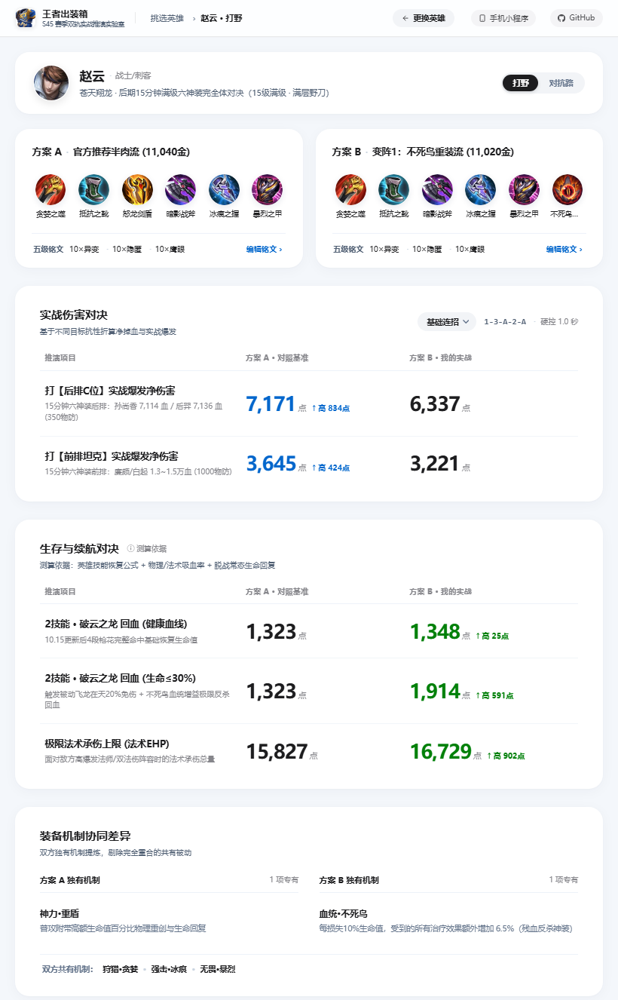

# 赵云打野出装详解：从前中期过渡到后期三大变阵的数据拆解

10月15日正式服对赵云的 2 技能回血与大招冷却做了一波微调。借着这次更新，想用数据和大家理性聊一聊当前版本打野赵云的出装选择。

在日常排位和巅峰赛里，单排赵云走极端路线往往很难打：纯输出装容错率太低，进场吃个控制瞬间就会被秒；过度堆肉又容易伤害刮痧，切不动敌方后排。因此，兼顾坦度与稳定切C能力的**半肉流**依然是最稳妥的思路——这也是为什么本文以**官方推荐半肉装**作为对比基准。

不过同样是半肉框架，实战中怎么微调依然有很多分歧：比如打野刀选红刀还是肉刀？后两件补不死鸟还是碎星锤？其实没有哪套出装是绝对完美的，换任何一件装备，本质上都是在**前中期抓人节奏、技能冷却衔接、以及团战抗集火能力**之间做取舍。

为了避免只凭体感聊装备，我在平时常用的出装计算工具「**王者出装箱**」里，结合排位真实经济进度，按**前期（5分钟第一大件）、中期（10分钟双龙团三大件）、后期（15分钟六神装完全体）**三个关键节点，对官方半肉装和另外 3 套实战变阵进行了完整推演。每套出装在不同时期能打多少血、能扛多少伤，我们直接看图和数据说话。

> **测算基准**：百穿隐匿铭文（**10异变 + 10鹰眼 + 10隐匿**）；基础连招 **1-3-A-2-A**（1技能突进 + 3技能击飞感电 + 强化普攻 + 2技能4段打满 + 普攻）。

---

## 一、 四套六神装横向对账：你得到了什么，又放弃了什么？

在进入前中后期节奏拆解之前，我们先通过一张 **全维度面板与实战数据表**，把 4 套主流六神装的数值底牌摊开：

### 📊 表 1：赵云打野 4 套六神装核心指标横向对比（15级满级·满层野刀）

| 评估维度 | ① 官方推荐半肉流 (基准) | ② 变阵1：不死鸟重装流 | ③ 变阵2：碎星锤破甲流 | ④ 变阵3：肉刀破军万血流 |
| :--- | :--- | :--- | :--- | :--- |
| **成型总造价** | 11,040 金 | **11,020 金 (最便宜)** | 11,070 金 | 11,530 金 (最贵) |
| **物理攻击 / 冷却缩减** | 761 / 32.5% | 761 / 32.5% | 816 / 32.5% | 711 / **35.0% (最高)** |
| **最大生命 / 物防 / 法防** | 9,332 / **1,095** / 419 | 9,582 / 1,035 / **449** | 9,032 / 885 / 419 | **10,282 (破万血)** / 885 / 419 |
| **物理穿透 / 面板移速** | 280 / 494 | 280 / 494 | **280 + 30%双穿** / **527 (最快)** | 280 / 494 |
| **物理有效生命 (物理EHP)** | **26,306 (物抗最肉)** | 26,056 | 22,310 | 25,398 |
| **法术有效生命 (法术EHP)** | 15,827 | 16,729 (+902) | 15,318 | **17,438 (万血加持)** |
| **打后排C位爆发 (350物防)** | 7,171 | 6,337 (-834) | 6,982 | **7,296 (全场最高)** |
| **打前排坦克伤害 (1000物防)** | 3,645 | 3,221 | **4,110 (+12.8%)** | 3,709 |
| **2技能回血 (健康 / 生命≤30%)** | 1,323 / 1,323 | 1,348 / **1,914 (+44.7%)** | 1,307 / 1,307 | **1,406** / 1,406 |
| **单刷大龙耗时 (3.5万血)** | 12.0 秒 | 13.8 秒 | 12.0 秒 | **10.7 秒 (最快)** |

可以看到，**没有任何一套出装能在所有维度全胜**。下面我们逐套拆解它们的置换逻辑：

---

### 1. 官方推荐半肉流（攻防均衡的基准参照系）

* **核心收益（物理承伤上限最高 + 伤害刚好过斩杀线）**：物理防御高达 **1,095 点（约64.5%物理减伤）**，物理有效生命达到 **26,306 点**（四套最高）；同时 **7,171 点** 的连招爆发刚好跨过 15 级无防装后排 C 位（约 7,120 血）的满血斩杀线。
* **置换代价（缺百分比破甲、怕高法伤消耗）**：只有 280 点固定穿透，打 1,000 物防以上的重装坦克（3,645 伤害）较为吃力；法术防御仅靠抵抗之靴与怒龙剑盾，面对多法核阵容容易被压血线。
* **适配对局**：双方阵容均衡（常规战边 + 单法师 + 射手）、局势均势的常规排位局。

### 2. 变阵1：不死鸟重装流（用 834 点切C爆发，置换残血 1,914 点极限回血）

* **核心收益（被动免伤与不死鸟的联动质变）**：赵云在残血（生命值≤40%触发【飞龙在天】档位）时自带 **20% 免伤**，配合 `不死鸟之眼` 被动-血统（每损失 10% 生命值额外增加 **6.5%** 生命恢复效果），残血一个 2 技能瞬间回血 **1,914 点**（比官方流多回 **591 点**，增幅 **+44.7%**），法术有效生命也提升至 **16,729 点**。
* **置换代价（失去单人满血秒后排能力）**：舍弃怒龙剑盾后，打后排爆发降至 **6,337 点**（差约 800 伤害无法单秒满血后排），单刷大龙耗时也慢了 1.8 秒（13.8 秒）。
* **适配对局**：敌方有高爆发法刺/炮台（不知火舞、安琪拉、干将莫邪）或双法伤阵容（法系中单 + 法系打野/法球流射手）。

### 3. 变阵2：碎星锤破甲流（用 210 点物防，置换 30% 破甲与 527 全场最高移速）

* **核心收益（打坦效率质变 + 高移速机动拉扯）**：S45 版本的 `碎星锤` 提供 **90 物攻 + 700 生命 + 7.5% 移速 + 30% 物理穿透**。叠加暗影战斧后形成 **280 + 30% 双穿**，打 1,000 物防坦克伤害提升至 **4,110 点（+12.8%）**，打 1,200 物防重装大肉更是高出 **15.2%**；同时面板移速飙升至 **527 点**（比其余三套快 33 点），转线与拉扯极快。
* **置换代价（正面物理抗集火能力下降）**：把暴烈之甲换成碎星锤后，物理防御从 1,095 降至 885，物理 EHP 减少约 4,000 点（22,310 点），团战不能像官方流那样硬吃敌方射手满额普攻。
* **适配对局**：敌方选出廉颇、白起、项羽、张飞等双前排铁桶阵，或敌方后排 C 位早早补出 `不祥征兆 / 暴烈之甲`。

### 4. 变阵3：肉刀破军万血流（用 490 金差价与合成平滑度，置换万血身板与最高爆发）

* **核心收益（破万血量 + 全场最高切C斩杀线）**：满层 `巨人之握` 让最大生命突破 **10,282 点**，不仅让赵云 2 技能常态回血达到四套最高的 **1,406 点**，还放大了 `怒龙剑盾` 按最大生命值计算的被动伤害；配合 `破军` 的残血收割增伤与 5% 冷却，实现 **7,296 点最高爆发**、**35% 冷却缩减** 与 **10.7 秒最快单刷大龙速度**。
* **置换代价（造价最贵、破军合成期极度卡手）**：总价 **11,530 金**，破军单件高达 2,540 金（需憋两把风暴巨剑），均势或逆风局强行憋破军会导致中期 3 分钟没有任何成装节奏。
* **适配对局**：前期大顺风经济碾压局，或己方阵容极度缺乏终结能力、需要赵云单人强行秒杀敌方后排。

---

## 二、 前期（4~5分钟）：第一大件为什么绝不能先出怒龙剑盾？

无论你这局准备走哪套流派，**5 分钟前期的出装顺序只有一条铁律：必须先出暗影战斧，绝不能按系统默认顺序先裸怒龙剑盾。**

### 📊 表 2：5分钟前期（7级·约3,490金）常见目标身板与斩杀线测算

| 5分钟敌方目标类型 | 7级满血生命值 | 基准抗性 (物防/法防) | 方案A：先出暗影战斧 (13A2A伤害) | 方案B：先出怒龙剑盾 (13A2A伤害) | 实战结果对比 |
| :--- | :--- | :--- | :--- | :--- | :--- |
| **后排 C 位** (鲁班/后羿/安琪拉) | 4,050 ~ 4,150 | 350 / 180 | **4,075 (满血直接秒杀)** | 3,421 (差654血逃生) | **暗影战斧质变** |
| **对抗路半肉战士** (孙策/狂铁) | 5,200 ~ 5,600 | 500 / 250 | **3,331 (配合队友稳杀)** | 2,909 (伤害不足) | **暗影战斧高 422点** |
| **前排肉辅/坦克** (张飞/廉颇) | 7,000 ~ 7,500 | 1,000 / 500 | **2,071** | 1,941 | **暗影战斧高 130点** |

### 🛠️ 前期最优合成微操路线（精确到小件）

我们把这两种 5 分钟出装放进 **「王者出装箱」** 进行实测对比：

* **底层机制拆解**：`怒龙剑盾` 的被动伤害与回血挂钩 **英雄最大生命值**（对野怪/兵线 7% 最大生命、对英雄 3.5% 最大生命，冷却 2.5 秒）。5 分钟（7级）英雄基础血量尚未成长起来、也没有多件肉装堆叠，此时先出怒龙剑盾不仅被动伤害低，而且 **0 物理攻击、0 物理穿透、0 冷却缩减**，导致赵云高额外 AD 加成的技能全面刮痧。
* **实战收益差距**：如上方实测图所示，5 分钟先做 `暗影战斧`（先合 760 金的 `陨星`），一套 `1-3-A-2-A` 打后排 C 位净伤害达到 **4,075 点**（比先出怒龙剑盾高出 **654 点**），刚好跨过 7 级后排 C 位的 4,050 血斩杀线；单刷暴君/主宰耗时也快了整整 **5.3 秒**（26.4s vs 31.7s）。

---

## 三、 中期（8~10分钟）：暗影双龙团的六种过渡方案抉择

**10 分钟暗影暴君与暗影主宰刷新，是决定整局胜负的分水岭。** 此时赵云通常处于 **12 级、经济约 7,570~7,630 金**（二级野刀 + 抵抗之靴 + 3 件成装）。第 3、4、5 格装备怎么过渡，直接决定了你 10 分钟龙团的定位。

### 📊 表 3：10分钟中期（12级）敌方目标身板基准

| 10分钟敌方目标类型 | 典型代表英雄 | 12级生命值 | 基准物防 | 10分钟赵云团战核心诉求 |
| :--- | :--- | :--- | :--- | :--- |
| **无防装后排 C 位** | 后羿 / 孙尚香 / 安琪拉 | **5,986 ~ 6,200** | ~350 | 一套 `13A2A` 爆发达到 **5,800+** 即可配合惩击/队友切死，达到 **6,500** 可单人满血瞬秒 |
| **半肉战士 / 出防装后排** | 狄仁杰 / 貂蝉 (带不祥/时之预言) | **7,200 ~ 7,800** | ~650 | 需要 20%~30% 冷却缩减 + 冰痕减速粘人打第二套 `2技能` |
| **中期成型前排坦克** | 廉颇 / 白起 / 夏侯惇 | **11,500 ~ 12,500** | ~1,000 | 需要碎星锤破甲或怒龙剑盾持续消耗，切忌把大招交在前排身上 |

我们将 10 分钟最常见的 **6 种三大件过渡方案** 放入 **「王者出装箱」** 进行同经济横向测算：

### 📊 表 4：10分钟中期（二级野刀+抵抗鞋+三大件）6 种过渡方案全维度对比

| 10分钟中期过渡方案 | 总造价 | 冷却缩减 | 打后排C位爆发 (350物防) | 打前排坦克 (1000物防) | 物理有效生命 (物理EHP) | 2技能回血 (健康/残血) | 单刷暗影大龙 (3.5万血) |
| :--- | :--- | :--- | :--- | :--- | :--- | :--- | :--- |
| **① 官方半肉过渡** (`2级红刀+黑切+怒龙+冰痕`) | 7,590 金 | 20% | 5,817 | 2,957 | 20,581 | 1,191 / 1,191 | 15.6 秒 |
| **② 抗法重装过渡** (`2级红刀+黑切+冰痕+不死鸟`) | 7,570 金 | 20% | 5,130 | 2,608 | 20,343 (法EHP **14,983**) | 1,216 / **1,727** | 18.2 秒 |
| **③ 双穿破甲过渡** (`2级红刀+黑切+冰痕+碎星锤`) | 7,630 金 | 20% | 5,746 | **3,382 (打坦第一)** | 17,616 | 1,173 / 1,173 | 16.0 秒 |
| **④ 肉刀重装过渡** (`2级肉刀+黑切+怒龙+冰痕`) | 7,590 金 | 20% | 5,538 | 2,815 | **22,680 (最抗揍)** | **1,258** / 1,258 | 14.6 秒 |
| **⑤ 宗师爆发过渡** (`2级红刀+黑切+怒龙+宗师`) | 7,630 金 | 10% | **6,501 (秒C第一)** | 3,304 | 17,612 | 1,251 / 1,251 | **13.5 秒 (控龙最快)** |
| **⑥ 极寒高CD过渡** (`2级红刀+黑切+怒龙+极寒`) | 7,570 金 | **30% (拿蓝满CD)** | 4,805 | 2,442 | 21,173 | 1,237 / 1,237 | 19.6 秒 |

我们重点来看 10 分钟最常纠结的 **「① 官方半肉过渡（出冰痕）」** 与 **「⑤ 宗师爆发过渡（出宗师）」** 的实测对比：

### 💡 中期（8~10分钟）实战过渡法则

1. **均势局打 10 分钟龙团拉扯：选「① 官方半肉过渡」或「④ 肉刀重装过渡」**
   * **合成顺序**：做出 `暗影战斧` 后，第 2 大件先做 `冰痕之握`（先买 750 金 `荆棘护手` 补物防），第 3 大件再做 `怒龙剑盾`。此时你有黑切+冰痕属性打底，物理有效生命达到 **20,581 点**（肉刀流更是高达 **22,680 点**），5,817 点的爆发配合惩击刚好能收割 12 级后排。
2. **顺风局想单人瞬秒满血后排 + 极速 Rush 暗影双龙：选「⑤ 宗师爆发过渡」**
   * **数据逻辑**：12 级后羿满血 5,986、安琪拉满血 6,200。官方半肉过渡（5,817 伤害）在敌方有辅助微弱治疗或护盾时差一口气；而把冰痕换成 `宗师之力` 后，一套爆发飙升至 **6,501 点（高出 684 点）**，可单人直接满血瞬秒任何无防装后排，且单刷暗影大龙仅需 **13.5 秒（快 2.1 秒）**。代价是少了 300 点物防（物理 EHP 降至 17,612）与 10% 冷却。
3. **敌方法核中期天肥 / 敌方双前排抱团：第 3 大件提前变阵**
   * 若敌方不知火舞/安琪拉在 8 分钟已经超神，千万别等最后一件才做魔抗，第 3 大件直接出 `不死鸟之眼`（**方案②**，残血 2 技能回 **1,727 血**）；
   * 若敌方双坦克死保射手推进，第 3 大件直接出 `碎星锤`（**方案③**，打坦伤害提升至 **3,382 点**）。

---

## 四、 后期（15分钟+）：完全体斩杀线与大后期换装细节

比赛进入 15 分钟后，全员 15 级六神装成型。我们先看 4 套出装面对不同防御梯度对手的真实斩杀线：

### 📊 表 5：15分钟六神装赵云对阵 5 类满级目标的连招净伤害测算

| 15级满级敌方目标 | 满级血量 / 抗性基准 | ① 官方半肉流 | ② 不死鸟重装流 | ③ 碎星锤破甲流 | ④ 肉刀破军流 | 后期实战切入策略 |
| :--- | :--- | :--- | :--- | :--- | :--- | :--- |
| **无防装后排 C 位** (孙尚香/后羿/小乔) | ~7,120 血 / 350物防 | **7,171 (满血秒)** | 6,337 (需补1A) | 6,982 (配惩击秒) | **7,296 (满血秒)** | 官方流与肉刀破军流大招命中必死；不死鸟流需多补一发普攻 |
| **带不祥征兆的后排** (防装狄仁杰/公孙离) | ~8,320 血 / 620物防 | 5,116 (打61%血) | 4,520 (打54%血) | **5,411 (打65%血)** | 5,205 (打63%血) | 任何出装都无法一套满血单秒，必须用 **碎星锤流** 或等队友压血线 |
| **半肉战士** (铠/孙策/夏洛特) | ~9,800 血 / 750物防 | 4,495 | 3,972 | **4,882 (双穿占优)** | 4,574 | 利用 2.6秒~2.7秒一个的 2 技能（配合 3.3秒~3.4秒的 1 技能与冰痕减速）拉扯打两套 |
| **常规前排坦克** (廉颇/夏侯惇) | ~13,500 血 / 1,000物防 | 3,645 | 3,221 | **4,110 (+12.8%)** | 3,709 | 团战切忌把大招交在前排身上，可用 2 技能刮前排回血刷感电 |
| **极限重装大肉** (白起/项羽) | ~15,000 血 / 1,200物防 | 3,166 (刮痧) | 2,798 (刮痧) | **3,648 (+15.2%)** | 3,221 | 面对 1,200 物防大肉，**碎星锤破甲流** 是唯一能打出有效压制的方案 |

我们再看 **「王者出装箱」** 对后期 **「官方推荐半肉流」** 与 **「变阵1：不死鸟重装流」** 在生存续航与独有机制上的完整对比：

### 🔄 18分钟大后期经济溢出：鞋子与第6件保命装怎么换？

很多玩家到了 18 分钟经济溢出时，喜欢直接把 `抵抗之靴` 卖掉换 `复活甲 / 名刀`。**这是大后期团战暴毙的隐形元凶：**

1. **为什么常态绝不能随便卖抵抗之靴？**
   卖掉 `抵抗之靴` 会直接丢失 **25% 韧性（减少被控制时长）** 与 **50 点固定移速**（面板移速从 494~527 跌至 440 左右）。没有韧性的赵云一旦进场吃到西施、王昭君、张良或墨子的控制，连大招和 2 技能都按不出来就会被集火秒掉，有复活甲也只是原地多死一次。
2. **正确的“第 6 格保命轮换法”**：
   * **开团前常驻**：保留 `抵抗之靴`，用 **第 6 格装备位**（原 `暴烈之甲 / 不死鸟之眼` 槽位）替换为 **贤者的庇护（复活甲）** 或 **血魔之怒**，保证带 25% 韧性进场打满第一套 `1-3-A-2-A`；
   * **倒地秒换操作**：第一波进场吸收成吨伤害触发复活甲倒地的那 2 秒内，打开商店 **秒卖复活甲 → 秒买名刀·司命**（手速快可继续预购血魔之怒）；
   * **什么时候才能卖鞋？**：只有当你的 **复活甲 2 次机会已经用完、名刀也处于冷却CD中**，且双方正在争夺 20 分钟风暴龙王的最后一波决胜团时，才临时把 `抵抗之靴` 换成 `血魔之怒 / 纯净苍穹` 孤注一掷。

---

## 五、 一张表总结：赵云打野排位看阵容选装速查表

最后，我们将四套流派的 **适用阵容、核心收益、置换代价与各阶段关键节点** 浓缩为一张实战速查表：

### 📋 表 6：赵云打野排位看阵容选装速查表

| 敌方阵容特征 | 推荐出装流派 | 核心收益 (得到了什么) | 置换代价 (放弃了什么) | 前中期关键节奏点 |
| :--- | :--- | :--- | :--- | :--- |
| **双方阵容均衡** (常规战坦+双C) | **① 官方推荐半肉流** | **26,306 最高物理EHP** + 7,171 秒C爆发 | 打千防大肉偏慢、缺高额魔抗 | 5分钟先出 **暗影战斧**；10分钟配齐 **冰痕+怒龙** |
| **高爆发法刺 / 双法伤阵容** | **② 变阵1：不死鸟重装流** | **残血2技能回 1,914血 (+44.7%)** + 高法抗 | 切C爆发降 834点，需补普攻收割 | 若敌方法核天肥，10分钟第5件直接做 **不死鸟之眼** |
| **双前排铁桶阵 / 射手出防装** | **③ 变阵2：碎星锤破甲流** | **280+30%双穿** + 打坦高12.8%~15.2% + **527移速** | 物理EHP降约 4,000点，忌硬扛集火 | 10分钟或第6件补 **碎星锤**，利用高移速拉扯打两套 |
| **前期大顺风 / 队友缺收割** | **④ 变阵3：肉刀破军流** | **10,282破万血** + **7,296最高爆发** + 10.7s刷龙 | 总价贵490金，破军2,540金合成期卡手 | 10分钟顺风也可先出 **宗师之力 (6,501爆发)** 终结比赛 |

---

> **工具地址：**
> 1. 手机端：直接搜小程序 **【王者出装箱】** 即点即用
> 2. 电脑端：[wzry.aodilab.com](https://wzry.aodilab.com)
> 3. github：[github.com/aodilab/wzry-build-comparator](https://github.com/aodilab/wzry-build-comparator)（详细的架构逻辑）
