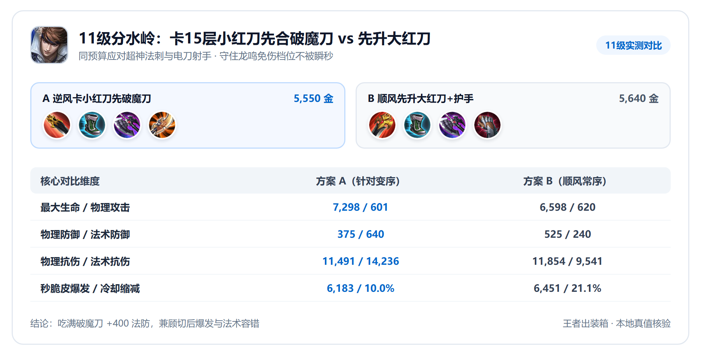

# 王者荣耀 S45 赛季打野赵云 · 血手跨档送一技能与六套动态出装

> **版本基线**：S45 正式服（`config/items_ground_truth.json` / `config/hero_skills_data.json` / `config/hero_arcana_data.py` 本地真值核验）
> **核心结论**：赵云被动【龙鸣】按生命区间提供 0%/10%/20% 三档免伤，且每次跨档变化额外赠送一次一技能位移强普；二技能五枪回血挂钩额外生命，三技能未命中英雄返还 50% 冷却。实战以「红刀 + 抵抗鞋 + 黑切 + 黄盾 + 血手」构成攻防闭环（彻底淘汰仅 266 法防的无魔抗脆皮套），按阵容在冰脉、暴烈、破军、碎星锤、破魔刀、魔女间切换。

---

## PART 01 · 核心机制与连招细节（跨档送位移 / 二技能回血 / 冰脉双强击）

**龙鸣三档免伤与血手主动跨档刷一技能、13A2A双强击留人、空大返还50%冷却**

- 龙鸣三档免伤与跨档送一技能：生命处于 70%以上 / 40%~70% / 40%以下分别对应 0% / 10% / 20% 免伤，每次跨档立即获赠一发额外一技能；溢出档位的回复还会转为永久护盾。
- 13A2A 衔接与二技能额外生命加成：1 技能近身接 3 技能中心击飞感电，落地平A接 2 技能五连刺（每枪吃 65%额外物攻并回血 +1.5%额外生命）再接平A，刚好卡准冰脉 1.25 秒内置冷却打出两次冰圈减速；赶路或拉扯空放三技能未中英雄可返还 50% 冷却。
- 双抗与血手协同伏笔：血手主动扣除 30% 当前生命换 40% 最大生命白盾，既能主动压血跨入高免伤档位白送一发一技能追击/撤退，又需搭配黄盾或魔抗装防止低血档被法伤瞬秒。

---

## PART 02 · 主流单件取舍推导与六套容错满装（兼顾输出与双抗容错）

**红刀黑切黄盾血手闭环、冰脉vs暴烈vs破军分工、碎星锤/破魔刀/魔女六套落位**

- 核心闭环与告别 266 法防脆皮套：旧式「红刀+抵抗鞋+黑切+冰脉+破军+血手」满级法防仅 266，后期吃中单一套不明 AOE 即漏光护盾暴毙；常驻绑定怒龙剑盾（+1,100血 +150双抗）将法防抬至 416 以上并提速控龙。
- 六套阵容模块化替换：单排让蓝选冰脉（32.5%冷却黏人）；控蓝正面团选暴烈（10,650血+满层增伤移速）；大顺风秒C选破军（11,587秒脆皮且保住黄盾双抗）；打双前排重坦换碎星锤；遇法刺电刀换破魔刀（816法防）；逆风双法核消耗换魔女（24,616法抗）。

### 六套实战满装与专属铭文速查（全量通过容错门禁）

| 方案与定位 | 口语六件套 | 专属 30 枚铭文 | 满级关键指标 | 针对阵容与取舍逻辑 |
| :--- | :--- | :--- | :--- | :--- |
| **方案 ① · 单双排让蓝常驻底座** 红刀·冰脉黄盾血手流 | 红刀 + 抵抗鞋 + 黑切 + 冰脉 + 黄盾 + 血手 | 10异变 10鹰眼 7隐匿 3狩猎 | 9,650血 ｜ 895物防 / 416法防 ｜ 32.5%冷却 ｜ 秒脆皮 10,465 | 单双排让蓝常规均衡局、需兼顾抓边留人与团战七进七出的首选底座。 无蓝 32.5% 冷却配 13A2A 卡准冰脉 1.25 秒强普冰圈留人，血手主动扣 30% 当前血直接跨档白送一次一技能并撑起 3,860 白盾，黄盾补齐 416 法防。 |
| **方案 ② · 控蓝万血正面团战底座** 红刀·暴烈黄盾血手流 | 红刀 + 抵抗鞋 + 黑切 + 暴烈 + 黄盾 + 血手 | 10异变 10鹰眼 7隐匿 3狩猎 | 10,650血 ｜ 805物防 / 416法防 ｜ 22.5%冷却 ｜ 秒脆皮 10,182 | 己方能控蓝 Buff、敌方多战坦正面团战持续拉扯的对局。 10,650 高血量放大二技能额外生命回血与血手护盾，承伤掉档同时叠满暴烈 10% 增伤与 10% 移速，拿蓝 Buff 满 40% 冷却。 |
| **方案 ③ · 顺风切C高爆发收割** 红刀·破军黄盾血手流 | 红刀 + 抵抗鞋 + 黑切 + 破军 + 黄盾 + 血手 | 10异变 10鹰眼 10隐匿 | 9,650血 ｜ 595物防 / 416法防 ｜ 27.5%冷却 ｜ 秒脆皮 11,587 | 己方顺风滚雪球、需一套大招瞬秒敌方无位移双 C 的对局。 破军高额外物攻将秒脆皮爆发拉至 11,587（无蓝 27.5% 冷却），同时保留黄盾与血手守住 9,650 血与 416 法防，杜绝旧纯输出套 266 法防进场蒸发。 |
| **方案 ④ · 双前排重坦高穿破甲** 红刀·碎星锤黄盾血手流 | 红刀 + 抵抗鞋 + 黑切 + 碎星锤 + 黄盾 + 血手 | 10异变 10鹰眼 10隐匿 | 10,350血 ｜ 595物防 / 416法防 ｜ 22.5%冷却 ｜ 秒脆皮 10,276 | 敌方白起、项羽、张飞等双前排重坦早叠高护甲的对局。 280 固穿叠碎星锤 +30% 物穿将打坦净伤提至 5,735，配合黄盾与血手万血身板在重坦阵中反复穿刺。 |
| **方案 ⑤ · 法刺超神/电刀混伤反杀** 红刀·黄盾破魔刀血手流 | 红刀 + 抵抗鞋 + 黑切 + 黄盾 + 破魔刀 + 血手 | 10异变 10鹰眼 7隐匿 3狩猎 | 10,350血 ｜ 595物防 / 816法防 ｜ 22.5%冷却 ｜ 秒脆皮 9,775 | 敌方诸葛亮、露娜、火舞超神或射手出闪电匕首混伤的对局。 高物攻直接吃满破魔刀 250 被动法防（总法防高达 816，法术抗伤 23,436），顶着法刺爆发与电刀法球强切后排。 |
| **方案 ⑥ · 均逆风高压/双长手法核消耗** 红刀·黄盾血手魔女流 | 红刀 + 抵抗鞋 + 黑切 + 黄盾 + 血手 + 魔女 | 10异变 10鹰眼 7隐匿 3狩猎 | 10,750血 ｜ 677物防 / 716法防 ｜ 22.5%冷却 ｜ 秒脆皮 9,078 | 己方逆风守高地，或敌方干将、嬴政、沈梦溪远程双法核消耗局。 10,750 血配魔女 + 黄盾（716 法防，法术抗伤 24,616），脱战法盾吸收消耗保住满血一档位不提前漏盾，残血开血手反打。 |

---

## PART 03 · 赵云专属打法思路、1,400金分水岭与保命换装

**4级陨星发力、压二档刺野攒永久白盾、侧翼13A2A双冰圈与空大穿墙脱身**

- 专属核心打法思路（档位免伤七进七出）：① 赵云 1~3 级偏弱，开局稳刷到 4 级做出陨星再主动抓边控龙；② 中后期开团前若处于二档（40%~70%血），顺手对路边野怪刺一发二技能让溢出回血转为永久白盾，带着 10% 免伤+白盾进场；③ 团战从侧翼 13A2A 切后排卡准两次冰脉强击留人，半血开血手主动跨档白拿额外一技能追击收割，残血撤退果断空放三技能穿墙（未中英雄返还 50% 冷却仅约 5 秒）。
- 备战卡小红刀与 1,400 金分水岭：备战第 1 格设追击刀锋，前 5 分钟先做完小红刀+抵抗鞋+黑切；顺风满 15 层直升贪婪之噬，均逆风或法刺超神时卡 15 层小红刀先用 800 金神隐合破魔刀（11 级法抗从 9,541 升至 14,236）或先合冰脉。
- 18 分钟保命三连换：血手开出白盾并打完赠送的一技能进入 75 秒冷却后，原格秒换复活甲 → 倒地换名刀（1 秒无敌锁 20% 最高免伤档反刺收尾）。

