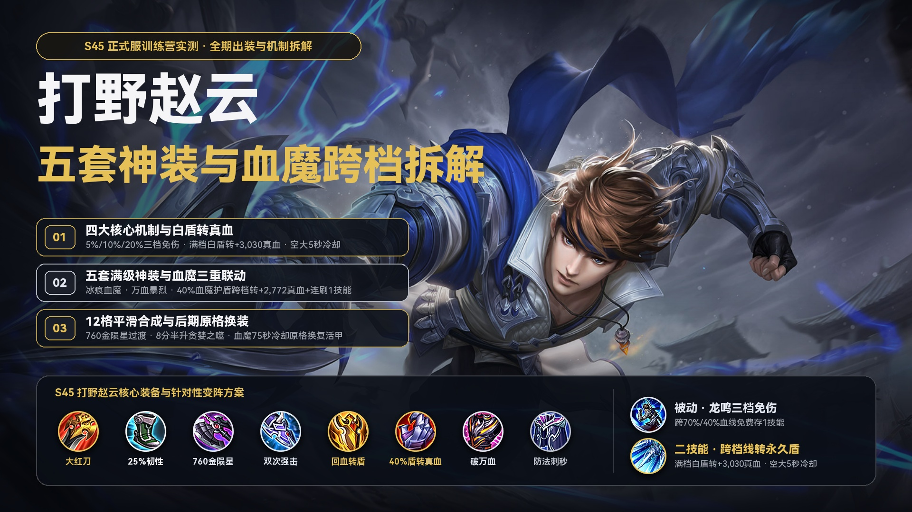
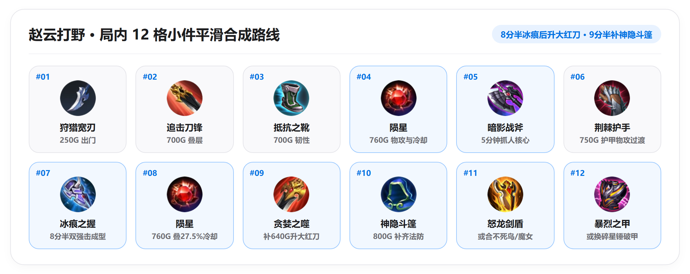
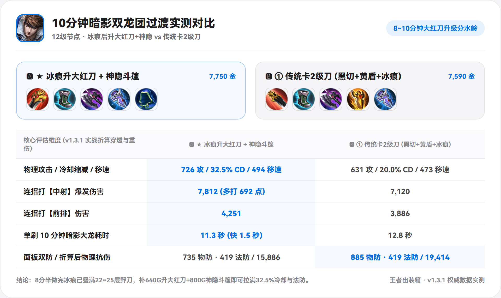
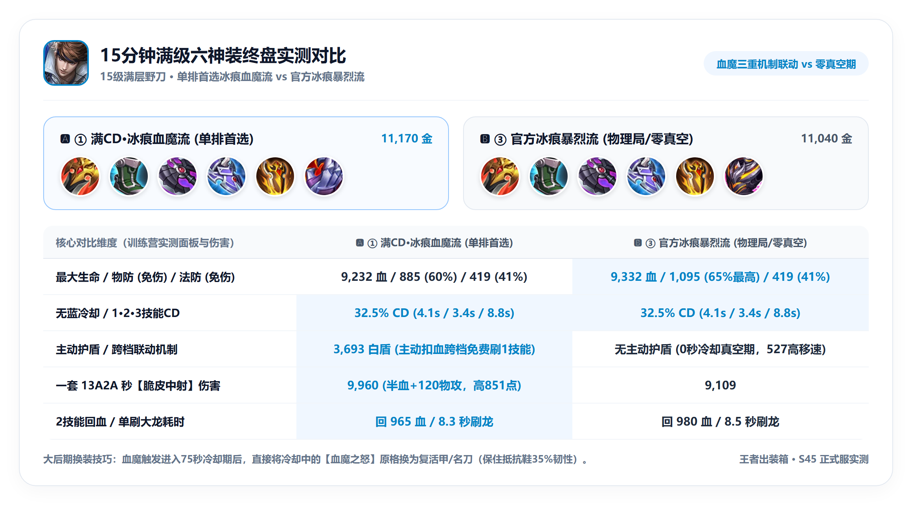

# 打野赵云出装与实战细节详解

*(注：文中数据均计入五级百穿铭文，并按对局时期折算了敌方护甲魔抗、敌方 `破晓/碎星锤/虚无法杖` 穿透，以及 `梦魇之牙/制裁之刃` 降低 35% 回血的效果。)*

---

## 一、 英雄特点、强势期与四个实战机制

### 1. 英雄特点与强势期
* **装备驱动型机动战刺，高额外物攻加成 + 档位免伤 + 溢出护盾**：赵云拥有 `1技能` 与 `3技能` 两段自由位移，由于自身没有主动的韧性和解控技能，常规控制局鞋位优先推荐 **`抵抗之靴`**。其 **1、2、3 技能伤害全部吃高额「额外物理攻击」加成**（一套标准 `13A2A` 合计高达 **`578%` 额外物攻倍率**），2 技能每枪回血吃 **`+1.5%` 额外生命加成**。
* **前期（`1~3级`）偏弱需稳刷，4 级出陨星发力，中后期至六神装持续强势**：
  - **前期（`1~3级`）**：无装备支撑时额外物攻与额外生命较低，1 级 1 技能冷却 `8秒` 且位移较短，野区对拼弱于前期固定真伤英雄，开局以稳刷升 4 级做出 `陨星（760金）` 为主。
  - **中后期至六神装（`4级 ~ 15分钟+`）**：装备成型后，被动【龙鸣】随血量降低提供 **`5% / 10% / 20%` 百分比免伤**（不受敌方 `破晓 30%` 与 `虚无法杖 45%` 穿透扣减），配合 2 技能溢出回血转永久护盾与高额额外 AD 倍率，越往后打身板与切 C 能力越扎实。

### 2. 四个容易忽略的实战机制
1. **被动【龙鸣】双向跨档存额外 `1技能`**：血量跨越 `70%` 和 `40%` 分界线时（**无论受击掉档、回血升档，还是开启 `血魔之怒` 主动扣除 30% 当前生命跨档**），都会立即额外获得 1 次免费的 `1技能 + 强化普攻`（附带 `50%` 减速）。
2. **跨档位线溢出转白盾 & 填满升档白盾消失转真血**：只有当血量处于二档（`40%~70%`）或三档（`≤40%`），且回血**触及并跨过当前档位上限（`70%` 或 `40%` 刻度线）**时，真实绿血才会锁在档位线上（保留 `10%/20%` 免伤），跨过刻度线溢出的回血转化为**永久白盾**；而一旦继续回血使「绿血+白盾」把上一档填满（达到 `70%` 或 `100%`）正式升入下一档位，**前一个档位的白盾会立刻消失（等额转化为真实绿血）**。因此只有血量刚好卡在 `40%` 或 `70%` 分界线附近回血（且未填满上一档）时，才能带着被动白盾与高免伤进场。
3. **大招未命中英雄返还 `50%` 冷却**：`3技能` 若未命中敌方英雄，直接返还 `50%` 冷却（满冷却下空大仅约 **`5秒`**），逆风带线撤退或远距离赶路时可果断空放当穿墙位移用。
4. **`2技能` 刺 5 枪耗时 `1.3秒`，卡准 `冰痕之握` 双强击**：2 技能连刺 5 枪耗时约 `1.3秒`，在 **`13A2A` 连招**中，起手 `3A` 与收尾平 A 刚好跨过 **`冰痕之握` `1.25秒` 冷却**，稳定触发 **2 次冰痕强击与范围减速**（而 `宗师之力` 3 秒冷却在一套内仅能触发 1 次）。

---

## 二、 五套六神装全维度对比与替换细节

### 1. 满级六神装面板与实战数据总表

半肉赵云的核心底子是 **`贪婪之噬 + 抵抗之靴 + 暗影战斧 + 怒龙剑盾`**（前中期通常先出 `冰痕之握` 撑护甲与冷却，第 5 件合出 `怒龙剑盾` 补齐双抗与回血转盾）。围绕最后两件防装/半肉装的搭配，5 套主流方案的实测面板与伤害对比如下：

| 评估维度 | ① 冰痕血魔流 *(单排通用首选)* | ② 暴烈血魔流 *(控蓝/5v5大团)* | ③ 官方冰痕暴烈流 *(物理局/高频团)* | ④ 碎星锤破甲流 *(打双前排/半肉C)* | ⑤ 顺风破军流 *(顺风高斩杀线)* |
| :--- | :---: | :---: | :---: | :---: | :---: |
| **第 5、6 件搭配** | **`冰痕 + 血魔`** | **`暴烈 + 血魔`** | **`冰痕 + 暴烈`** | **`冰痕 + 碎星锤`** | **`冰痕/血魔 + 破军`** |
| **成型总金币** | 11,170 | 11,160 | **11,040** | 11,070 | 11,530 ~ 11,650 |
| **物攻 / 物穿** | 801 / 280 | 781 / 280 | 761 / 280 | 816 / **280+30%** | **876~896** / 280 |
| **无蓝冷却 (拿蓝)** | **32.5%** *(满40%)* | 22.5% *(满40%)* | **32.5%** *(满40%)* | **32.5%** *(满40%)* | 27.5~**37.5%** |
| **1/2/3技能CD (无蓝)** | **4.4 / 3.4 / 10.8秒** | 5.0 / 3.9 / 12.4秒 | **4.4 / 3.4 / 10.8秒** | **4.4 / 3.4 / 10.8秒** | **4.1 / 3.1 / 10.0秒** |
| **最大生命值** | 9,232 | **10,232 (破万血)** | 9,332 | 9,032 | 8,332 ~ 9,232 |
| **物防 (物理免伤)** | 885 (60%) | 795 (57%) | **1,095 (65%最高)** | 885 (60%) | 585~885 (49~60%) |
| **法防 (法术免伤)** | 419 (41%) | 419 (41%) | 419 (41%) | 419 (41%) | 419 (41%) |
| **秒脆皮 (350物防)** | **9,960** | 9,644 | 9,109 | 9,565 | **10,326 ~ 10,976** |
| **打坦克 (1000物防)** | 4,707 | 4,621 | 4,603 | **5,522 (最高)** | 4,880 ~ 5,187 |
| **2技能回血 / 护盾** | 回746 + **3,693白盾** | 回809 + **4,093白盾** | 回752 *(0真空期)* | 回733 *(移速527)* | 回689~746 |
| **单刷大龙耗时** | 8.3 秒 | **8.1 秒** | 8.5 秒 | 8.4 秒 | **7.8 秒** |

---

### 2. 主流方案逐一拆解（优势 / 短板 / 适用对局）

#### （1）满CD·冰痕血魔流：单排最均衡的全能首选

这套是 **`贪婪之噬 + 抵抗之靴 + 暗影战斧 + 冰痕之握 + 怒龙剑盾 + 血魔之怒`**。
* **核心优势**：
  1. **`血魔之怒` 与赵云的三重底层联动**：① **40% 血魔护盾跨档位线直接转永久真血**：赵云二/一档每个档位宽度仅 `30%` 最大生命，而血魔主动扣除 `30%` **当前生命**、提供 **`40%` 最大生命白盾（`3,693` 点）**；当「当前绿血 + 40% 血魔白盾」跨过下一个档位线（`40%`/`70%`/`100%`）填满该档时，**刻度线以下的血魔白盾会直接转化为永久真实绿血**（例如 `50%` 血开血魔扣至 `35%`、加上 `40%` 护盾达 `75%` 跨过 `70%` 线，训练营实测当场跳出 **`+2,772` 绿字**将整段护盾变成永久真血）；② **双向跨档连续刷新 1 技能**：主动扣血掉档与护盾填满升档跨越 `70%/40%` 分界线时，**当场免费刷新额外 `1技能 + 强普`**；③ 提供 **`+75` 物攻** 与被动【狂怒】普攻附带 `1.5%` 最大生命物伤（半血提升 50% 至 **`2.25%` 最大生命**），一套 `13A2A` 秒脆皮高达 **`9,960` 伤害**。
  2. **不挑蓝 Buff，留人稳定**：`冰痕之握` 补足 **`32.5%` 无蓝常驻冷却**（避免没拿到蓝 Buff 或蓝 Buff 到期时的技能真空期），且 `13A2A` 刚好触发 **2 次冰痕强击减速**。
* **主要短板**：`血魔之怒` 触发后有 **75 秒冷却真空期**，冷却期间面板物防（`885`）与移速（`494`）低于暴烈之甲。
* **适用场景**：单排路人局（不确定能否全程拿蓝）、需要自己带节奏切后排并兼顾团战容错的常规对局。

#### （2）万血大团·暴烈血魔流：控蓝局与 5v5 正面大团战首选

这套是将 `冰痕之握` 替换为 **`暴烈之甲`**（`贪婪之噬 + 抵抗之靴 + 暗影战斧 + 怒龙剑盾 + 暴烈之甲 + 血魔之怒`）。
* **核心优势**：
  1. **突破 `10,232` 万血大关，三项生命收益叠满**：暴烈之甲提供 `+1,000` 生命（比 0 生命的冰痕多 1,000 血），同时把 2 技能回血（`809`，后续每枪衰减 8% 合计 `4.2倍` 首枪）、怒龙剑盾被动与血魔护盾（**`4,093` 白盾**）推到最高，5v5 正面集火下最耐打。
  2. **高移速与全技能增伤**：暴烈受击叠满后提供 **`+10%` 增伤** 与 **`527` 战斗移速**，团战追击与输出（秒脆皮 `9,644`）兼备。
* **主要短板**：缺少冰痕的 `10%` 冷却与减速，**无蓝 Buff 时仅有 `22.5%` 冷却**（2 技能 `3.9秒`、大招 `12.4秒`），断蓝期技能衔接偏慢。
* **适用场景**：己方能稳定控蓝（拿蓝直接满 `40%` 冷却），或中后期围绕双龙打 5v5 正面抱团硬碰硬的对局。

#### （3）零真空期·官方冰痕暴烈流：应对物理菜刀队与高频遭遇战

这套是系统默认的 **`贪婪之噬 + 抵抗之靴 + 暗影战斧 + 冰痕之握 + 怒龙剑盾 + 暴烈之甲`**。
* **核心优势**：
  1. **全程零主动冷却真空期，物理护甲最高（`1,095` 点）**：不用惦记血魔 75 秒主动 CD，随时接团都是满状态；三件护甲装将物防堆到 **`1,095`（65%物理免伤）**，即便被敌方射手 `破晓` 穿透 30% 仍剩 `760+` 物防，非常克制多物理阵容。
  2. **拉扯手感最丝滑**：同时拥有 `32.5%` 冷却、冰痕范围减速与暴烈 `527` 高移速，一慢一快黏人极稳。
* **主要短板**：
  1. **秒满血后排少了约 `850` 点爆发**（`9,109` vs 冰痕血魔 `9,960`），后期对面射手有辅助护盾时单套较难直接秒杀；
  2. **重物防、轻法防**：冰痕与暴烈均为 `0` 法防，面对高爆发法师或吕布、马可波罗、貂蝉等无视护甲的真实伤害时，不如血魔的 `4,000` 白盾实在。
* **适用场景**：敌方多物理阵容（战边+物理野+射手）、野区小规模遭遇战频繁的对局。

#### （4）碎星锤破甲流 & 魔女/不死鸟法防针对替换

* **何时换 `碎星锤`？** 当敌方有双前排坦克，或敌方射手补出 `不祥征兆/暴烈之甲`（护甲过 600）时，第 6 件换 **`碎星锤`**（`280 + 30%` 双穿 + `527` 常驻高移速），打半肉射手伤害提至 **`8,140`**、打千防坦克伤害从 `4,603` 提升至 **`5,522`**。

* **何时换 `魔女斗篷 / 不死鸟之眼`？（解决 419 法防短板）**
  - 上面所有常规半肉装全身仅靠抵抗鞋（`+100`）和黄盾（`+150`）提供魔抗，满级法防只有 **`419 点（41%法术免伤）`**。到了中后期，敌方法师做出 **`虚无法杖（45%法穿）` + `88法穿铭文`** 后，先扣 88 固定法穿、再扣 45% 百分比法穿，**实际生效法防仅剩 `182` 点（法术免伤跌至 `23%`）**！
  - 因此：若敌方是**沈梦溪、嬴政、扁鹊**等持续消耗型法师，可将黄盾换为 **`不死鸟之眼`**（三档残血 2 技能单次回 **`1,041`** 血、重伤后 **`677`**，跨过 `40%` 线后连刺 3 发 2 技能即可填满 `40%~70%` 档位跳出 **`+3,030` 绿字**将整段白盾转为永久真血并刷新 1 技能）；若敌方是**不知火舞、干将莫邪、安琪拉**等高爆发法刺，应将黄盾或最后一件换为 **`魔女斗篷`**（法防提至 **`569［49%法免］`**，并带 **`1,450` 脱战法术护盾**，防止进场被一套秒杀）。
* **全输出娱乐 / 纯肉蓝领参考**：大顺风追求秒人可走全输出 `贪婪+抵抗+黑切+宗师+破军+碎星锤`（秒脆皮 `13,480`）；大逆风纯前排可走 `巨人之握+抵抗+冰痕+黄盾+不死鸟+不祥征兆`（`12,182` 血）。

---

## 三、 铭文选择与出装联动

* **默认高爆发铭文：`10异变、10鹰眼、10隐匿`**（`+45物攻、+100物穿、+10%移速`，吃满 `578%` 额外物攻加成）。
* **强普手感微调（线性攻速平滑生效）：`10异变、10鹰眼、7隐匿3狩猎`**（现版本每 1% 攻速均线性缩短普攻前后摇，赵云半肉装为 `0%` 额外攻速，用 `3狩猎` 补 `3%` 攻速可让大招落地接平 A 与 `1A` / `3A2A` 强普出手更干脆跟手）。

---

## 四、 局内合成顺序、大红刀升级节点与后期换装

### 1. 两条主流合成路线（对应第 3、4 件顺序）
* **走【冰痕+血魔】或【冰痕+暴烈】时（先冰痕、后黄盾）**：
  `狩猎宽刃 → 追击刀锋 → 抵抗之靴 → 陨星 → 暗影战斧 → 荆棘护手 → 冰痕之握 → 补陨星升贪婪之噬 → 神隐斗篷 → 怒龙剑盾 → 血魔之怒 / 暴烈之甲`
* **走【暴烈+血魔】时（不出冰痕，黑切后直接做黄盾）**：
  `狩猎宽刃 → 追击刀锋 → 抵抗之靴 → 陨星 → 暗影战斧 → 怒龙剑盾 → 补陨星升贪婪之噬 → 暴烈之甲 → 血魔之怒`

### 2. 两个关键时间节点的实测数据对比

| 关键时间节点与测试条件 | 推荐合成方案 | 对照过渡方案 | 冷却 / 移速对比 | 连招打中射 / 单刷大龙 |
| :--- | :--- | :--- | :---: | :---: |
| **5分钟（7级）第一大件** | **先出 `暗影战斧`** (3,490金) | 裸出 `怒龙剑盾` (3,440金) | **10% CD** vs 0% CD | **5,419 / 21.0秒** *(vs 4,250 / 24.2秒)* |
| **10分钟（12级）双龙团** | **冰痕后升 `贪婪之噬+神隐斗篷`** (7,750金) | 卡2级刀出 `冰痕+怒龙剑盾` (7,590金) | **32.5% CD / 494移速** *(vs 20% / 470)* | **7,812 / 11.3秒** *(vs 7,120 / 12.8秒)* |

* **5 分钟第一大件先出 `暗影战斧`，不宜直接裸出 `怒龙剑盾`**：黄盾被动按最大生命百分比计算，7 级基础血量低且合成小件（守护者之铠+神隐斗篷）`0` 物攻、`0` 冷却；先出暗影战斧一套打后排高出 **`1,169` 点伤害**（`5,419` vs `4,250`），单刷第一条暴君快 `3.2秒`。
* **8分半做完 `冰痕之握` 后，立即补 `陨星` 升级 `贪婪之噬`**：二级刀上限仅 15 层（`+70` 物攻、`0%` 冷却、`0%` 移速），8分半时野刀早已叠到 22~25 层；此时花 `760` 金出 `陨星`、再补 `640` 金升大红刀（满层 `+165` 物攻、`+12.5%` 冷却、`+5%` 移速，对英雄灼烧提至 `25%`），9分半再花 `800` 金买 **`神隐斗篷`** 把法防拉到 `393`，10 分钟双龙团既有 `32.5%` 冷却又有双抗。

### 3. 15分钟满级六神装面对不同护甲目标的一套 `13A2A` 伤害与法防穿透实测表

| 满级六神装方案 | 打无防装中射 (`350`物防) | 打半肉射手/战刺 (`650`物防) | 打重装坦克 (`1,000`物防) | 被 `虚无法杖+88法穿` 穿透后剩余法防 |
| :--- | :---: | :---: | :---: | :---: |
| **① 满CD·冰痕血魔流** | **9,960** *(半血触发血魔)* | 7,485 | 4,707 | `182` 法防 *(23%法术免伤)* |
| **② 万血大团·暴烈血魔流** | 9,644 *(叠满暴烈+血魔)* | 7,260 | 4,621 | `182` 法防 *(23%法术免伤)* |
| **③ 零真空期·冰痕暴烈流** | 9,109 *(叠满暴烈)* | 6,890 | 4,603 | `182` 法防 *(23%法术免伤)* |
| **④ 碎星锤双穿破甲流** | 9,565 | **8,140 (打半肉C最高)** | **5,522 (打坦克最高)** | `182` 法防 *(23%法术免伤)* |
| **⑤ 魔女斗篷法防替换流** | 9,480 | 7,110 | 4,510 | **265 法防 (31%法免) + 1,450法盾** |

* **大后期（15分钟后）保命装无缝轮换技巧**：前中期可先穿 `冰痕 + 暴烈` 享受零冷却真空期打架；16 分钟决胜龙王团前将第 6 件换为 `血魔之怒` 拼团。**一旦血魔 `3,693` 白盾触发进入 75 秒冷却真空期，直接将冷却中的 `血魔之怒` 原格换为 `贤者的庇护`（复活甲）并预购 `名刀·司命`（比卖掉抵抗之靴多保留 50 移速与 25% 韧性）**。

---

## 五、 围绕出装节点的实战节奏与团战打法

* **前期（1~4级）**：稳刷升 4 级出 `陨星`；蹲草或进场前可提前空放 1 技能“存一发强化普攻”，抓边距离够近时先用 `1A` 挂 `50%` 减速逼出敌方闪现或位移，再预判落点交 `3技能` 击飞接 `A2A`。
* **中期（5~12分钟）**：压在二档（`≤70%` 血）刷野或换血后，进场前顺手对野怪/兵线刺一发 `2技能` 溢出档位线攒出永久白盾（兼顾 `10%` 免伤与护盾），连招打满 `13A2A` 触发两次冰痕强击减速，主动控双龙压塔。
* **后期（12~15分钟+）**：侧翼 `13A2A` 切后排，半血或残血开启 `血魔之怒`（主动扣 30% 当前血 + 40% 最大生命白盾跨档位线直接变成永久真血，并连续刷新额外 `1技能`），立刻打出免费刷新的 `1技能 + 强普` 收割或拉开，再用 `2技能` 回血二次切入；残血脱身直接空放大招穿墙（返还 50% 冷却仅约 `5秒`）。

> **工具地址：**
> 1. 手机端：直接搜小程序 **【王者出装箱】** 即点即用
> 2. 电脑端：[wzry.aodilab.com](https://wzry.aodilab.com)
